<p align="center">
  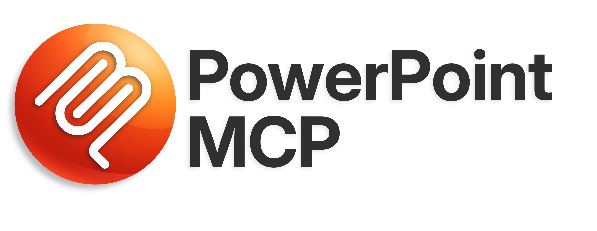
</p>

<p align="center">
  <a href="README.md">English (en)</a> · <a href="README.ja.md">日本語 (ja)</a> · <a href="README.zh-CN.md">简体中文 (zh-CN)</a> · <a href="README.es.md">Español (es)</a> · <strong>Português (pt-BR)</strong> · <a href="README.he.md">עברית (he)</a>
</p>

<p align="center">
  <a href="https://www.python.org/"></a>
  <a href="LICENSE"></a>
  
  <a href="https://pepy.tech/projects/ppt-mcp"></a>
</p>

<p align="center">
  <strong>Controle do PowerPoint em tempo real no Windows e no macOS:<br>um servidor MCP com <!--tools-->157<!--/tools--> ferramentas para agentes de IA e desenvolvedores.</strong>
</p>

---

Um servidor MCP (Model Context Protocol) que dá a agentes de IA controle total sobre uma instância aberta do Microsoft PowerPoint, via COM no Windows e via Apple Events no macOS. Ao contrário de bibliotecas que trabalham com arquivos, como a python-pptx, este servidor conversa diretamente com o PowerPoint em execução.

## 🎬 Demonstração

Um agente montando uma apresentação numa janela do PowerPoint aberta (velocidade 15x):

https://github.com/user-attachments/assets/178b9b5b-624d-4de0-a1dd-619dc13d4bd7

## ✨ Principais recursos

- **Controle em tempo real**: age direto sobre o PowerPoint em execução, e as mudanças aparecem na tela na mesma hora
- **<!--tools-->157<!--/tools--> ferramentas em <!--categories-->26<!--/categories--> categorias**: slides, formas, texto, tabelas, gráficos, animações, SmartArt, mídia, formas livres e mais
- **Seguro para agentes de IA**: `ppt_activate_presentation` prende todas as ferramentas a um arquivo específico, evitando edições acidentais na apresentação errada
- **Ícones do [Google Material Symbols](https://fonts.google.com/icons)**: busque entre mais de 2.500 ícones por palavra-chave e insira como SVG com as cores do tema
- **Cores do tema**: passe `accent1`, `accent2` etc. em qualquer lugar que aceite cor de preenchimento, linha, sombra, brilho ou texto, em vez de valores RGB fixos; as formas acompanham o tema quando ele muda
- **Windows e macOS**: as mesmas ferramentas, argumentos e retornos nos dois; quando o PowerPoint para Mac não consegue fazer algo, a ferramenta avisa em vez de simplesmente não fazer nada

## 📋 Requisitos

- Windows 11, ou macOS com Apple Silicon ou Intel
- Microsoft PowerPoint
- [uv](https://docs.astral.sh/uv/getting-started/installation/)

No macOS, o servidor controla o PowerPoint via Apple Events em vez de COM. A
primeira chamada de ferramenta dispara o aviso de automação do sistema, e é
preciso permitir o PowerPoint ali uma vez. Imagens, ícones, modelos, temas,
prévias e exportações passam pela pasta do próprio PowerPoint, que o macOS 14
e posteriores protegem de outros apps; por isso o aplicativo que inicia o
servidor (Terminal, um editor, o Claude) precisa de Acesso Total ao Disco para
essas ferramentas. Rodando a partir de um terminal, o macOS pode recusar sem
perguntar; nesse caso as ferramentas dizem o que liberar. Formas, texto,
tabelas e gráficos funcionam de qualquer jeito. Veja
[Suporte ao macOS](#-suporte-ao-macos) para o que muda.

## 🚀 Primeiros passos

Configuração padrão, que funciona no Claude Desktop, no Cursor, em `.mcp.json` e na maioria dos outros clientes MCP:

```json
{
  "mcpServers": {
    "powerpoint": {
      "command": "uvx",
      "args": ["ppt-mcp"]
    }
  }
}
```

### Claude Code

**Escopo de usuário** (disponível em todos os projetos)
```bash
claude mcp add powerpoint uvx ppt-mcp
```

**Escopo de projeto** (salvo em `.mcp.json` e compartilhado com o time)
```bash
claude mcp add --scope project powerpoint uvx ppt-mcp
```

### Cursor

[](https://cursor.com/install-mcp?name=ppt-mcp&config=eyJ0eXBlIjoic3RkaW8iLCJjb21tYW5kIjoidXZ4IiwiYXJncyI6WyJwcHQtbWNwIl19)

Ou adicione manualmente em `~/.cursor/mcp.json` usando a configuração padrão acima.

### Claude Desktop

Edite `%APPDATA%\Claude\claude_desktop_config.json` usando a configuração padrão acima.

### Codex

Edite `~/.codex/config.toml`:

```toml
[mcp_servers.ppt-mcp]
command = "uvx"
args = ["ppt-mcp"]
```

Ou use a configuração JSON padrão acima em `.codex/config.json`.

### VS Code

```bash
code --add-mcp '{"name":"powerpoint","command":"uvx","args":["ppt-mcp"]}'
```

### A partir do código-fonte

```bash
git clone https://github.com/ykuwai/ppt-mcp.git
cd ppt-mcp
uv sync
```

```json
{
  "mcpServers": {
    "powerpoint": {
      "command": "uv",
      "args": [
        "--directory",
        "C:\\path\\to\\ppt-mcp",
        "run",
        "mcp",
        "run",
        "src/server.py"
      ]
    }
  }
}
```

## 🛠️ Categorias de ferramentas

| Categoria | Ferramentas | Descrição |
|----------|------:|-------------|
| **Aplicativo** | 5 | Conectar ao PowerPoint, informações do app, janela ativa, estado da janela, listar apresentações |
| **Apresentação** | 8 | Criar (com modelos), abrir (um arquivo local ou, no Windows, uma URL do SharePoint ou do OneDrive), salvar, fechar, informações, definir o alvo, listar modelos |
| **Slides** | 10 | Adicionar, excluir (em lote), duplicar (por posição/vários), mover (em lote), copiar (entre apresentações), listar, informações, anotações, navegação |
| **Formas** | 10 | Adicionar formas/caixas de texto/imagens/linhas (com posição na ordem Z, inclusive atrás do texto), listar, informações (posição, preenchimento, linha, quadro de texto), atualizar (uma forma, um conjunto ou o slide inteiro, em valor absoluto ou por deslocamento), excluir, ordem Z |
| **Texto** | 10 | Definir texto (o quadro inteiro, um trecho mantendo a formatação, ou em partes), obter texto (com medição e transbordamento), formatar um trecho ou vários em lote, formato de parágrafo, marcadores, localizar/substituir (inclusive dentro de grupos), quadro de texto, extrair todo o texto como Markdown, verificação tipográfica |
| **Espaços reservados** | 6 | Listar, obter e definir o conteúdo dos espaços reservados |
| **Formatação** | 3 | Preenchimento, linha, sombra (na forma ou no texto dela) |
| **Tabelas** | 13 | Adicionar tabelas, obter/definir células, definir dados em lote, mesclar/dividir células, adicionar/excluir linhas/colunas, estilos, layout, bordas |
| **Exportação** | 4 | PDF, imagens, prévia do slide, cópia para a área de transferência |
| **Apresentação de slides** | 6 | Iniciar, parar, próximo, anterior, ir para um slide, status |
| **Gráficos** | 7 | Adicionar gráficos (no Windows, exceto os 3D e alguns tipos menos comuns, sem abrir o Excel), definir/obter dados (no Windows, ao definir, o gráfico é trocado por uma cópia com outro id de forma, sem abrir o Excel quando dá, e lido de volta; dados que não entraram são um erro, e um rótulo que o Excel leu de outro jeito é um aviso; um gráfico de dispersão ou de bolhas toma os valores x das categorias, e uma série de bolhas seus `sizes`), formatar, formatar eixo, séries, trocar o tipo |
| **Animação** | 6 | Transições, adicionar/listar/atualizar/remover/limpar animações (entrada, saída, ênfase, trajetória de movimento, sequências interativas) |
| **Temas** | 4 | Aplicar temas, obter/definir cores do tema, cabeçalhos/rodapés |
| **Grupos** | 3 | Agrupar, desagrupar, obter os itens do grupo |
| **Conectores** | 2 | Adicionar, formatar |
| **Hiperlinks** | 3 | Adicionar, obter, remover |
| **Seções** | 3 | Adicionar, listar, gerenciar |
| **Propriedades** | 2 | Definir/obter os metadados da apresentação |
| **Mídia** | 3 | Vídeo, áudio, configurações de mídia |
| **SmartArt** | 3 | Adicionar, modificar, listar layouts |
| **Operações de edição** | 6 | Desfazer e refazer (na apresentação alvo), copiar formas/formatação entre slides |
| **Layout** | 8 | Alinhar, distribuir, tamanho do slide, plano de fundo, espelhar, mesclar formas, verificação de layout |
| **Efeitos** | 3 | Brilho e reflexo (na forma ou no texto dela), bordas suaves |
| **Comentários** | 3 | Adicionar, listar, excluir |
| **Avançado** | 19 | Tags, fontes (listar as da apresentação ou as deste computador, definir padrões, substituir em massa), recorte, formato de imagem, exportar forma, visibilidade, seleção, modo de exibição, copiar animação, imagem a partir de URL, ícones SVG, busca de ícones, travar proporção, aplicar em lote, estilo padrão de forma |
| **Forma livre** | 7 | Construir formas livres, obter/definir a posição dos nós, inserir/excluir nós, tipo de edição do nó, tipo de segmento |
| | **157** | |

## 💡 Exemplos de prompts

Basta descrever o que você quer em linguagem comum, sem precisar de código.

---

**Simples**: só o tema

> *"Create a 3-slide intro deck for a productivity app called Flowly."*

<details>
<summary>Ver slides</summary>
<br>

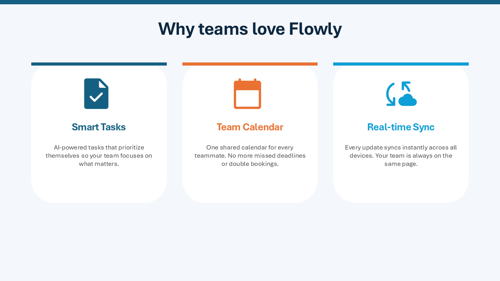

</details>

---

**Com direção de estilo**: tema + estilo visual

> *"Make a 4-slide presentation on the benefits of async work. Dark navy style, add icons for each benefit."*

<details>
<summary>Ver slides</summary>
<br>
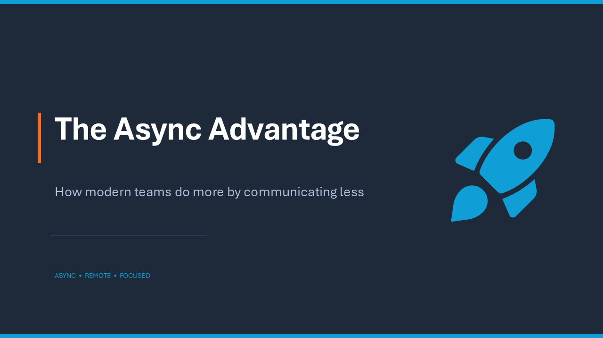
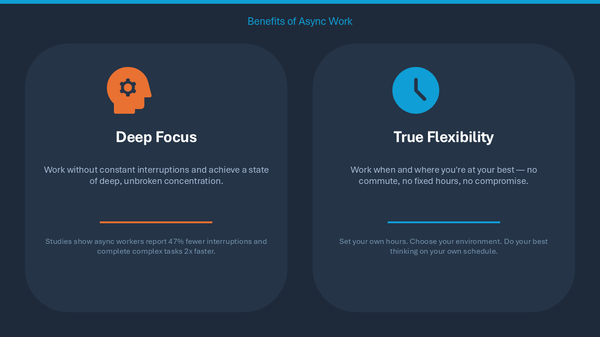
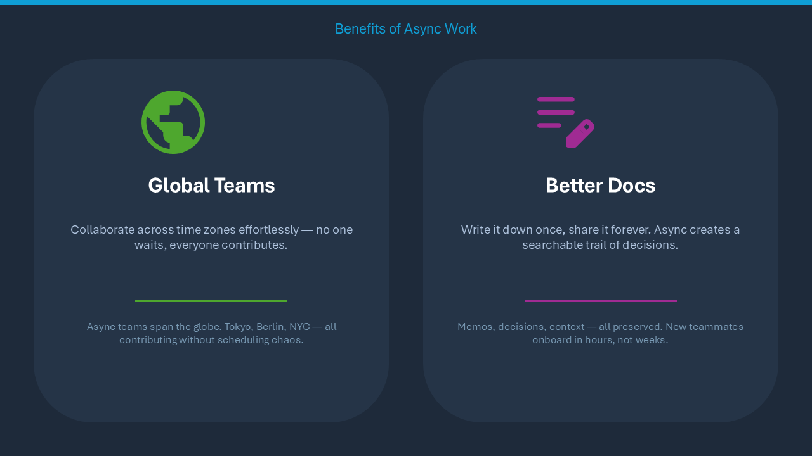
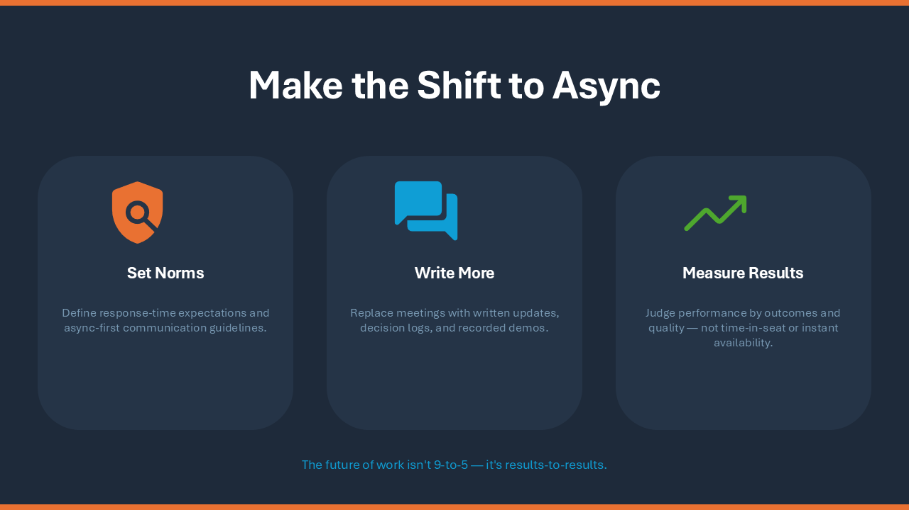
</details>

---

**Detalhado**: tema + intenção de design + estrutura dos slides

> *"Build a 5-slide pitch for an AI note-taking app called NoteAI. White background, teal accent. Slides: title, problem, solution, features with icons, closing."*

<details>
<summary>Ver slides</summary>
<br>
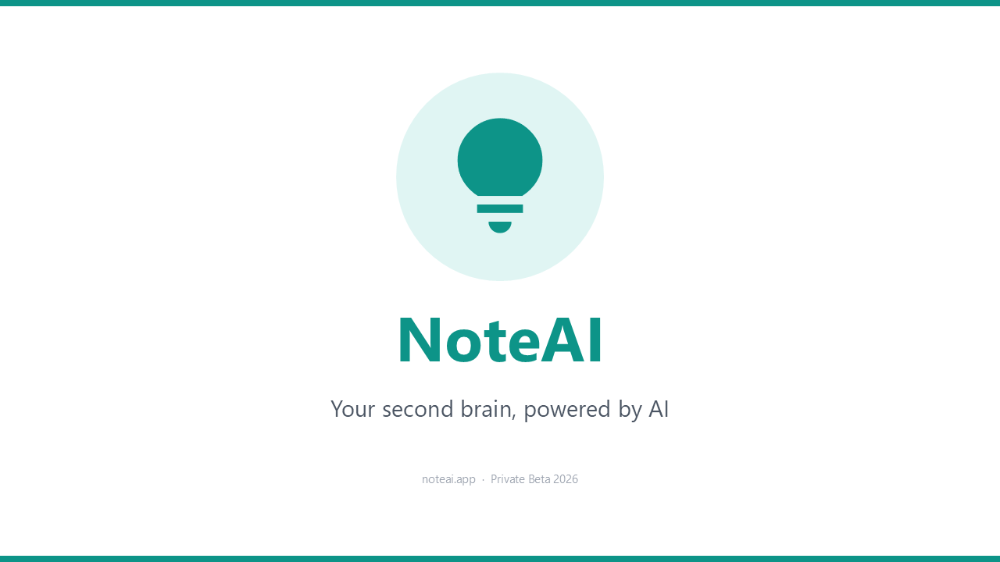
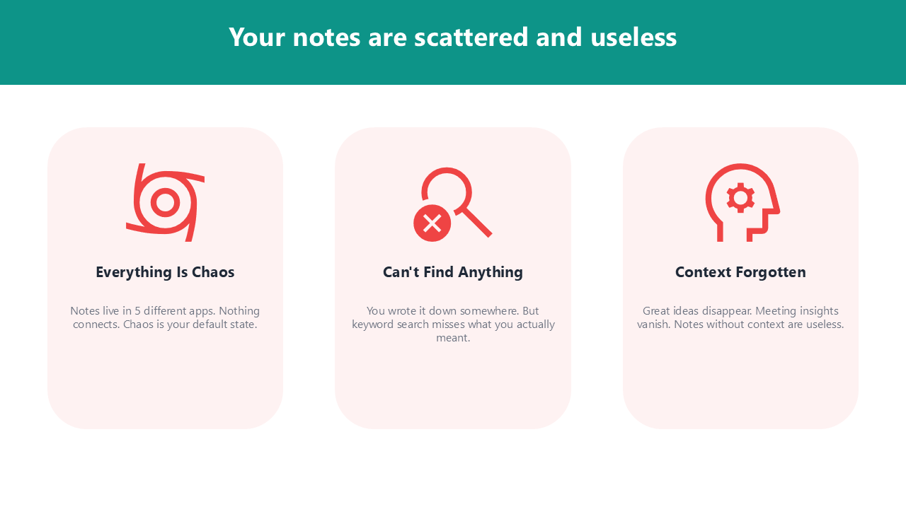
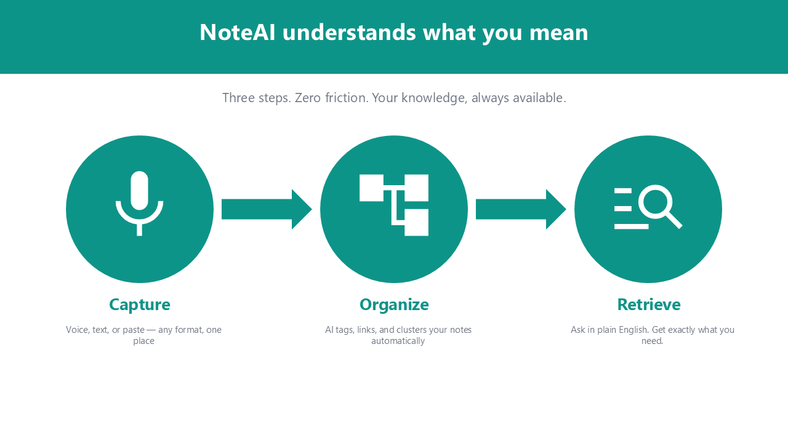
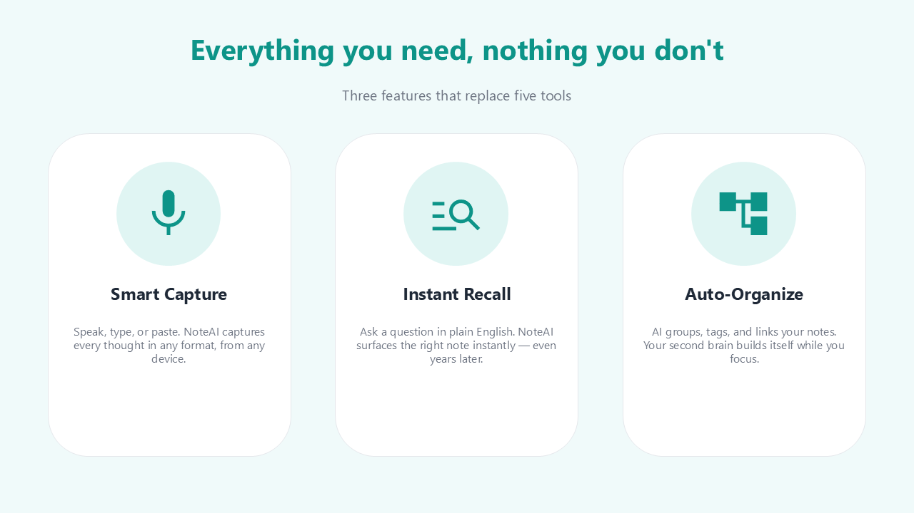
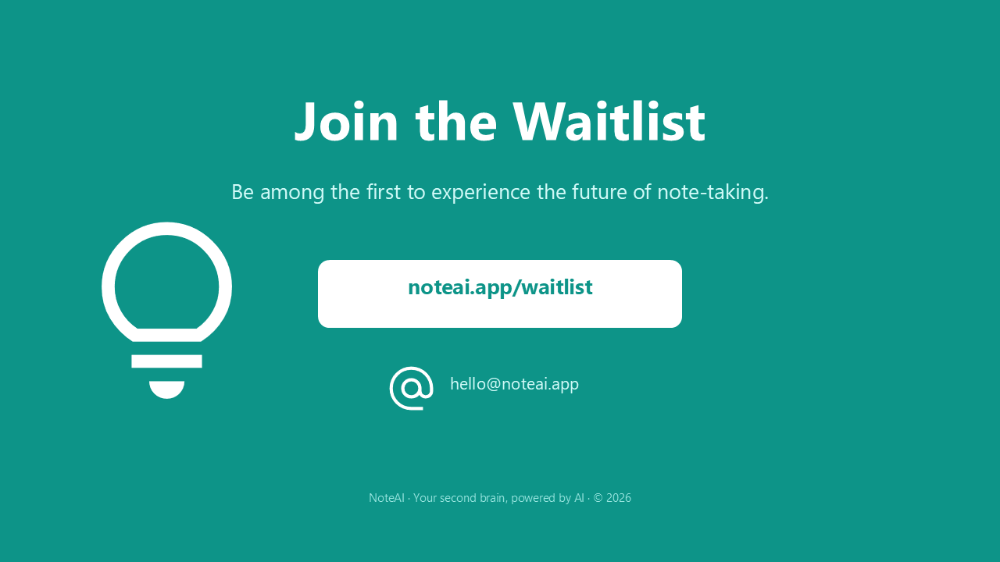
</details>

---

**Palavras-chave de design que melhoram o resultado:**

| Aspecto | Palavras-chave / expressões | O que faz |
|---|---|---|
| **Ícones** | `add icons` · `icon for each point` · `use icons throughout` | Busca no Google Material Symbols e posiciona ícones SVG nítidos automaticamente |
| **Esquema de cores** | `dark navy` · `white background` · `monochrome` · `light gray` | Define a paleta geral e o clima da apresentação |
| **Cor de destaque** | `teal accent` · `blue accent` · `brand color #2563EB` | Aplica uma cor de destaque específica a títulos, ícones e formas |
| **Tom do estilo** | `modern minimal` · `bold and vibrant` · `clean and professional` · `playful` | Indica a personalidade visual geral |
| **Tipo de apresentação** | `pitch deck` · `investor presentation` · `workshop slides` · `status report` | Orienta o layout e a densidade de conteúdo para o objetivo pretendido |
| **Estrutura dos slides** | `Slides: title, problem, solution, features, CTA` · `4 slides` | Define de antemão o arco da narrativa e o número de slides |
| **Layout** | `card layout` · `two-column` · `centered` · `full-bleed background` | Determina como o conteúdo é organizado em cada slide |
| **Densidade de texto** | `minimal text` · `one message per slide` · `bullet points` | Controla quanto texto aparece e como ele é formatado |
| **Planos de fundo** | `gradient background` · `solid dark background` · `soft light background` | Especifica o tratamento do fundo nos slides |
| **Ênfase** | `highlight key numbers` · `bold headings` · `accent bar on each slide` | Chama atenção para as informações mais importantes |

## 🔍 Recursos em detalhe

### 🎯 Apresentação alvo

`ppt_activate_presentation` define um alvo para a sessão, de modo que todas as chamadas seguintes atuem naquele arquivo específico, seja qual for a janela ativa no PowerPoint. Para trocar de alvo, basta chamá-la de novo.

```python
ppt_activate_presentation(presentation_name="report.pptx")
# All tools now operate on report.pptx
ppt_activate_presentation(presentation_name="demo.pptx")
# Switched — all tools now operate on demo.pptx
```

A apresentação ativada é um valor único para o servidor inteiro, e um cliente como o Claude Desktop passa todas as conversas pelo mesmo servidor. Quando várias conversas trabalham em arquivos diferentes ao mesmo tempo, passe `presentation` em cada chamada. Ele vale só para aquela chamada, não mexe na apresentação ativada e aceita o caminho completo, o nome do arquivo ou o nome sem extensão. Um arquivo que não está aberto gera erro; nunca há troca silenciosa para outro.

```python
ppt_add_textbox(params={...}, presentation="report.pptx")
# Lands in report.pptx whatever another conversation has activated
```

### 👥 Arquivos que outras pessoas editam ao mesmo tempo (Windows)

Uma apresentação aberta do SharePoint ou do OneDrive pode ser editada por outras pessoas enquanto o servidor trabalha nela. Sem o salvamento automático, o PowerPoint só incorpora o que elas salvaram quando o arquivo é salvo, e até lá mostra "Atualizações disponíveis"; o servidor leria e gravaria o estado antigo. Para esse tipo de arquivo, o servidor cuida disso:

- **Antes de uma chamada de ferramenta**, ele mescla as mudanças dos outros, desde que não haja nada não salvo nesta cópia, para que uma leitura veja o estado atual. Uma chamada de escrita cujos slides ou formas tenham sido deslocados pela mesclagem é recusada sem alterações, porque os índices dela vieram do estado antigo.
- **Os resultados** trazem `coauthoring`: `pending_updates` (há mudanças esperando; `ppt_save_presentation` as incorpora), `merged_updates` (acabaram de ser mescladas), `conflict`. `ppt_open_presentation`, `ppt_activate_presentation` e `ppt_get_presentation_info` sempre informam isso, junto com `coauthor_count`; `ppt_list_presentations` dá `pending_updates` para cada arquivo.
- **Um conflito** (os dois lados mudaram o mesmo objeto) abre a caixa de diálogo "Resolver conflito" do PowerPoint, que o modelo de objetos não consegue responder, então ela fica com o usuário. Uma integração pode responder no lugar dele: `utils.coauthoring.set_conflict_resolver(fn)` registra uma função que recebe a Presentation na thread COM e retorna `True` assim que a caixa de diálogo é respondida; o resultado então lista em `overwritten` cada slide que agora difere da versão desta cópia, com o texto que tinha aqui.

### 📁 Suporte a modelos

Detecta automaticamente sua pasta pessoal de modelos do PowerPoint (pelo registro, pelo OneDrive ou pelos caminhos padrão). Use `ppt_list_templates` para descobrir os modelos disponíveis e depois `ppt_create_presentation(template_path=...)` para criar uma apresentação nova a partir de qualquer um deles.

### 🎨 Ícones do Google Material Symbols

Busque entre mais de 2.500 ícones do [Google Material Symbols](https://fonts.google.com/icons) com `ppt_search_icons(query="...")` e insira como SVG com `ppt_add_svg_icon`:
- **3 estilos**: outlined, rounded, sharp
- **Variantes preenchidas**: defina `filled=True`
- **Cores do tema**: `color="accent1"` usa a cor de destaque da apresentação
- **Ajuste automático**: mantém a proporção dentro da área indicada

### ⚡ Navegação em tempo real

Toda operação de escrita leva o PowerPoint automaticamente ao slide alvo. Você vê as mudanças acontecendo em tempo real, sem precisar trocar de slide na mão.

### ✍️ Formatação de texto

- `\n`: quebra de parágrafo (Enter). Cada parágrafo tem seu próprio marcador e nível de recuo.
- `\v`: quebra de linha (Shift+Enter). Continua no mesmo parágrafo e mantém a formatação.
- Formatação por caractere com `ppt_format_text_range`
- Controle de ajuste automático: reduzir o texto para caber, redimensionar a forma ou deixar transbordar

### 🎨 Paletas prontas e geração automática de cores do tema

`ppt_set_theme_colors` tem três modos:
- **17 paletas selecionadas**: paletas acessíveis no nível WCAG AA, em 5 categorias: Classic (`corporate_blue`, `executive`, `consulting`), Design Systems (`tailwind`, `chakra`, `open_color`, `radix`), Nature (`ocean`, `forest`, `sunset`, `sage`), Modern (`nord_light`, `pastel_deep`, `swiss`), Vibrant (`vivid`, `rainbow`, `neon_safe`)
- **Geração a partir da cor primária**: informe uma única cor da marca (`primary="#2B579A"`) para gerar automaticamente uma paleta completa e harmoniosa usando harmonia de cores (complementar dividida + análoga)
- **Manual**: defina cada posição de cor individualmente (`accent1`, `accent2` etc.)

Os modos podem ser combinados: use uma paleta pronta como base e sobrescreva posições específicas. Todas as cores de destaque têm contraste garantido de pelo menos 3:1 sobre o branco.

### 🔍 Verificação tipográfica

`ppt_check_typography` detecta, e opcionalmente corrige sozinho, problemas tipográficos comuns:
- **Linhas viúvas**: linhas isoladas de 1 a 3 caracteres causadas pela quebra automática
- **Linhas curtas depois de quebras manuais**: efeitos colaterais de quebras de linha manuais (`\v`)
- **Texto reduzido automaticamente**: texto comprimido em silêncio pelo recurso de reduzir para caber do PowerPoint

As estratégias de correção incluem alargar as caixas de texto e inserir quebras de linha manuais.

### 📐 Verificação de layout

`ppt_check_layout` mede um slide, ou a apresentação inteira, e relata o que está errado em números, não em imagem, então funciona quer o modelo consiga ler imagens ou não:
- **Fora do slide**: uma forma, ou o texto dela, passando da borda do slide
- **Transbordamento**: texto que precisa de mais espaço do que a caixa oferece
- **Sobreposição**: texto invadindo outra forma ou outro texto, texto sobre as células de uma tabela ou escondido sob um cartão colocado por cima, e qualquer coisa que o slide acrescente invadindo ou cruzando os gráficos do próprio modelo: o logotipo, uma faixa na lateral, uma linha de rodapé, o fio sob o título
- **Contraste baixo**: texto contra o que está atrás dele, abaixo do mínimo WCAG para o tamanho, também sobre degradê, e sobre uma foto em relação à parte da foto que fica embaixo
- **Texto apertado**: texto num cartão encostado numa das bordas
- **Margem estreita**: uma forma mais perto da lateral do slide do que a margem que o resto do slide respeita, ou que vai quase até o topo ou a base
- **Borda do título**: um título cujas palavras começam a poucos pontos de onde começa o corpo abaixo dele, o que se lê como duas bordas ligeiramente desencontradas
- **Desalinhamento**: bordas a poucos pontos de distância que deveriam estar alinhadas
- **Espaçamento irregular**: uma linha ou coluna de formas semelhantes com intervalos desiguais
- **Tamanhos irregulares**: formas semelhantes numa linha que não têm a mesma altura, ou numa coluna que não têm a mesma largura, e uma linha com um cartão um pouco mais largo que os outros
- **Texto de exemplo**: lorem ipsum, "Your title here", "[Company name]" ou "XX%" esquecidos por um modelo ou rascunho, e um gráfico que ainda guarda os dados que o PowerPoint coloca num gráfico novo
- **Imagens distorcidas**: uma imagem ou logotipo desenhado em proporções diferentes das da imagem original; a correção restaura a proporção ou recorta a imagem para a caixa com `ppt_crop_picture crop_fit`
- **Texto pequeno**: texto abaixo de 10 pt, que se perde num slide projetado, medido no tamanho em que o PowerPoint desenha o texto que ele reduz para caber
- **Imagens borradas**: uma imagem desenhada maior do que seus pixels permitem
- **Gráficos**: rótulos de dados se sobrepondo, ou uma legenda ou título em cima da área de plotagem. Só no Windows: o PowerPoint para Mac não tem um objeto de gráfico para ler
- **Texto alternativo**: uma imagem, gráfico ou elemento SmartArt que um leitor de tela não consegue descrever. `ppt_update_shape alt_text` define esse texto no Windows; o PowerPoint para Mac não deixa uma ferramenta defini-lo, então lá ele é definido à mão
- **Fontes**: texto numa fonte que este computador não tem, de modo que o PowerPoint usa uma substituta, e hebraico ou árabe desenhado numa fonte diferente da pedida
- **Texto da direita para a esquerda**: num slide em hebraico ou árabe, uma linha só de números, como "1948–1967", que o PowerPoint desenha da esquerda para a direita e o leitor lê de trás para a frente, e um parágrafo da esquerda para a direita num arquivo escrito por outro programa. `ppt_set_paragraph_format direction='rtl'` define a direção do parágrafo e mantém o lado em que ele está alinhado
- **Espaços reservados vazios** e, na apresentação inteira, **títulos** que mudam de tamanho, posição, alinhamento, peso, fonte ou cor de um slide para outro, ou que estão em maiúsculas no meio de títulos em caixa normal, **texto do corpo** um ou dois tamanhos diferente do resto da apresentação, e slides **sem título** ou com **o mesmo título** de outro, que o leitor de tela e o modo de estrutura de tópicos não conseguem distinguir. Um título alinhado à direita, como numa apresentação em hebraico ou árabe, é comparado pela borda direita, e um título num layout que nenhum outro slide usa é cobrado pelo lugar que o layout dele define

Formas dentro de grupos e elementos SmartArt são verificados quanto ao que o texto diz e como ele está formatado: transbordamento, contraste, texto de exemplo, fontes, direção e tamanho.

Um slide é avaliado do jeito que a apresentação de slides o desenha. Linhas que uma animação mostra uma de cada vez no mesmo lugar não contam como sobreposição, uma forma movida por uma trajetória é avaliada onde vai parar, o ícone de um som arrastado para fora do slide está escondido de propósito, e uma forma esperando fora de um slide vizinho a uma transição Transformar é deixada lá. Uma ocorrência num slide oculto informa que ele está oculto.

Cada problema aponta as formas envolvidas e diz como corrigir, com a chamada de ferramenta e os valores. Uma correção mantém o slide coeso em vez de só eliminar o problema: um cartão cresce junto com o espaçamento interno e com o resto da linha, e uma forma trazida de volta para o slide respeita a margem do slide. As ferramentas que adicionam, copiam, movem, redimensionam, alinham, distribuem ou reescrevem uma forma, ou preenchem um espaço reservado, também verificam a forma em que mexeram e relatam qualquer problema no próprio resultado, em `layout_issues`, para que ele seja pego pela chamada que o causou. Um novo plano de fundo de slide, ou um novo preenchimento sob um texto, informa o texto que ficou difícil de ler, e uma mudança na apresentação inteira (tema, cores do tema, fontes ou tamanho do slide) informa o que ela quebrou que antes não estava quebrado.

Cada uma dessas verificações relê o slide, o que acrescenta um instante a cada escrita, mais no Mac. Para deixar a verificação só a cargo de `ppt_check_layout`, defina `PPT_LAYOUT_CHECKS=off` no `env` do servidor; as instruções do servidor passam então a pedir ao modelo que a rode a cada poucas mudanças. Os valores aceitos são `on` (o padrão) e `off`; qualquer outro é ignorado com um aviso e as verificações continuam ligadas. Uma mudança na apresentação inteira (tema, cores do tema, fonte, fontes padrão, tamanho do slide) lê todos os slides antes e depois. Numa apresentação com mais de 300 formas, ela não lê nem um nem outro, porque isso levaria mais tempo que a própria mudança, e informa isso em `layout_check_skipped`, deixando a apresentação para `ppt_check_layout`. Formatação de parágrafo, marcadores, recortes e formatos de imagem, agrupamento, SmartArt, dados de gráfico, linhas, exclusão de linhas e colunas de tabela, divisão de células e cópia de slides são verificados da mesma forma. Um slide copiado para outra apresentação aberta não é: a verificação lê a apresentação em que o servidor está trabalhando.

Numa apresentação feita a partir de um modelo, o modelo entra na verificação. Os gráficos que o slide mestre e os layouts desenham são lidos, então um gráfico dimensionado por cima do logotipo ou uma nota de rodapé sobre a linha de confidencialidade são relatados, e o que o modelo projetou é tomado como intencional: um espaço reservado ainda nas cores do tema, ou o título menor próprio de um layout de legenda, não é cobrado como os demais, e numa apresentação com dois designs os títulos de cada design são comparados só entre si. Cores do tema definidas com `ppt_set_theme_colors` são escolha de quem chamou, então essa chamada avalia também os espaços reservados nessas cores, assim como toda verificação posterior, depois que a cor de texto do próprio tema deixa de ser legível sobre o fundo. O PowerPoint para Mac expõe os gráficos do mestre, mas não os de um layout, nem o que há dentro de um grupo; por isso lá os gráficos do layout, o lugar do título, as fontes do tema e o texto dentro dos grupos são lidos do arquivo salvo da apresentação, desde que ele corresponda ao que está na tela. Numa apresentação ainda não salva, ou alterada desde então, o design de um layout é levado em conta pelos espaços reservados dele.

## ⚙️ Configuração avançada

### Lidando com caixas de diálogo modais do PowerPoint

Quando o PowerPoint está com uma caixa de diálogo modal aberta (por exemplo, o seletor de layout do SmartArt, a caixa Salvar ou a caixa Inserir), as chamadas COM retornam `RPC_E_CALL_REJECTED`. O servidor MCP **tenta de novo automaticamente por até 15 segundos** (5 tentativas × 3 s), então continua conectado e respondendo mesmo quando uma caixa de diálogo está travando o PowerPoint.

**Fechamento automático (opcional):** por padrão, o servidor espera você fechar a caixa de diálogo à mão. Para que ele envie ESC automaticamente na primeira nova tentativa, fechando a caixa sem interação do usuário, defina `PPT_AUTO_DISMISS_DIALOG=true`:

```json
{
  "mcpServers": {
    "powerpoint": {
      "command": "uvx",
      "args": ["ppt-mcp"],
      "env": {
        "PPT_AUTO_DISMISS_DIALOG": "true"
      }
    }
  }
}
```

ESC cancela sem confirmar nada, então não há efeitos colaterais destrutivos. Isso é especialmente útil em fluxos automatizados em que não há ninguém para fechar as caixas de diálogo.

### PowerPoint iniciado pelo servidor

Se nenhum PowerPoint estiver em execução quando uma ferramenta precisar de um (`ppt_create_presentation`, `ppt_open_presentation`, `ppt_connect`), o servidor o inicia. No macOS, ele é iniciado em segundo plano e não tira o foco do app em que você está trabalhando.

Quando um fechamento não deixa nenhuma apresentação aberta num PowerPoint que o servidor iniciou, `ppt_close_presentation` também encerra o PowerPoint e avisa (`powerpoint_quit`). Um PowerPoint que você mesmo abriu nunca é encerrado, nem um que ainda tenha uma apresentação aberta (no Windows, também um arquivo aberto no Modo de Exibição Protegido). Passe `keep_powerpoint_open=true` para mantê-lo em execução, por exemplo para abrir outra apresentação logo em seguida. Até que uma ferramenta inicie o PowerPoint de novo, as ferramentas que precisam dele respondem que o PowerPoint não está em execução, onde antes teriam devolvido uma lista vazia.

### Trabalhando na mesma apresentação que o modelo

Cada escrita leva a janela da apresentação ao slide em que ela atua, para você ver onde o modelo está. Para trabalhar na apresentação ao mesmo tempo sem que a janela pule para outro slide, defina `PPT_FOLLOW_EDITS=off` no `env` do servidor. As edições acontecem do mesmo jeito; só a janela fica onde você a deixou. `ppt_goto_slide` continua movendo a janela quando solicitado. Os valores aceitos são `on` (o padrão) e `off`; qualquer outro é ignorado com um aviso. Enquanto você digita numa caixa de texto, o PowerPoint pode segurar a chamada do modelo por um instante, e o desfazer (Ctrl+Z) é compartilhado, então ele pode desfazer a última mudança do modelo.

```json
"env": { "PPT_FOLLOW_EDITS": "off" }
```

### Ícones numa rede que bloqueia os sites de ícones

`ppt_search_icons` lê a lista de ícones de `fonts.google.com`, e `ppt_add_svg_icon` baixa os ícones de `cdn.jsdelivr.net`. Todo download, inclusive de imagens por URL, desiste depois de 15 segundos e diz qual host não conseguiu alcançar. Três configurações mudam isso:

| Configuração | Padrão | O que faz |
|---|---|---|
| `PPT_ICON_BASE_URL` | `https://cdn.jsdelivr.net/npm/@material-symbols/svg-400@0.31.3` | De onde vêm os ícones. Qualquer endereço com a estrutura do pacote (`<base>/outlined/home.svg`) funciona: um espelho como `https://unpkg.com/@material-symbols/svg-400@0.31.3`, ou uma cópia local do pacote como `file:///path/to/svg-400`. |
| `PPT_ICON_METADATA_URL` | `https://fonts.google.com/metadata/icons` | De onde vem a lista de ícones. Salve essa página uma vez e aponte para a cópia, como `file:///path/to/icons.json`. |
| `PPT_DOWNLOAD_TIMEOUT` | `15` | Segundos de espera pela resposta de um servidor. Um valor que não seja um número positivo é ignorado (usa-se 15). |

```json
{
  "mcpServers": {
    "powerpoint": {
      "command": "uvx",
      "args": ["ppt-mcp"],
      "env": {
        "PPT_ICON_BASE_URL": "https://unpkg.com/@material-symbols/svg-400@0.31.3"
      }
    }
  }
}
```

### A lista de ferramentas: modo catálogo

Um cliente envia a descrição de cada ferramenta que lista em toda requisição, e as <!--tools-->157<!--/tools--> deste servidor somam cerca de 112 mil tokens, uma boa parte de uma janela de 128 mil ou 200 mil antes de qualquer trabalho. Com `PPT_TOOL_MODE=catalog` no `env` do servidor, ele lista apenas três ferramentas, cerca de 700 tokens, e o modelo chega às demais por meio delas:

| Ferramenta | O que faz |
|---|---|
| `ppt_describe` | Sem nomes, a lista de todas as ferramentas, uma linha para cada. Com nomes, a descrição completa e os argumentos delas. |
| `ppt_run` | Executa uma ferramenta: `{"tool": "ppt_add_textbox", "params": {...}}`. |
| `ppt_run_steps` | Executa várias em ordem, numa única chamada. Um passo pode usar o que um passo anterior respondeu: `"$prev.shape_name"` é o `shape_name` do passo anterior, `"$2.shape_name"` o do segundo passo. O primeiro passo que falhar encerra a execução e diz o motivo. |

As ferramentas em si são as mesmas, com os mesmos argumentos, verificações e respostas, e `presentation` é passado do mesmo jeito. O modelo consulta `ppt_describe` antes de usar uma ferramenta pela primeira vez, o que custa uma chamada. Montando a mesma apresentação de 12 slides pelo Claude Code, o contexto chegou no máximo a 136 mil tokens no modo catálogo, contra 206 mil com todas as ferramentas listadas, e a execução custou um terço a menos.

O que o modo catálogo sacrifica é o controle por ferramenta no cliente: aprovar ou bloquear uma ferramenta pelo nome, e a indicação de somente leitura dela, passam a valer para as três ferramentas acima e não para cada uma. Por isso ele não é o padrão: cada ferramenta é listada com o próprio nome, a menos que a configuração peça outra coisa, que é também o que `PPT_TOOL_MODE=full` diz. Um valor diferente de `catalog` ou `full` é ignorado com um aviso, e todas as ferramentas são listadas.

```json
{
  "mcpServers": {
    "powerpoint": {
      "command": "uvx",
      "args": ["ppt-mcp"],
      "env": { "PPT_TOOL_MODE": "catalog" }
    }
  }
}
```

## 🍎 Suporte ao macOS

**<!--mac-refusals-->11<!--/mac-refusals--> ferramentas recusam no macOS. As demais funcionam.** As <!--mac-refusals-->11<!--/mac-refusals--> estão listadas pelo nome na
seção 6.1 de [MACOS_PORT.md](MACOS_PORT.md), e um teste garante que essa lista esteja correta.

As mesmas ferramentas, os mesmos argumentos, as mesmas respostas. O que muda é
o que o dicionário de scripts do PowerPoint para Mac consegue alcançar, e onde
ele não alcança algo a ferramenta avisa em vez de fazer algo inesperado.

Não disponível no macOS:

- **O tipo de edição de um nó de forma livre.** Canto, suave e simétrico não
  ficam guardados em nenhum lugar que um script alcance; mova as alças do nó.
- **Remover uma única animação.** Limpar as animações de um slide funciona.
- **Tags, `ppt_select_shapes`, `ppt_set_table_style` e `ppt_execute_mso`.**
  Nada no dicionário chega a nenhum deles.

Diferenças menores:

- **Chame as ferramentas uma depois da outra, não várias no mesmo turno.** Só
  uma requisição por vez chega ao PowerPoint, então as outras ficam na fila
  atrás dela e saem na ordem em que chegaram. Uma chamada que espera demais é
  retirada e avisa, sem ter mudado nada.
- Algumas ferramentas aceitam um argumento que não tem equivalente, como a dica
  de tela de um hiperlink. Essas recusam com uma mensagem que nomeia o
  argumento, então basta removê-lo e tentar de novo.
- **Vídeo e áudio entram incorporados, nunca vinculados**, e das oito
  configurações de reprodução só existem repetir e ocultar o quadro. Ocultar o
  quadro é recusado num slide que já tem animações, porque gravar essa opção
  as reescreve.
- As exportações passam pelo contêiner do próprio PowerPoint e depois são
  movidas, porque o aplicativo roda em sandbox e não consegue gravar em
  qualquer pasta.
- **Os layouts próprios de um modelo são encontrados pelo nome no arquivo
  salvo da apresentação**, então salve uma apresentação nova antes de pedir um
  layout pelo nome a `ppt_add_slide`. O PowerPoint para Mac não informa o nome
  de nenhum layout a um script, então o slide é colado já no layout, o que leva
  cerca de um segundo.
- As imagens dos slides são geradas a partir de um PDF em vez de exportadas
  como PNG. Uma prévia tem 2 pixels por ponto nas duas plataformas.
- A permissão de automação pertence ao aplicativo que iniciou o servidor, então
  rodá-lo a partir de outro terminal ou editor dispara o aviso de novo.
- Salve a apresentação cedo e a cada pausa. Não custa nada, e já se viu o
  PowerPoint fechar todos os documentos abertos e depois sair quando um aviso
  de sandbox apareceu por trás de um script
  ([#191](https://github.com/ykuwai/ppt-mcp/issues/191)).
- **Gráficos, formas livres e agrupamento passam pela área de transferência**,
  o que significa que a operação a ocupa por um instante e depois devolve o que
  havia nela. É assim que esses três chegam a um dicionário que não tem
  palavras para eles.
- **Editar um gráfico ou forma livre existente recria a forma.** As
  ferramentas de dados, tipo, título, legenda, eixo e séries do gráfico, e as
  ferramentas de nós, copiam a forma, reescrevem e colam de volta, e depois
  excluem a original. O nome, a posição e a ordem Z são mantidos; as animações
  da forma não, e o resultado informa quantas se perderam. Alguns argumentos de
  formatação que dependem do tamanho renderizado do gráfico (`chart_style`, as
  coordenadas da legenda e do título, as predefinições de legenda em 8
  direções) são recusados pelo nome.
- **O texto dentro de um grupo é editado do mesmo jeito.** `ppt_set_text` (o
  texto inteiro, ou um trecho dentro de uma linha) e `ppt_format_text` chegam a
  um membro do grupo pelo nome dele ou pelo caminho (`"Group 4/TextBox 3"`); o
  grupo é copiado, o membro reescrito e o grupo colado de volta. Os membros
  mantêm os nomes, e o grupo perde as animações, como acima.
- Os ícones são rasterizados com `sips` antes de serem inseridos, porque o
  PowerPoint para Mac não consegue ler SVG. Isso exige macOS 13 ou posterior;
  sistemas mais antigos recebem uma recusa explicando o motivo em vez de uma
  caixa em branco.

## 🤝 Como contribuir

Pull requests são bem-vindos. Baseie-os em `develop`, um assunto por PR, com testes; o [CONTRIBUTING.md](CONTRIBUTING.md) traz o resto.

## 📄 Licença

MIT

## 🙏 Créditos

- [FastMCP](https://github.com/jlowin/fastmcp): framework de servidor MCP em Python
- [pywin32](https://github.com/mhammond/pywin32): automação COM no Windows
- [appscript](https://github.com/hhas/appscript): ponte de Apple Events para macOS
- [Model Context Protocol](https://modelcontextprotocol.io/): da Anthropic
