<p align="center">
  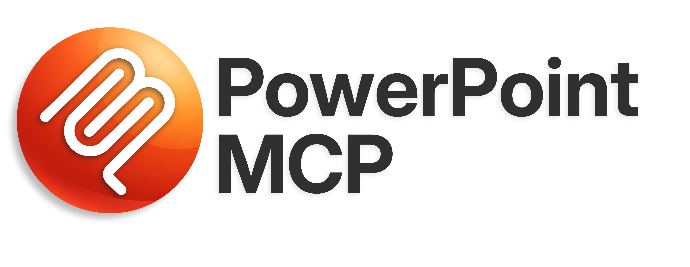
</p>

<p align="center">
  <a href="README.md">English (en)</a> · <a href="README.ja.md">日本語 (ja)</a> · <strong>简体中文 (zh-CN)</strong> · <a href="README.es.md">Español (es)</a> · <a href="README.pt-BR.md">Português (pt-BR)</a> · <a href="README.he.md">עברית (he)</a>
</p>

<p align="center">
  <a href="https://www.python.org/"></a>
  <a href="LICENSE"></a>
  
  <a href="https://pepy.tech/projects/ppt-mcp"></a>
</p>

<p align="center">
  <strong>在 Windows 和 macOS 上实时控制 PowerPoint —<br>为 AI 智能体和开发者打造、提供 <!--tools-->157<!--/tools--> 个工具的 MCP 服务器。</strong>
</p>

---

这是一个 MCP（Model Context Protocol）服务器，让 AI 智能体能够完全控制正在运行的 Microsoft PowerPoint：在 Windows 上通过 COM，在 macOS 上通过 Apple Events。与 python-pptx 这类基于文件的库不同，它直接与运行中的 PowerPoint 应用程序交互。

## 🎬 演示

智能体在打开的 PowerPoint 窗口中制作演示文稿（15 倍速）：

https://github.com/user-attachments/assets/178b9b5b-624d-4de0-a1dd-619dc13d4bd7

## ✨ 主要特性

- **实时控制** — 直接操作运行中的 PowerPoint，改动立即显示在屏幕上
- **<!--categories-->26<!--/categories--> 个类别共 <!--tools-->157<!--/tools--> 个工具** — 幻灯片、形状、文本、表格、图表、动画、SmartArt、媒体、任意多边形路径等
- **对 AI 智能体安全** — `ppt_activate_presentation` 把所有工具锁定到指定文件，避免误改其他演示文稿
- **[Google Material Symbols](https://fonts.google.com/icons) 图标** — 按关键词搜索 2,500 多个图标，以 SVG 形式插入并使用主题色
- **感知主题色** — 凡是接受填充、线条、阴影、发光或文字颜色的地方，都可以传 `accent1`、`accent2` 等，而不必写死 RGB 值；主题更换后，形状也会随之变化
- **Windows 和 macOS** — 两个平台上工具、参数和返回值完全相同；遇到 Mac 版 PowerPoint 做不到的事，工具会明确说明，而不是悄悄什么都不做

## 📋 环境要求

- Windows 11，或搭载 Apple Silicon / Intel 芯片的 macOS
- Microsoft PowerPoint
- [uv](https://docs.astral.sh/uv/getting-started/installation/)

在 macOS 上，服务器通过 Apple Events 而不是 COM 来驱动 PowerPoint。
第一次调用工具时，系统会弹出自动化授权提示，需要在其中允许一次 PowerPoint。
图片、图标、模板、主题、预览和导出都要经过 PowerPoint 自己的文件夹，
而 macOS 14 及以上版本不允许其他应用访问该文件夹，因此启动服务器的应用（终端、编辑器、
Claude）需要获得“完全磁盘访问权限”才能使用这些工具。从终端运行时，macOS 可能不询问就直接拒绝，
此时工具会告诉你需要授予什么权限。形状、文本、表格和图表不受影响，照常可用。
与 Windows 的差异请参阅 [macOS 支持](#-macos-支持)。

## 🚀 快速开始

标准配置 — 适用于 Claude Desktop、Cursor、`.mcp.json` 以及大多数其他 MCP 客户端：

```json
{
  "mcpServers": {
    "powerpoint": {
      "command": "uvx",
      "args": ["ppt-mcp"]
    }
  }
}
```

### Claude Code

**用户级**（所有项目可用）
```bash
claude mcp add powerpoint uvx ppt-mcp
```

**项目级**（保存在 `.mcp.json` 中，可与团队共享）
```bash
claude mcp add --scope project powerpoint uvx ppt-mcp
```

### Cursor

[](https://cursor.com/install-mcp?name=ppt-mcp&config=eyJ0eXBlIjoic3RkaW8iLCJjb21tYW5kIjoidXZ4IiwiYXJncyI6WyJwcHQtbWNwIl19)

也可以手动把上面的标准配置加到 `~/.cursor/mcp.json` 中。

### Claude Desktop

用上面的标准配置编辑 `%APPDATA%\Claude\claude_desktop_config.json`。

### Codex

编辑 `~/.codex/config.toml`：

```toml
[mcp_servers.ppt-mcp]
command = "uvx"
args = ["ppt-mcp"]
```

也可以在 `.codex/config.json` 中使用上面的标准 JSON 配置。

### VS Code

```bash
code --add-mcp '{"name":"powerpoint","command":"uvx","args":["ppt-mcp"]}'
```

### 从源码运行

```bash
git clone https://github.com/ykuwai/ppt-mcp.git
cd ppt-mcp
uv sync
```

```json
{
  "mcpServers": {
    "powerpoint": {
      "command": "uv",
      "args": [
        "--directory",
        "C:\\path\\to\\ppt-mcp",
        "run",
        "mcp",
        "run",
        "src/server.py"
      ]
    }
  }
}
```

## 🛠️ 工具类别

| 类别 | 工具数 | 说明 |
|----------|------:|-------------|
| **应用** | 5 | 连接 PowerPoint、应用信息、活动窗口、窗口状态、列出演示文稿 |
| **演示文稿** | 8 | 新建（支持模板）、打开（本地文件，Windows 上也可以是 SharePoint 或 OneDrive 的 URL）、保存、关闭、信息、指定操作目标、列出模板 |
| **幻灯片** | 10 | 添加、删除（批量）、复制（指定位置/多张）、移动（批量）、跨演示文稿复制、列表、信息、备注、导航 |
| **形状** | 10 | 添加形状/文本框/图片/线条（可指定叠放次序，包括置于文字下方）、列表、信息（位置、填充、线条、文本框）、更新（单个、多个或整张幻灯片，绝对值或偏移量）、删除、叠放次序 |
| **文本** | 10 | 设置文本（整个文本框、保留格式修改一段，或按文本段）、获取文本（含尺寸测量和溢出判断）、设置一段或批量设置格式、段落格式、项目符号、查找替换（可深入组合内部）、文本框设置、以 Markdown 提取全部文本、排版检查 |
| **占位符** | 6 | 列出、获取、设置占位符内容 |
| **格式** | 3 | 填充、线条、阴影（作用于形状或其文字） |
| **表格** | 13 | 添加表格、获取/设置单元格、批量设置数据、合并/拆分单元格、添加/删除行列、样式、布局、边框 |
| **导出** | 4 | PDF、图片、幻灯片预览、复制到剪贴板 |
| **放映** | 6 | 开始、结束、下一张、上一张、跳转到指定幻灯片、状态 |
| **图表** | 7 | 添加图表（在 Windows 上，除 3D 面积图、圆锥图、股价图等少数类型外不启动 Excel）、设置/获取数据（在 Windows 上，设置时尽量不启动 Excel，而是换成图表的副本（形状 ID 会变），设置后会读回图表，数据未写入时报错，Excel 把标签理解成别的值时给出 warning；散点图和气泡图以类别作为 x 值，气泡大小由系列的 `sizes` 给出）、格式、坐标轴格式、数据系列、更改类型 |
| **动画** | 6 | 切换效果，动画的添加/列出/更新/删除/清除（进入、退出、强调、动作路径、交互式序列） |
| **主题** | 4 | 应用主题、获取/设置主题色、页眉/页脚 |
| **组合** | 3 | 组合、取消组合、获取组合内的项目 |
| **连接符** | 2 | 添加、格式 |
| **超链接** | 3 | 添加、获取、删除 |
| **节** | 3 | 添加、列出、管理 |
| **属性** | 2 | 设置/获取演示文稿元数据 |
| **媒体** | 3 | 视频、音频、媒体设置 |
| **SmartArt** | 3 | 添加、修改、列出布局 |
| **编辑操作** | 6 | 撤销和重做（针对目标演示文稿）、在幻灯片之间复制形状/格式 |
| **布局** | 8 | 对齐、分布、幻灯片大小、背景、翻转、合并形状、布局检查 |
| **效果** | 3 | 发光和映像（作用于形状或其文字）、柔化边缘 |
| **批注** | 3 | 添加、列出、删除 |
| **高级** | 19 | 标记、字体（列出演示文稿中或本机上的字体、设置默认字体、批量替换）、裁剪、图片格式、导出形状、显示/隐藏、选择、视图、复制动画、从 URL 插入图片、SVG 图标、图标搜索、锁定纵横比、批量应用格式、默认形状样式 |
| **任意多边形** | 7 | 构建任意多边形路径、获取/设置节点位置、插入/删除节点、节点编辑类型、线段类型 |
| | **157** | |

## 💡 提示词示例

用平常的话描述你想要什么就行，不需要写代码。

---

**简单** — 只给主题

> *“为一款名叫 Flowly 的效率应用做一份 3 页的介绍演示文稿。”*

<details>
<summary>查看幻灯片</summary>
<br>

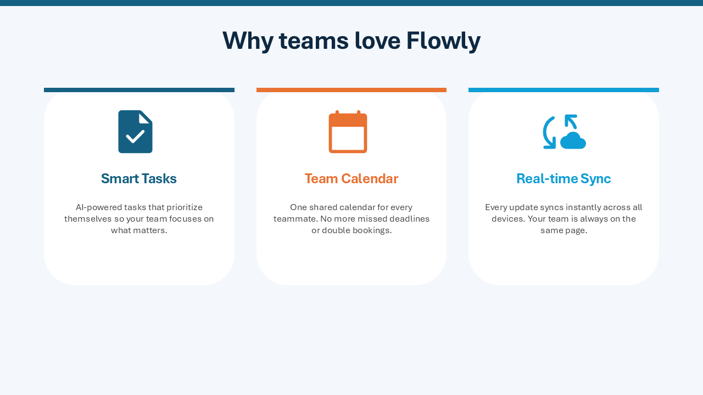

</details>

---

**指定风格** — 主题 + 视觉风格

> *“做一份 4 页的演示文稿，讲异步工作的好处。深海军蓝风格，每个好处配一个图标。”*

<details>
<summary>查看幻灯片</summary>
<br>
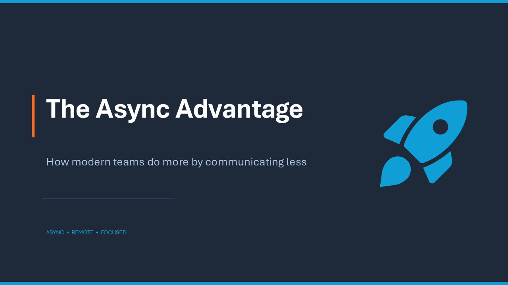
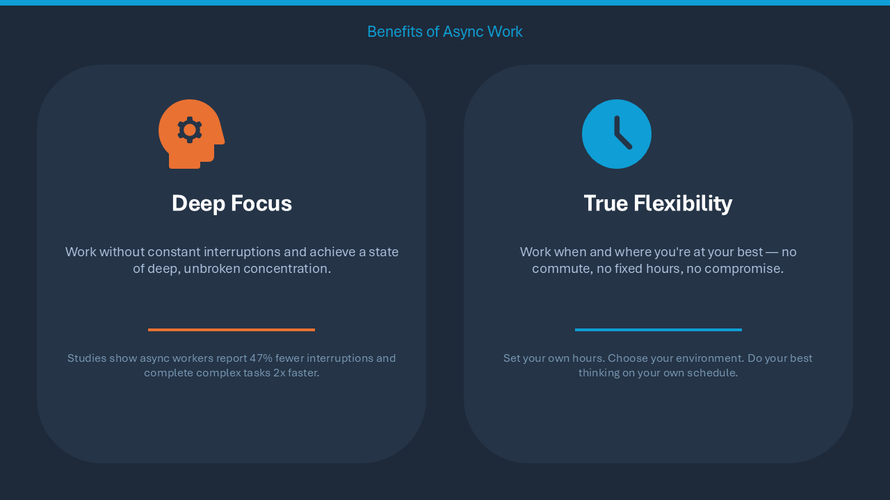
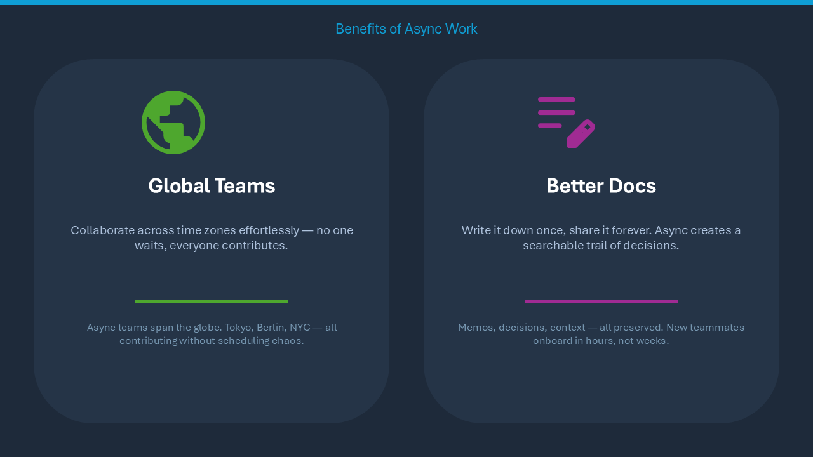
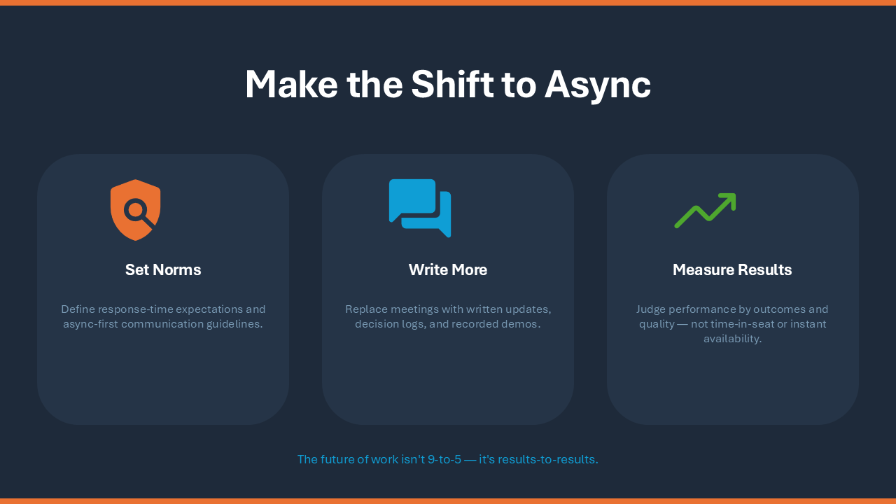
</details>

---

**详细** — 主题 + 设计意图 + 幻灯片结构

> *“为一款名叫 NoteAI 的 AI 笔记应用做一份 5 页的路演稿。白色背景，青绿色强调色。幻灯片依次为：标题、问题、解决方案、带图标的功能介绍、结尾。”*

<details>
<summary>查看幻灯片</summary>
<br>
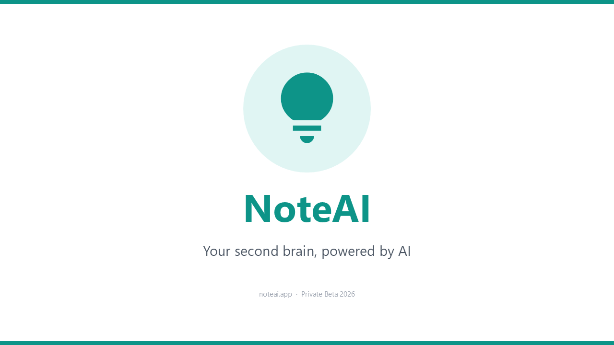
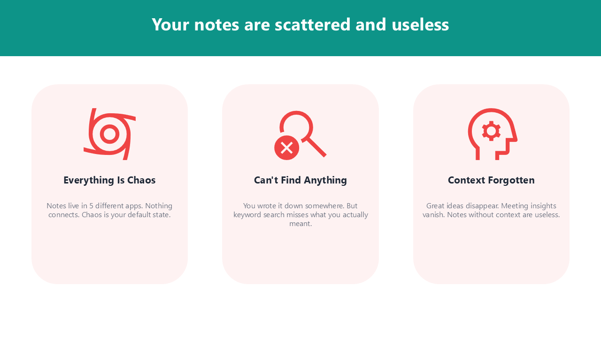
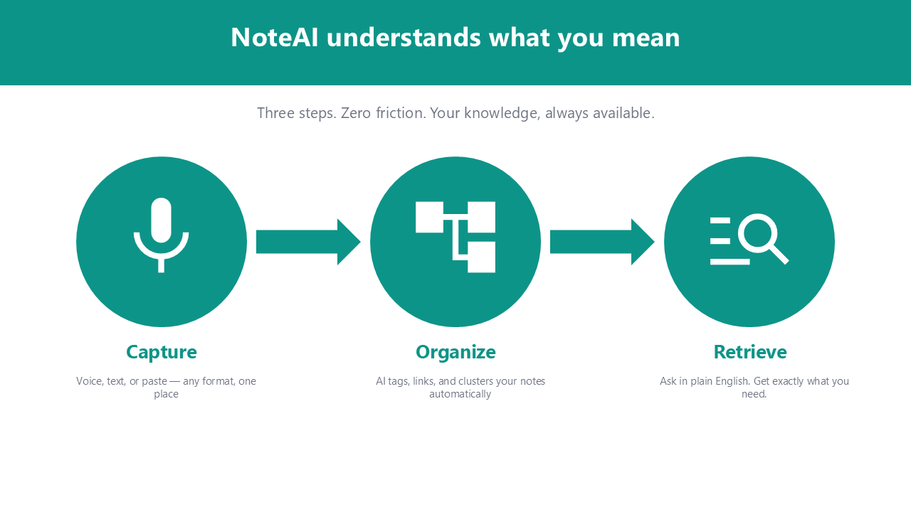
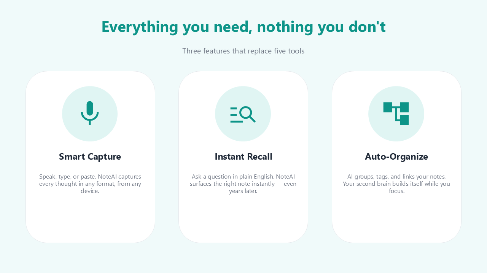
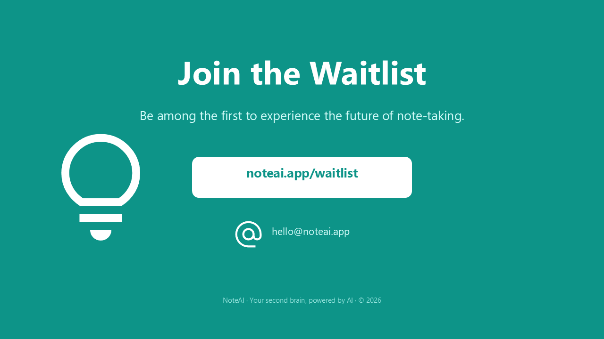
</details>

---

**能让效果更好的设计关键词：**

| 方面 | 关键词 / 说法 | 作用 |
|---|---|---|
| **图标** | `加上图标` · `每个要点配一个图标` · `全篇使用图标` | 搜索 Google Material Symbols，自动放置清晰的 SVG 图标 |
| **配色** | `深海军蓝` · `白色背景` · `单色` · `浅灰色` | 设定整体调色板和氛围 |
| **强调色** | `青绿色强调` · `蓝色强调` · `品牌色 #2563EB` | 为标题、图标和形状指定一种突出颜色 |
| **风格基调** | `现代简约` · `大胆鲜明` · `简洁专业` · `活泼` | 表明整体的视觉个性 |
| **演示文稿类型** | `路演稿` · `投资人演示` · `工作坊幻灯片` · `进度汇报` | 让版式和内容密度贴合用途 |
| **幻灯片结构** | `幻灯片：标题、问题、解决方案、功能、行动号召` · `4 页` | 事先确定叙事脉络和页数 |
| **版式** | `卡片式布局` · `两栏` · `居中` · `全出血背景` | 决定每页内容如何排布 |
| **文字密度** | `尽量少的文字` · `每页一个要点` · `项目符号` | 控制文字的多少和呈现方式 |
| **背景** | `渐变背景` · `纯深色背景` · `柔和的浅色背景` | 指定各页背景的处理方式 |
| **强调** | `突出关键数字` · `标题加粗` · `每页加一条强调色条` | 把注意力引向最重要的信息 |

## 🔍 功能详解

### 🎯 指定目标演示文稿

`ppt_activate_presentation` 设置一个会话级的目标，之后每次工具调用都作用于这个文件，无论 PowerPoint 中当前激活的是哪个窗口。随时再调用一次即可切换目标。

```python
ppt_activate_presentation(presentation_name="report.pptx")
# All tools now operate on report.pptx
ppt_activate_presentation(presentation_name="demo.pptx")
# Switched — all tools now operate on demo.pptx
```

激活的演示文稿对整个服务器只有一个值，而 Claude Desktop 这样的客户端会让所有对话共用同一个服务器。如果几个对话同时在处理不同的文件，请在每次调用时传 `presentation`。它只对当次调用生效，不会改变已激活的演示文稿，可以是完整路径、文件名，或不带扩展名的文件名。指定的文件没有打开时会报错，绝不会退而改用另一个文件。

```python
ppt_add_textbox(params={...}, presentation="report.pptx")
# Lands in report.pptx whatever another conversation has activated
```

### 👥 他人同时编辑的文件（Windows）

从 SharePoint 或 OneDrive 打开的演示文稿，在服务器处理它的同时，其他人也可能在编辑。没有开启自动保存时，PowerPoint 只有在保存文件时才会合并别人已保存的改动，在此之前会显示“有可用的更新”；服务器读写的就会是旧的状态。对这类文件，服务器会这样处理：

- **在工具调用之前**，只要本地副本没有未保存的内容，就先合并他人的改动，让读取看到的是当前状态。如果合并移动了某个写入调用所涉及的幻灯片或形状，该调用会被拒绝且不做任何改动，因为它的索引来自旧状态。
- **返回结果**中带有 `coauthoring`：`pending_updates`（有改动在等待；`ppt_save_presentation` 会把它们合并进来）、`merged_updates`（刚刚合并过）、`conflict`。`ppt_open_presentation`、`ppt_activate_presentation` 和 `ppt_get_presentation_info` 总会报告它，并附带 `coauthor_count`；`ppt_list_presentations` 会按文件给出 `pending_updates`。
- **发生冲突时**（双方改了同一个对象），PowerPoint 会弹出“解决冲突”对话框。对象模型无法回应这个对话框，所以只能交给用户处理。集成方也可以自行处理：`utils.coauthoring.set_conflict_resolver(fn)` 注册一个函数，它在 COM 线程上接收 Presentation，在对话框处理完后返回 `True`；随后结果会在 `overwritten` 中列出现在与本地副本不同的每一张幻灯片，以及它在本地时的文字。

### 📁 模板支持

自动找到你个人的 PowerPoint 模板文件夹（通过注册表、OneDrive 或默认路径）。用 `ppt_list_templates` 查看可用的模板，再用 `ppt_create_presentation(template_path=...)` 基于任意模板新建演示文稿。

### 🎨 Google Material Symbols 图标

用 `ppt_search_icons(query="...")` 在 2,500 多个 [Google Material Symbols](https://fonts.google.com/icons) 图标中搜索，再用 `ppt_add_svg_icon` 以 SVG 形式插入：
- **3 种风格**：outlined、rounded、sharp
- **填充版本**：设置 `filled=True`
- **主题色**：`color="accent1"` 使用演示文稿的强调色
- **自动适应**：在指定区域内保持纵横比

### ⚡ 实时跳转

每次写操作都会让 PowerPoint 自动跳到目标幻灯片。你能实时看到改动发生，不必手动切换幻灯片。

### ✍️ 文本格式

- `\n` — 分段（Enter）。每个段落有自己的项目符号/缩进级别。
- `\v` — 换行（Shift+Enter）。仍在同一段落内，保留格式。
- 用 `ppt_format_text_range` 逐字符设置格式
- 自动调整控制：缩小文字以适应、调整形状大小，或允许溢出

### 🎨 主题色预设与自动生成

`ppt_set_theme_colors` 支持三种模式：
- **17 套精选预设** — 符合 WCAG AA 无障碍标准的调色板，分为 5 类：Classic（`corporate_blue`、`executive`、`consulting`）、Design Systems（`tailwind`、`chakra`、`open_color`、`radix`）、Nature（`ocean`、`forest`、`sunset`、`sage`）、Modern（`nord_light`、`pastel_deep`、`swiss`）、Vibrant（`vivid`、`rainbow`、`neon_safe`）
- **由主色生成** — 只给一个品牌色（`primary="#2B579A"`），按色彩和谐规则（分裂互补 + 类似色）自动生成一整套协调的调色板
- **手动** — 逐个设置颜色槽（`accent1`、`accent2` 等）

几种模式可以组合：以某个预设为基础，再覆盖特定的颜色槽。所有强调色在白色背景上都保证至少 3:1 的对比度。

### 🔍 排版检查

`ppt_check_typography` 检测常见的排版问题，并可选择自动修复：
- **孤行** — 自动换行造成的只有 1 到 3 个字符的孤立行
- **软回车后的短行** — 手动换行（`\v`）带来的副作用
- **被自动缩小的文字** — 被 PowerPoint 的“溢出时缩小文字”功能悄悄压缩的文字

自动修复的方法包括加宽文本框和插入软回车。

### 📐 布局检查

`ppt_check_layout` 测量一张幻灯片或整个演示文稿，用数字而不是图片报告问题，因此无论模型能否读图都能使用：
- **超出幻灯片** — 形状或其文字越过了幻灯片边缘
- **溢出** — 文字需要的空间超过文本框所能提供的
- **重叠** — 文字撞上其他形状或其他文字，文字压在表格单元格上或被盖在上面的卡片遮住，以及幻灯片上添加的任何东西撞上或穿过模板自带的图形：徽标、侧边色带、页脚线、标题下的横线
- **对比度低** — 文字与其背后内容的对比度低于该字号的 WCAG 最低要求，渐变背景上同样检查，照片上则与文字下方那部分照片比较
- **文字拥挤** — 卡片上的文字紧贴卡片的某条边
- **页边距过窄** — 形状离幻灯片侧边的距离小于幻灯片其余部分保持的边距，或几乎贴到顶部或底部
- **标题边缘** — 标题文字的起点与下方正文的起点相差几个磅，看起来像两条略微错开的边
- **未对齐** — 本应对齐的边缘相差几个磅
- **间距不均** — 一行或一列同类形状之间的间隔不相等
- **尺寸不一** — 一行中的同类形状高度不一，或一列中的宽度不一，以及一行中有一张卡片比其他的稍宽
- **示例文字** — 模板或草稿遗留下的 lorem ipsum、“Your title here”、“[Company name]”或“XX%”，以及仍保留着 PowerPoint 新建图表时默认数据的图表
- **图片被拉伸** — 图片或徽标的显示比例与原图不同；修复会恢复比例，或用 `ppt_crop_picture crop_fit` 把图片裁剪到框内
- **文字过小** — 小于 10 磅的文字，投影时会看不清；对于被自动缩小的文字，按 PowerPoint 实际绘制的字号测量
- **图片模糊** — 图片显示得比其像素所能支撑的更大
- **图表** — 数据标签互相重叠，或图例、标题压在绘图区上。仅限 Windows：Mac 版 PowerPoint 没有可读取的图表对象
- **替代文字** — 屏幕阅读器无法描述的图片、图表或 SmartArt 图形。在 Windows 上用 `ppt_update_shape alt_text` 设置；Mac 版 PowerPoint 不允许工具设置，需要手动填写
- **字体** — 使用了本机没有的字体，PowerPoint 会用替代字体显示；以及希伯来文或阿拉伯文显示的字体与指定的不同
- **从右到左的文字** — 在希伯来文或阿拉伯文幻灯片上，只有数字的一行（如“1948–1967”）会被 PowerPoint 从左到右绘制，读者会倒着读；以及其他程序生成的文件中从左到右的段落。`ppt_set_paragraph_format direction='rtl'` 设置段落方向，并保持其对齐的一侧不变
- **空占位符**；对整个演示文稿，还检查**标题**在各页之间大小、位置、对齐、粗细、字体或颜色不一致，或在正常大小写的标题中混入全大写的标题，**正文**字号与整体相差一两级，以及**没有标题**或与另一页**标题相同**的幻灯片（屏幕阅读器和大纲视图无法区分它们）。右对齐的标题（如希伯来文或阿拉伯文演示文稿）按右边缘比较；只有一张幻灯片使用的版式，其标题按该版式规定的位置来衡量

组合和 SmartArt 图形内部的形状，会检查其文字内容和设置：溢出、对比度、示例文字、字体、方向和字号。

幻灯片按放映时的效果来判断。动画逐条在同一位置显示的各行不算重叠，被动作路径移动的形状按它到达的位置判断，被拖到幻灯片外的声音图标视为有意隐藏，挨着“平滑”切换的幻灯片外等候的形状也不予处理。隐藏幻灯片上的问题会注明该幻灯片是隐藏的。

每个问题都会指出涉及的形状并说明修复方法，附带具体的工具调用和参数值。修复会让整张幻灯片保持协调，而不只是消除这一个问题：卡片连同内边距和同一行的其他卡片一起变大，被移回幻灯片内的形状保持幻灯片的边距。添加、复制、移动、调整大小、对齐、分布形状或修改其文字、填充占位符的工具，也会检查它们所动过的形状，并在各自结果的 `layout_issues` 中报告问题，从而由引起问题的那次调用当场发现。新的幻灯片背景或文字下方新的填充，会报告因此变得难以阅读的文字；对整个演示文稿的改动（主题、主题色、字体或幻灯片大小）会报告它弄坏了哪些原本正常的地方。

每项检查都要把幻灯片读回来，这会让每次写入多花一点时间，在 Mac 上更多。如果只想交给 `ppt_check_layout` 检查，请在服务器的 `env` 中设置 `PPT_LAYOUT_CHECKS=off`；此时服务器的说明会让模型每做几处改动就运行一次检查。可接受的值是 `on`（默认）和 `off`；其他值会被忽略并给出警告，检查保持开启。对整个演示文稿的改动（主题、主题色、字体、默认字体、幻灯片大小）会在改动前后读取每一张幻灯片。形状超过 300 个的演示文稿两次都不读，因为那会比改动本身还慢，并在 `layout_check_skipped` 中注明，把检查留给 `ppt_check_layout`。段落格式、项目符号、图片裁剪与格式、组合、SmartArt、图表数据、线条、删除表格行列、拆分单元格和复制幻灯片也以同样方式检查。复制到另一个已打开演示文稿中的幻灯片不检查：检查读取的是服务器当前处理的演示文稿。

对于基于模板的演示文稿，模板也是检查的一部分。会读取幻灯片母版和版式所绘制的图形，因此盖住徽标的图表、压在保密声明线上的脚注都会被报告；模板刻意设计的内容会被视为有意为之：仍使用主题色的占位符、说明文字版式中本来就较小的标题，不会按其余标准要求；使用两套设计的演示文稿中，每套设计的标题只在同一设计内比较。通过 `ppt_set_theme_colors` 设置的主题色属于调用方的选择，因此该调用也会检查使用这些颜色的占位符；一旦主题自身的文字颜色在背景上看不清，之后的每次检查也会如此。Mac 版 PowerPoint 只暴露母版的图形，不暴露版式自身的图形，也不暴露组合内部的内容，因此在 Mac 上，版式的图形、标题位置、主题字体和组合内的文字是从演示文稿已保存的文件中读取的，前提是该文件与屏幕上的内容一致。对于尚未保存或保存后又有改动的演示文稿，则通过占位符来推断版式的设计。

## ⚙️ 高级配置

### 处理 PowerPoint 的模态对话框

当 PowerPoint 打开了模态对话框（例如 SmartArt 布局选择器、保存对话框、插入对话框）时，COM 调用会返回 `RPC_E_CALL_REJECTED`。MCP 服务器会**自动重试最长 15 秒**（5 次 × 3 秒），因此即使对话框挡住了 PowerPoint，服务器也能保持连接并正常响应。

**自动关闭（需手动开启）：** 默认情况下，服务器会等你手动关闭对话框。如果希望服务器在第一次重试时自动发送 ESC，无需用户操作就关掉对话框，请设置 `PPT_AUTO_DISMISS_DIALOG=true`：

```json
{
  "mcpServers": {
    "powerpoint": {
      "command": "uvx",
      "args": ["ppt-mcp"],
      "env": {
        "PPT_AUTO_DISMISS_DIALOG": "true"
      }
    }
  }
}
```

ESC 只是取消而不会提交，所以没有破坏性的副作用。在无人值守、没人关闭对话框的自动化流程中，这一点尤其有用。

### 由服务器启动的 PowerPoint

如果某个工具需要 PowerPoint（`ppt_create_presentation`、`ppt_open_presentation`、`ppt_connect`）时它没有在运行，服务器会启动它。在 macOS 上它在后台启动，不会抢走你正在使用的应用的前台位置。

当关闭操作使服务器启动的 PowerPoint 中不再有打开的演示文稿时，`ppt_close_presentation` 会一并退出 PowerPoint，并在结果中注明（`powerpoint_quit`）。你自己启动的 PowerPoint 永远不会被退出，仍有演示文稿打开着的也不会（在 Windows 上，包括在受保护的视图中打开的文件）。传入 `keep_powerpoint_open=true` 可以让它保持运行，比如想紧接着打开另一个演示文稿时。在某个工具再次启动 PowerPoint 之前，需要它的工具会回复 PowerPoint 未运行，而不是返回一个空列表。在 Windows 上，以受保护的视图打开的文件会列在 `ppt_list_presentations` 的 `protected_view` 下，`ppt_close_presentation` 可按名称关闭它，不会保存。

### 与模型在同一个演示文稿中工作

每次写入都会把演示文稿窗口切到正在处理的幻灯片，这样你能看到模型在改哪里。如果你想同时在这个演示文稿里工作，不希望窗口跳到别的幻灯片，请在服务器的 `env` 中设置 `PPT_FOLLOW_EDITS=off`。改动照常写入，只是窗口停在你离开时的位置。`ppt_goto_slide` 被调用时仍会移动窗口。可接受的值是 `on`（默认）和 `off`；其他值会被忽略并给出警告。你在文本框中打字时，PowerPoint 可能会让模型的调用稍等片刻；另外撤销（Ctrl+Z）是共用的，所以可能会撤掉模型的最后一次改动。

```json
"env": { "PPT_FOLLOW_EDITS": "off" }
```

### 在屏蔽图标网站的网络中使用图标

`ppt_search_icons` 从 `fonts.google.com` 读取图标列表，`ppt_add_svg_icon` 从 `cdn.jsdelivr.net` 下载图标。每次下载（包括通过 URL 插入图片）都会在 15 秒后放弃，并说明无法访问的是哪个主机。有三个设置可以改变这一行为：

| 设置 | 默认值 | 作用 |
|---|---|---|
| `PPT_ICON_BASE_URL` | `https://cdn.jsdelivr.net/npm/@material-symbols/svg-400@0.31.3` | 图标的来源。任何与该包目录结构一致（`<base>/outlined/home.svg`）的地址都可以：例如镜像 `https://unpkg.com/@material-symbols/svg-400@0.31.3`，或包的本地副本 `file:///path/to/svg-400`。 |
| `PPT_ICON_METADATA_URL` | `https://fonts.google.com/metadata/icons` | 图标列表的来源。把该页面保存一次，然后指向这个副本，如 `file:///path/to/icons.json`。 |
| `PPT_DOWNLOAD_TIMEOUT` | `15` | 等待服务器响应的秒数。不是正数的值会被忽略（使用 15）。 |

```json
{
  "mcpServers": {
    "powerpoint": {
      "command": "uvx",
      "args": ["ppt-mcp"],
      "env": {
        "PPT_ICON_BASE_URL": "https://unpkg.com/@material-symbols/svg-400@0.31.3"
      }
    }
  }
}
```

### 工具列表：目录模式

客户端每次请求都会附上它所列出的每个工具的说明，而本服务器的 <!--tools-->157<!--/tools--> 个工具约有 112k 个 token，还没开始干活就占去 128k 或 200k 上下文窗口的一大块。在服务器的 `env` 中设置 `PPT_TOOL_MODE=catalog` 后，服务器只列出三个工具，约 700 个 token，模型通过它们调用其余工具：

| 工具 | 作用 |
|---|---|
| `ppt_describe` | 不带名称时，返回所有工具的列表，每个一行。带名称时，返回这些工具的完整说明和参数。 |
| `ppt_run` | 运行一个工具：`{"tool": "ppt_add_textbox", "params": {...}}`。 |
| `ppt_run_steps` | 在一次调用中按顺序运行多个工具。后面的步骤可以使用前面步骤的返回值：`"$prev.shape_name"` 是上一步的 `shape_name`，`"$2.shape_name"` 是第二步的。第一个失败的步骤会终止运行并说明原因。 |

工具本身完全相同，参数、检查和返回结果都一样，`presentation` 的传法也一样。模型第一次使用某个工具前会先问 `ppt_describe`，这要多花一次调用。通过 Claude Code 制作同一份 12 页演示文稿时，目录模式下上下文峰值为 136k 个 token，而列出全部工具时为 206k，整次运行的花费少了三分之一。

目录模式放弃的是在客户端中按工具控制的能力：按名称批准或禁止某个工具，以及工具的只读提示，都只作用于上面这三个工具，而不是每个工具。这也是它不作为默认值的原因：除非设置另有要求，每个工具都以自己的名称列出，这也正是 `PPT_TOOL_MODE=full` 的含义。`catalog` 或 `full` 以外的值会被忽略并给出警告，所有工具照常列出。

```json
{
  "mcpServers": {
    "powerpoint": {
      "command": "uvx",
      "args": ["ppt-mcp"],
      "env": { "PPT_TOOL_MODE": "catalog" }
    }
  }
}
```

## 🍎 macOS 支持

**在 macOS 上有 <!--mac-refusals-->11<!--/mac-refusals--> 个工具会拒绝执行，其余都能用。** 这 <!--mac-refusals-->11<!--/mac-refusals--> 个工具的名称列在
[MACOS_PORT.md](MACOS_PORT.md) 第 6.1 节，并有测试保证该列表准确无误。

工具相同，参数相同，返回结果也相同。不同之处在于 Mac 版 PowerPoint 的脚本字典能触及哪些功能；
遇到触及不到的地方，工具会明确说明，而不是做出意料之外的事。

**Mac 版 PowerPoint 的 VBA 能触及更多，可以选择启用。** 服务器会把一个小型加载项
`ppt-mcp-bridge` 载入 PowerPoint，对脚本字典中没有对应词汇的功能，通过它运行 Windows 版的代码：
标记、`ppt_select_shapes`、`ppt_set_table_style`、删除和复制单个动画、任意多边形节点的编辑类型、图表的格式、坐标轴、
数据系列、类型和数据工具（数据写入图表的 Excel 工作簿，和 Windows 上一样，Excel 中会短暂打开该工作簿）、任意多边形的节点工具和组合、组合内的文字、按名称使用模板版式添加幻灯片、复制和拷贝幻灯片、编辑 SmartArt（文字、节点、颜色和样式），以及 Mac 上原本会拒绝的参数（屏幕提示、
在指定位置插入表格行或列、由另一个形状的单击触发的动画、映像的尺寸、文字上的发光、阴影和映像、
缩小文字以适应、音量、静音和淡入淡出、图表样式以及图例和标题的位置）。这些操作会就地修改形状，
因此动画得以保留，也不会动用剪贴板。加载项只负责转交这些调用，源码在 `src/backend/vba`。
PowerPoint 载入它时不会弹出提示，它在 PowerPoint 退出前一直有效，之后不留下任何东西。
如果无法载入，例如宏被策略禁用时，工具会按下面所述的方式工作。由于它是无需确认即可载入的宏，
默认关闭。若要使用，请在服务器的 `env` 中设置 `PPT_MAC_VBA=on`。

macOS 上不可用的功能：

- **没有加载项时，任意多边形节点的编辑类型。** 角部、平滑和对称这几种类型没有存放在脚本能访问的地方；
  请改为移动节点的控制柄。
- **`ppt_execute_mso`**，以及在没有加载项时的**标记、`ppt_select_shapes`、
  `ppt_set_table_style` 和删除单个动画**（清除一张幻灯片的全部动画是可以的）。
  脚本字典中没有任何内容能触及它们。

较小的差异：

- **请依次调用工具，不要在同一轮中同时调用多个。** PowerPoint 一次只能接收一个请求，
  其余请求会排在后面，按到达的顺序依次处理。等待过久的调用会被撤回并说明原因，不会造成任何改动。
- 没有加载项时，有少数工具接受在 Mac 上没有对应功能的参数，例如超链接的屏幕提示。这类调用会拒绝执行，
  并在消息中指出是哪个参数，去掉该参数重试即可。
- **视频和音频只能嵌入，不能链接**，八项播放设置中只有循环播放和隐藏画面框可用，有加载项时音量、静音和淡入淡出也可用。
  已有动画的幻灯片上会拒绝隐藏画面框，因为写入这项设置会重写这些动画。
- 导出的文件会先放在 PowerPoint 自己的容器中再移出来，因为该应用运行在沙盒中，
  无法写入任意文件夹。
- **没有加载项时，模板自带的版式是按名称从演示文稿已保存的文件中查找的**，所以在让 `ppt_add_slide`
  按名称使用某个版式之前，请先保存新建的演示文稿。Mac 版 PowerPoint 不向脚本提供版式名称，
  因此新幻灯片是连同其版式一起粘贴进来的，大约需要一秒。有加载项时，无论是否保存，都直接在打开的演示文稿中查找版式。
- 幻灯片图像是从 PDF 渲染得到的，而不是导出为 PNG。两个平台上的预览都是每磅 2 像素。
- 自动化授权属于启动服务器的那个应用，所以从另一个终端或编辑器运行时，会再次弹出授权提示。
- 请尽早保存演示文稿，并在每个阶段性节点保存。这样做没有任何代价，而且曾经出现过沙盒提示在脚本背后弹出时，
  PowerPoint 关闭所有打开的文档后退出的情况（[#191](https://github.com/ykuwai/ppt-mcp/issues/191)）。
- **添加图表通过剪贴板实现**，没有加载项时，其他图表工具、任意多边形路径和组合也是如此。
  也就是说操作期间会暂时占用剪贴板，完成后再恢复原有内容。脚本字典里没有描述它们的词汇，只能这样实现。Mac 版 PowerPoint
  总是粘贴到最前面的窗口，所以打开两个演示文稿时，这些操作只能用于最前面的那个；对另一个，
  工具会说明原因且不做任何改动，可以用 `ppt_activate_presentation` 把它放到最前面。
- **没有加载项时，编辑已有的图表或路径会重新创建形状**；有加载项时，设置气泡图的气泡大小仍会如此。图表数据、类型、标题、图例、坐标轴和数据系列工具，
  以及节点工具，会复制形状、改写后粘贴回去，再删除原来的形状。名称、位置和叠放次序会保留；
  形状上的动画则不会，结果中会注明丢失了几个。没有加载项时，少数依赖图表渲染尺寸的格式参数
  （`chart_style`、图例和标题的坐标、8 个方向的图例预设）会被点名拒绝。
- **组合内的文字**可以用 `ppt_set_text`（整段文字，或某一行中的一段）和 `ppt_format_text`
  通过名称或路径（`"Group 4/TextBox 3"`）访问。有加载项时，成员会被就地修改。没有加载项时，
  组合会被复制，成员被改写，然后组合被粘贴回去：成员保留各自的名称，组合则会像上面那样丢失动画。
- 图标在插入前会先用 `sips` 栅格化，因为 Mac 版 PowerPoint 无法读取 SVG。这需要 macOS 13
  或更高版本；在更旧的系统上会拒绝执行并说明原因，而不是插入一个空白框。

## 🤝 参与贡献

欢迎提交拉取请求。请基于 `develop` 分支，每个请求只涉及一个主题，并附带测试；其余说明见 [CONTRIBUTING.md](CONTRIBUTING.md)。

## 📄 许可证

MIT

## 🙏 致谢

- [FastMCP](https://github.com/jlowin/fastmcp) — Pythonic 风格的 MCP 服务器框架
- [pywin32](https://github.com/mhammond/pywin32) — Windows COM 自动化
- [appscript](https://github.com/hhas/appscript) — macOS Apple Event 桥接
- [Model Context Protocol](https://modelcontextprotocol.io/) — 由 Anthropic 推出
