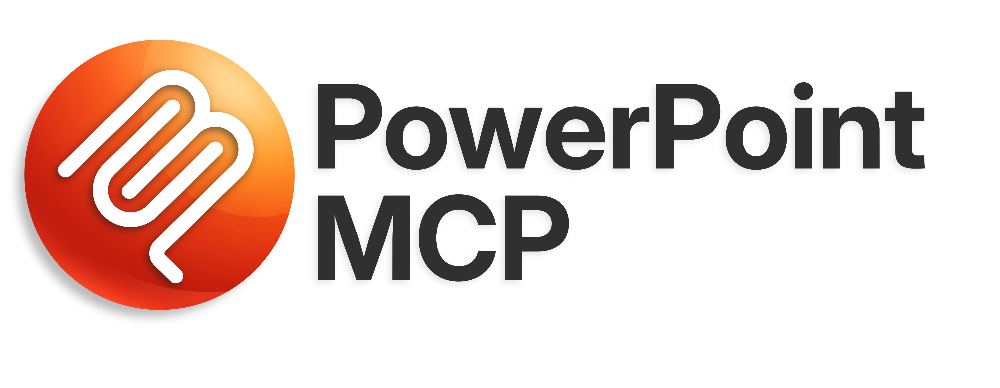
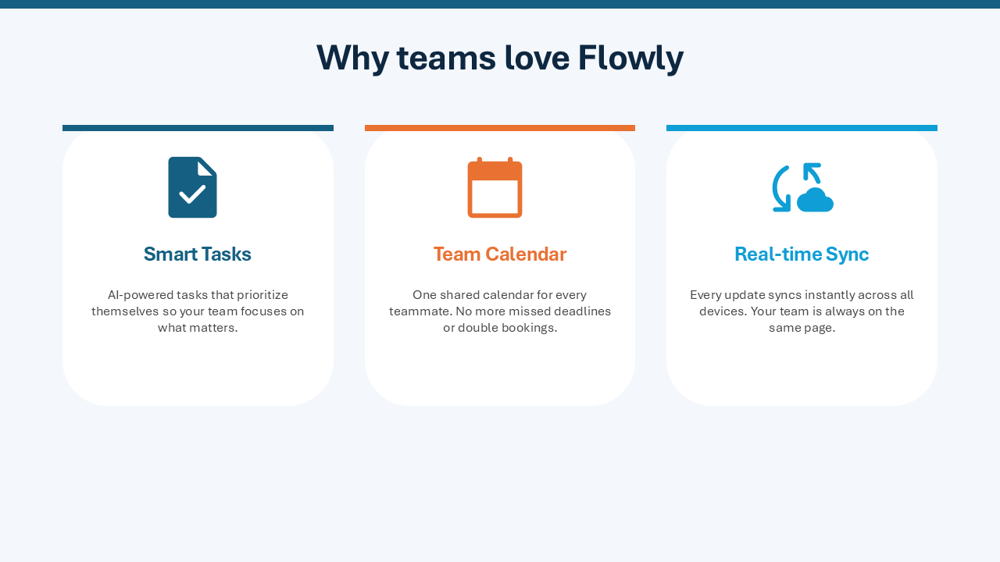
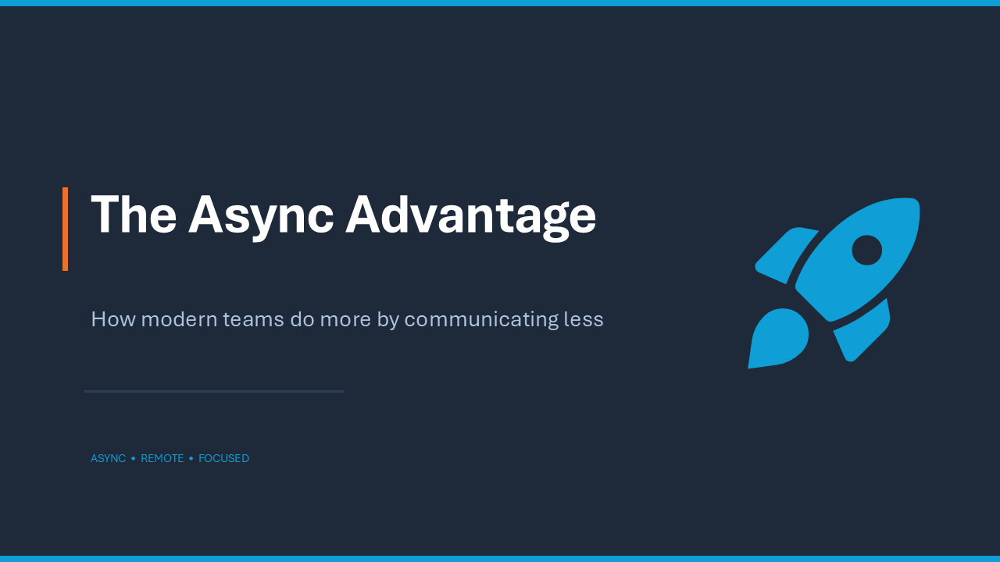
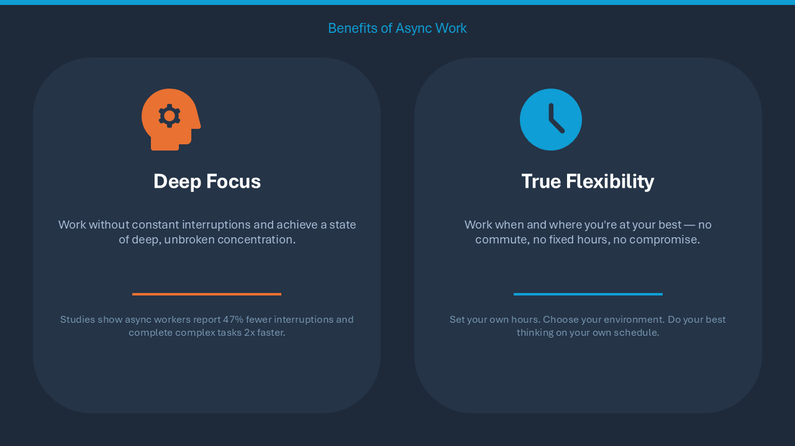
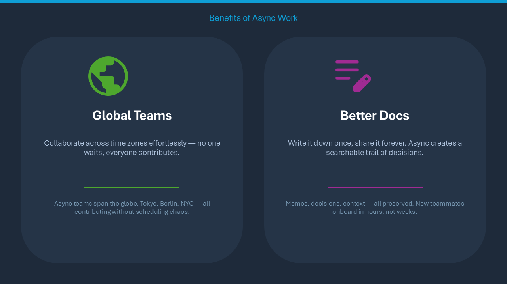
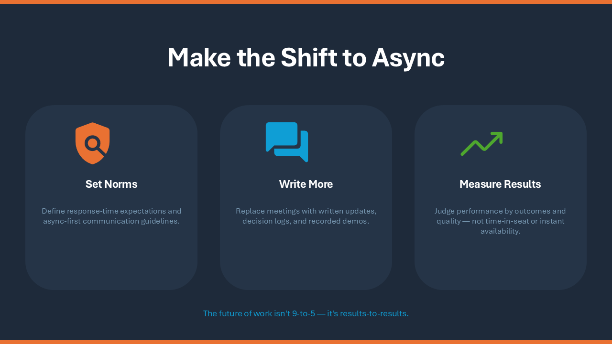
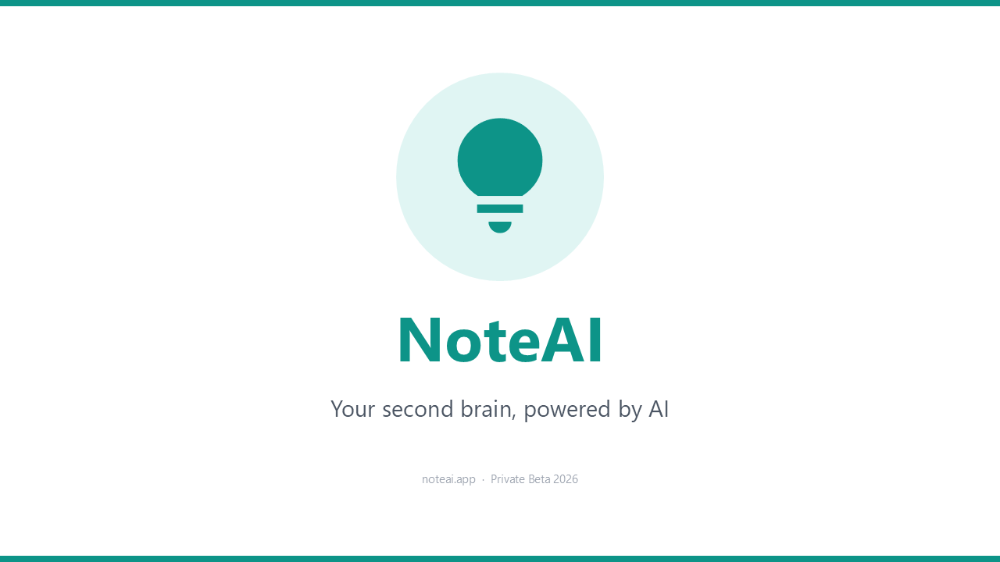
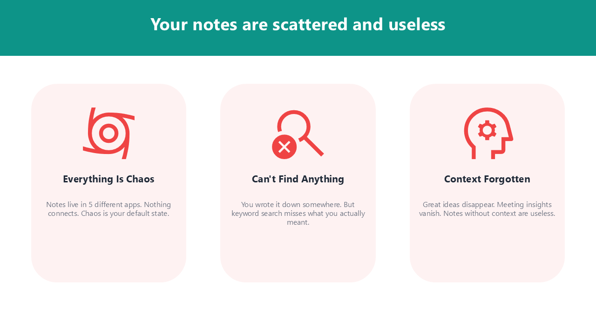
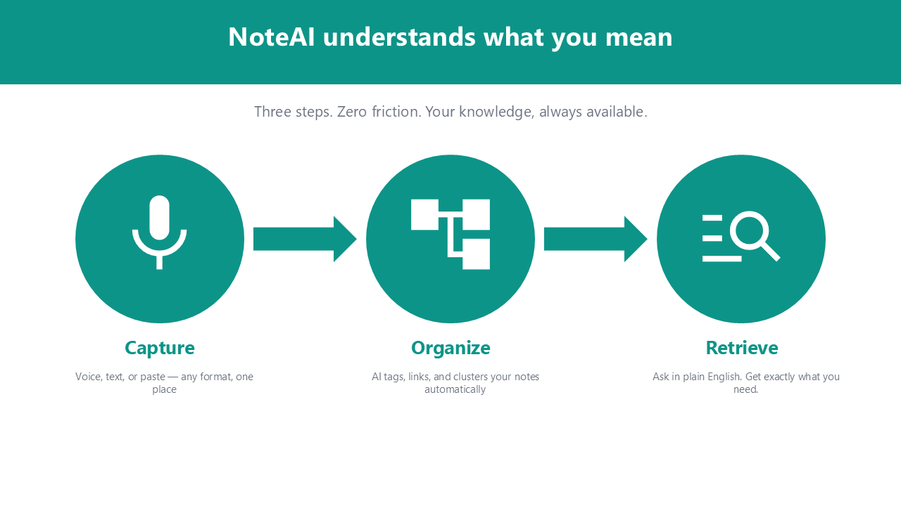
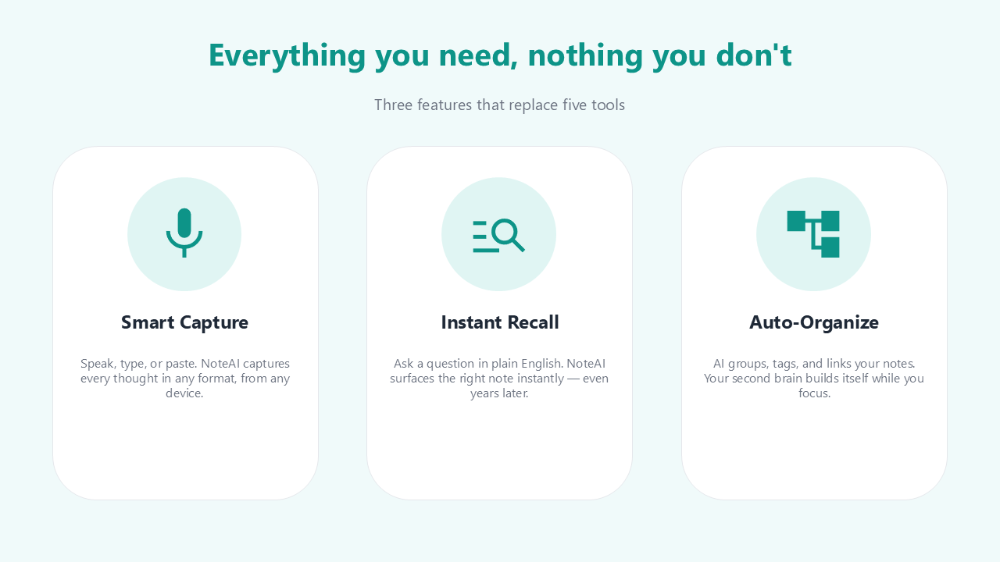

<p align="center">
  
</p>

<p align="center">
  <a href="../README.md">English (en)</a> · <a href="README.ja.md">日本語 (ja)</a> · <a href="README.zh-CN.md">简体中文 (zh-CN)</a> · <strong>Español (es)</strong> · <a href="README.pt-BR.md">Português (pt-BR)</a> · <a href="README.he.md">עברית (he)</a>
</p>

<p align="center">
  <a href="https://www.python.org/"></a>
  <a href="../LICENSE"></a>
  
  <a href="https://pepy.tech/projects/ppt-mcp"></a>
</p>

<p align="center">
  <strong>Control de PowerPoint en tiempo real en Windows y macOS:<br>un servidor MCP con <!--tools-->157<!--/tools--> herramientas para agentes de IA y desarrolladores.</strong>
</p>

---

Un servidor MCP (Model Context Protocol) que da a los agentes de IA control total sobre una instancia de Microsoft PowerPoint en ejecución, mediante COM en Windows y Apple Events en macOS. A diferencia de las bibliotecas que trabajan con archivos, como python-pptx, este servidor interactúa directamente con la aplicación PowerPoint abierta.

## 🎬 Demostración

Un agente creando una presentación en una ventana de PowerPoint abierta (a 15x):

https://github.com/user-attachments/assets/178b9b5b-624d-4de0-a1dd-619dc13d4bd7

## ✨ Características principales

- **Control en tiempo real**: manipula directamente una instancia de PowerPoint en ejecución; los cambios aparecen al instante en pantalla
- **Amplia cobertura**: diapositivas, formas, texto, tablas, gráficos, animaciones, SmartArt, multimedia, trazados de forma libre y más
- **Seguro para agentes de IA**: `ppt_activate_presentation` fija todas las herramientas a un archivo concreto y evita editar por error la presentación equivocada
- **Iconos de [Google Material Symbols](https://fonts.google.com/icons)**: busca entre más de 2500 iconos por palabra clave y los inserta como SVG con colores del tema
- **Colores del tema**: pasa `accent1`, `accent2`, etc. en cualquier lugar donde se acepte un color de relleno, línea, sombra, resplandor o texto, en vez de valores RGB fijos; las formas siguen al tema cuando este cambia
- **Windows y macOS**: las mismas herramientas, argumentos y valores de retorno en ambos; cuando PowerPoint para Mac no puede hacer algo, la herramienta lo dice en lugar de no hacer nada sin avisar

## 📋 Requisitos

- Windows 11, o macOS con Apple Silicon o Intel
- Microsoft PowerPoint
- [uv](https://docs.astral.sh/uv/getting-started/installation/)

En macOS el servidor controla PowerPoint mediante Apple Events en lugar de COM.
La primera llamada a una herramienta muestra el aviso de automatización del
sistema, y hay que permitir PowerPoint ahí una vez. Imágenes, iconos,
plantillas, temas, vistas previas y exportaciones pasan por la carpeta propia de
PowerPoint, a la que macOS 14 y posteriores no dejan acceder a otras apps, así
que la aplicación que lanza el servidor (Terminal, un editor, Claude) necesita
Acceso total al disco para esas herramientas. Si se ejecuta desde una terminal,
macOS puede denegar el acceso sin preguntar; en ese caso las herramientas dicen
qué permiso conceder. Formas, texto, tablas y gráficos funcionan igualmente.
Consulta [Compatibilidad con macOS](#-compatibilidad-con-macos) para ver qué
cambia.

## 🚀 Primeros pasos

Configuración estándar; funciona en Claude Desktop, Cursor, `.mcp.json` y la mayoría de los demás clientes MCP:

```json
{
  "mcpServers": {
    "powerpoint": {
      "command": "uvx",
      "args": ["ppt-mcp"]
    }
  }
}
```

### Claude Code

**Ámbito de usuario** (disponible en todos los proyectos)
```bash
claude mcp add powerpoint uvx ppt-mcp
```

**Ámbito de proyecto** (se guarda en `.mcp.json` y se comparte con tu equipo)
```bash
claude mcp add --scope project powerpoint uvx ppt-mcp
```

### Cursor

[](https://cursor.com/install-mcp?name=ppt-mcp&config=eyJ0eXBlIjoic3RkaW8iLCJjb21tYW5kIjoidXZ4IiwiYXJncyI6WyJwcHQtbWNwIl19)

O añádelo a mano en `~/.cursor/mcp.json` con la configuración estándar de arriba.

### Claude Desktop

Edita `%APPDATA%\Claude\claude_desktop_config.json` con la configuración estándar de arriba.

### Codex

Edita `~/.codex/config.toml`:

```toml
[mcp_servers.ppt-mcp]
command = "uvx"
args = ["ppt-mcp"]
```

O usa la configuración JSON estándar de arriba en `.codex/config.json`.

### VS Code

```bash
code --add-mcp '{"name":"powerpoint","command":"uvx","args":["ppt-mcp"]}'
```

### Desde el código fuente

```bash
git clone https://github.com/ykuwai/ppt-mcp.git
cd ppt-mcp
uv sync
```

```json
{
  "mcpServers": {
    "powerpoint": {
      "command": "uv",
      "args": [
        "--directory",
        "C:\\path\\to\\ppt-mcp",
        "run",
        "mcp",
        "run",
        "src/server.py"
      ]
    }
  }
}
```

## 🛠️ Categorías de herramientas

La lista completa de herramientas, por categoría, está en [TOOLS.md](../TOOLS.md) (en inglés).

## 💡 Ejemplos de instrucciones

Describe lo que quieres con tus propias palabras; no hace falta escribir código.

---

**Sencillo**: solo el tema

> *"Create a 3-slide intro deck for a productivity app called Flowly."*

<details>
<summary>Ver diapositivas</summary>
<br>



</details>

---

**Con indicaciones de estilo**: tema + estilo visual

> *"Make a 4-slide presentation on the benefits of async work. Dark navy style, add icons for each benefit."*

<details>
<summary>Ver diapositivas</summary>
<br>




</details>

---

**Detallado**: tema + intención de diseño + estructura de diapositivas

> *"Build a 5-slide pitch for an AI note-taking app called NoteAI. White background, teal accent. Slides: title, problem, solution, features with icons, closing."*

<details>
<summary>Ver diapositivas</summary>
<br>





</details>

---

**Palabras clave de diseño que mejoran el resultado:**

| Aspecto | Palabras clave / frases | Qué hace |
|---|---|---|
| **Iconos** | `add icons` · `icon for each point` · `use icons throughout` | Busca en Google Material Symbols y coloca iconos SVG nítidos automáticamente |
| **Esquema de color** | `dark navy` · `white background` · `monochrome` · `light gray` | Define la paleta general y el ambiente |
| **Color de acento** | `teal accent` · `blue accent` · `brand color #2563EB` | Aplica un color de realce concreto a títulos, iconos y formas |
| **Tono del estilo** | `modern minimal` · `bold and vibrant` · `clean and professional` · `playful` | Marca la personalidad visual general |
| **Tipo de presentación** | `pitch deck` · `investor presentation` · `workshop slides` · `status report` | Orienta el diseño y la densidad de contenido hacia el propósito buscado |
| **Estructura** | `Slides: title, problem, solution, features, CTA` · `4 slides` | Define de antemano el hilo narrativo y el número de diapositivas |
| **Diseño** | `card layout` · `two-column` · `centered` · `full-bleed background` | Determina cómo se organiza el contenido en cada diapositiva |
| **Densidad de texto** | `minimal text` · `one message per slide` · `bullet points` | Controla cuánto texto aparece y con qué formato |
| **Fondos** | `gradient background` · `solid dark background` · `soft light background` | Indica el tratamiento del fondo en todas las diapositivas |
| **Énfasis** | `highlight key numbers` · `bold headings` · `accent bar on each slide` | Llama la atención sobre la información más importante |

## 🔍 Funciones en detalle

### 🎯 Presentación de destino

`ppt_activate_presentation` fija un destino para la sesión, de modo que todas las llamadas posteriores trabajan sobre ese archivo, sea cual sea la ventana activa en PowerPoint. Puedes cambiar de destino en cualquier momento llamándola de nuevo.

```python
ppt_activate_presentation(presentation_name="report.pptx")
# All tools now operate on report.pptx
ppt_activate_presentation(presentation_name="demo.pptx")
# Switched — all tools now operate on demo.pptx
```

La presentación activada es un único valor para todo el servidor, y un cliente como Claude Desktop hace pasar todas las conversaciones por un mismo servidor. Cuando varias conversaciones trabajan a la vez en archivos distintos, pasa `presentation` en cada llamada. Se aplica solo a esa llamada, no toca la presentación activada y acepta una ruta completa, un nombre de archivo o un nombre de archivo sin extensión. Un archivo que no está abierto produce un error; nunca se recurre a otro.

```python
ppt_add_textbox(params={...}, presentation="report.pptx")
# Lands in report.pptx whatever another conversation has activated
```

### 👥 Archivos que otros editan al mismo tiempo (Windows)

Una presentación abierta desde SharePoint u OneDrive puede ser editada por otras personas mientras el servidor trabaja en ella. Sin Autoguardado, PowerPoint incorpora lo que ellos han guardado solo cuando se guarda el archivo, y hasta entonces muestra "Actualizaciones disponibles"; el servidor leería y escribiría sobre el estado anterior. Para un archivo así, el servidor se encarga de ello:

- **Antes de cada llamada** combina los cambios de los demás, siempre que no haya nada sin guardar en esta copia, para que una lectura vea el estado actual. Una llamada de escritura cuyas diapositivas o formas haya movido la combinación se rechaza sin hacer cambios, porque sus índices venían del estado anterior.
- **Los resultados** incluyen `coauthoring`: `pending_updates` (hay cambios en espera; `ppt_save_presentation` los incorpora), `merged_updates` (se acaban de combinar), `conflict`. `ppt_open_presentation`, `ppt_activate_presentation` y `ppt_get_presentation_info` siempre lo informan, junto con `coauthor_count`; `ppt_list_presentations` da `pending_updates` por archivo.
- **Un conflicto** (ambas partes cambiaron el mismo objeto) abre el cuadro "Resolver conflicto" de PowerPoint, que el modelo de objetos no puede responder, así que queda en manos del usuario. Una integración puede responderlo en su lugar: `utils.coauthoring.set_conflict_resolver(fn)` registra una función que recibe la Presentation en el hilo COM y devuelve `True` una vez respondido el cuadro; el resultado enumera entonces en `overwritten` cada diapositiva que ahora difiere de la versión de esta copia, con el texto que tenía aquí.

### 📁 Compatibilidad con plantillas

Detecta automáticamente tu carpeta personal de plantillas de PowerPoint (registro, OneDrive o rutas predeterminadas). Usa `ppt_list_templates` para descubrir las plantillas disponibles y luego `ppt_create_presentation(template_path=...)` para crear una presentación nueva a partir de cualquiera de ellas.

### 🎨 Iconos de Google Material Symbols

Busca entre más de 2500 iconos de [Google Material Symbols](https://fonts.google.com/icons) con `ppt_search_icons(query="...")` e insértalos como SVG con `ppt_add_svg_icon`:
- **3 estilos**: outlined, rounded, sharp
- **Variantes rellenas**: indica `filled=True`
- **Colores del tema**: `color="accent1"` usa el color de acento de la presentación
- **Ajuste automático**: conserva las proporciones dentro del área indicada

### ⚡ Navegación en tiempo real

Cada operación de escritura lleva PowerPoint automáticamente a la diapositiva de destino. Ves los cambios mientras ocurren, sin tener que cambiar de diapositiva a mano.

### ✍️ Formato de texto

- `\n`: salto de párrafo (Intro). Cada párrafo tiene su propia viñeta y nivel de sangría.
- `\v`: salto de línea (Mayús+Intro). Se queda en el mismo párrafo y conserva el formato.
- Formato por carácter con `ppt_format_text_range`
- Control del autoajuste: reducir el texto para que quepa, redimensionar la forma o dejar que desborde

### 🎨 Paletas predefinidas y generación automática de colores del tema

`ppt_set_theme_colors` admite tres modos:
- **17 paletas seleccionadas**: paletas accesibles WCAG AA en 5 categorías: Classic (`corporate_blue`, `executive`, `consulting`), Design Systems (`tailwind`, `chakra`, `open_color`, `radix`), Nature (`ocean`, `forest`, `sunset`, `sage`), Modern (`nord_light`, `pastel_deep`, `swiss`), Vibrant (`vivid`, `rainbow`, `neon_safe`)
- **Generación a partir de un color principal**: indica un solo color de marca (`primary="#2B579A"`) para generar automáticamente una paleta completa y armónica mediante armonía de color (complementario dividido + análogo)
- **Manual**: define cada posición de color por separado (`accent1`, `accent2`, etc.)

Los modos se pueden combinar: usa una paleta predefinida como base y sobrescribe posiciones concretas. Todos los acentos tienen garantizado un contraste de al menos 3:1 sobre blanco.

### 🔍 Revisión tipográfica

`ppt_check_typography` detecta y, si se pide, corrige automáticamente problemas tipográficos habituales:
- **Líneas viudas**: líneas aisladas de 1 a 3 caracteres provocadas por el ajuste de línea
- **Líneas cortas tras saltos de línea manuales**: efectos secundarios de los saltos de línea manuales (`\v`)
- **Texto reducido automáticamente**: texto comprimido sin aviso por la función de reducir para ajustar de PowerPoint

Las correcciones automáticas incluyen ensanchar cuadros de texto e insertar saltos de línea manuales.

### 📐 Revisión del diseño

`ppt_check_layout` mide una diapositiva, o la presentación entera, e informa de lo que está mal con números en lugar de con una imagen, así que funciona tanto si el modelo puede leer imágenes como si no:
- **Fuera de la diapositiva**: una forma, o su texto, que sobrepasa un borde de la diapositiva
- **Desbordamiento**: texto que necesita más espacio del que le da su cuadro
- **Solapamiento**: texto que choca con otra forma o con otro texto, texto sobre las celdas de una tabla u oculto bajo una tarjeta colocada encima, y cualquier cosa que añada una diapositiva y choque con los gráficos propios de la plantilla o los atraviese: su logotipo, una banda lateral, una línea de pie de página, la raya bajo el título
- **Contraste bajo**: texto frente a lo que tiene detrás por debajo del mínimo WCAG para su tamaño, también sobre un degradado, y sobre una foto frente a la parte de la foto que queda debajo
- **Texto apretado**: texto de una tarjeta pegado a uno de sus bordes
- **Margen estrecho**: una forma más cerca del lateral de la diapositiva que el margen que mantiene el resto de la diapositiva, o llevada casi hasta su borde superior o inferior
- **Borde del título**: un título cuyas palabras empiezan a unos pocos puntos de donde empieza el cuerpo de debajo, lo que se percibe como dos bordes ligeramente separados
- **Desalineación**: bordes a unos pocos puntos de distancia que debían coincidir
- **Espaciado irregular**: una fila o columna de formas similares con huecos desiguales
- **Tamaños irregulares**: formas similares en una fila que no tienen la misma altura, o en una columna que no tienen la misma anchura, y una fila con una tarjeta algo más ancha que las demás
- **Texto de ejemplo**: lorem ipsum, "Your title here", "[Company name]" o "XX%" olvidados por una plantilla o un borrador, y un gráfico que aún contiene los datos que PowerPoint pone en uno nuevo
- **Imágenes deformadas**: una imagen o logotipo dibujado con otras proporciones que las de su original; la corrección las restablece, o recorta la imagen a su cuadro con `ppt_crop_picture crop_fit`
- **Texto pequeño**: texto de menos de 10 pt, que se pierde en una diapositiva proyectada, medido al tamaño con que PowerPoint dibuja el texto que reduce para ajustar
- **Imágenes borrosas**: una imagen dibujada más grande de lo que permiten sus píxeles
- **Gráficos**: etiquetas de datos que chocan entre sí, o una leyenda o título sobre el área de trazado. Solo en Windows: PowerPoint para Mac no ofrece ningún objeto de gráfico que leer
- **Texto alternativo**: una imagen, gráfico o elemento SmartArt que un lector de pantalla no puede describir. `ppt_update_shape alt_text` lo define en Windows; PowerPoint para Mac no permite que una herramienta lo defina, así que allí se escribe a mano
- **Fuentes**: texto en una fuente que este equipo no tiene, por lo que PowerPoint lo dibuja con una sustituta, y hebreo o árabe dibujado en otra fuente distinta de la pedida
- **Texto de derecha a izquierda**: en una diapositiva en hebreo o árabe, una línea solo de números, como "1948–1967", que PowerPoint dibuja de izquierda a derecha y un lector lee al revés, y un párrafo de izquierda a derecha en un archivo escrito por otro programa. `ppt_set_paragraph_format direction='rtl'` define la dirección de un párrafo y mantiene el lado al que está alineado
- **Marcadores de posición vacíos** y, para toda la presentación, **títulos** que cambian de tamaño, posición, alineación, grosor, tipo de letra o color de una diapositiva a otra, o que están en mayúsculas entre títulos en caja normal, **texto del cuerpo** uno o dos puntos distinto del resto de la presentación, y diapositivas **sin título** o con **el mismo título** que otra, que un lector de pantalla y el esquema no pueden distinguir. Un título alineado a la derecha, como en una presentación en hebreo o árabe, se compara por su borde derecho, y un título en un diseño que no usa ninguna otra diapositiva se compara con la posición que le da su diseño

Las formas dentro de grupos y los elementos SmartArt se revisan en cuanto a lo que dice su texto y cómo está compuesto: desbordamiento, contraste, texto de ejemplo, fuentes, dirección y tamaño.

Una diapositiva se juzga tal como la dibuja la presentación con diapositivas. Las líneas que una animación de entrada muestra de una en una en el mismo sitio no se solapan, una forma que mueve una trayectoria se juzga donde acaba, el icono de un sonido arrastrado fuera de la diapositiva está oculto a propósito, y una forma que espera fuera de una diapositiva junto a una transición Morph se deja ahí. Un hallazgo en una diapositiva oculta indica que está oculta.

Cada problema nombra las formas y explica cómo corregirlo, con la llamada a la herramienta y sus valores. Una corrección mantiene la diapositiva coherente en lugar de solo eliminar el problema: una tarjeta crece junto con su relleno interior y el resto de su fila, y una forma que se devuelve a la diapositiva respeta el margen de la diapositiva. Las herramientas que añaden, copian, mueven, redimensionan, alinean, distribuyen o cambian el texto de una forma, o rellenan un marcador de posición, también revisan la forma que tocaron e informan de cualquier problema en su propio resultado, bajo `layout_issues`, para que lo detecte la misma llamada que lo causó. Un fondo de diapositiva nuevo, o un relleno nuevo bajo un texto, informa del texto que ha quedado difícil de leer, y un cambio en toda la presentación (su tema, colores del tema, fuentes o tamaño de diapositiva) informa de lo que ha roto que antes no estaba roto.

Cada una de esas revisiones vuelve a leer la diapositiva, lo que añade un momento a cada escritura, más en el Mac. Para dejar la revisión solo en manos de `ppt_check_layout`, define `PPT_LAYOUT_CHECKS=off` en el `env` del servidor; las instrucciones del servidor indican entonces al modelo que la ejecute cada pocos cambios. Los valores aceptados son `on` (el predeterminado) y `off`; cualquier otro se ignora con un aviso y las revisiones siguen activas. Un cambio en toda la presentación (tema, colores del tema, fuente, fuentes predeterminadas, tamaño de diapositiva) lee todas las diapositivas antes y después. En una presentación de más de 300 formas no lee ninguna, porque tardaría más que el propio cambio, y lo indica bajo `layout_check_skipped`, dejando la presentación a `ppt_check_layout`. El formato de párrafo, las viñetas, los recortes y formatos de imagen, la agrupación, SmartArt, los datos de gráficos, las líneas, la eliminación de filas y columnas de tablas, la división de celdas y la copia de diapositivas se revisan de la misma forma. Una diapositiva copiada a otra presentación abierta no: la revisión lee la presentación en la que trabaja el servidor.

En una presentación creada a partir de una plantilla, la plantilla forma parte de la revisión. Se leen los gráficos que dibujan su patrón de diapositivas y sus diseños, así que se informa de un gráfico que tapa el logotipo o de una nota al pie sobre la línea de confidencialidad, y lo que la plantilla diseñó se da por intencionado: un marcador de posición que sigue con los colores del tema, o el título más pequeño propio de un diseño de pie de foto, no se compara con el resto, y en una presentación con dos diseños los títulos de cada diseño solo se comparan entre sí. Los colores del tema definidos con `ppt_set_theme_colors` son decisión de quien llama, así que esa llamada también juzga los marcadores de posición que los usan, y lo mismo hace cada revisión posterior cuando el color de texto propio del tema ya no se lee sobre su fondo. PowerPoint para Mac expone los gráficos del patrón pero no los propios de un diseño, ni lo que hay dentro de un grupo, así que allí los gráficos del diseño, la posición de su título, las fuentes del tema y el texto dentro de grupos se leen del archivo guardado de la presentación, mientras este coincida con lo que hay en pantalla. En una presentación aún no guardada, o modificada desde entonces, el diseño de un layout se tiene en cuenta a través de sus marcadores de posición.

## ⚙️ Configuración avanzada

### Cuadros de diálogo modales de PowerPoint

Cuando PowerPoint tiene abierto un cuadro de diálogo modal (por ejemplo, el selector de diseños de SmartArt, el cuadro Guardar o el cuadro Insertar), las llamadas COM devuelven `RPC_E_CALL_REJECTED`. El servidor MCP **reintenta automáticamente durante un máximo de 15 segundos** (5 reintentos × 3 s), de modo que sigue conectado y respondiendo aunque un cuadro de diálogo esté bloqueando PowerPoint.

**Cierre automático (opcional):** de forma predeterminada, el servidor espera a que cierres el cuadro de diálogo a mano. Para que el servidor envíe ESC automáticamente en el primer reintento, cerrando el cuadro sin intervención del usuario, define `PPT_AUTO_DISMISS_DIALOG=true`:

```json
{
  "mcpServers": {
    "powerpoint": {
      "command": "uvx",
      "args": ["ppt-mcp"],
      "env": {
        "PPT_AUTO_DISMISS_DIALOG": "true"
      }
    }
  }
}
```

ESC cancela sin confirmar nada, así que no hay efectos secundarios destructivos. Resulta especialmente útil en flujos automatizados en los que no hay nadie para cerrar los cuadros de diálogo.

### PowerPoint iniciado por el servidor

Si no hay ningún PowerPoint en ejecución cuando una herramienta lo necesita (`ppt_create_presentation`, `ppt_open_presentation`, `ppt_connect`), el servidor lo inicia. En macOS se inicia en segundo plano y no le quita el primer plano a la app en la que estás trabajando.

Cuando al cerrar no queda ninguna presentación abierta en un PowerPoint que inició el servidor, `ppt_close_presentation` cierra también PowerPoint y lo indica (`powerpoint_quit`). Un PowerPoint que iniciaste tú nunca se cierra, ni tampoco uno que aún tiene una presentación abierta (en Windows, o un archivo abierto en Vista protegida). Pasa `keep_powerpoint_open=true` para mantenerlo en ejecución, por ejemplo para abrir otra presentación justo después. Hasta que una herramienta vuelva a iniciar PowerPoint, las herramientas que lo necesitan responden que PowerPoint no está en ejecución, donde de otro modo habrían devuelto una lista vacía. En Windows, un archivo abierto en Vista protegida aparece en `ppt_list_presentations` bajo `protected_view`, y `ppt_close_presentation` lo cierra por su nombre, sin guardarlo.

### Trabajar en la misma presentación que el modelo

Cada escritura lleva la ventana de la presentación a la diapositiva en la que trabaja, para que veas dónde está el modelo. Si quieres trabajar tú en la presentación al mismo tiempo sin que la ventana salte a otra diapositiva, define `PPT_FOLLOW_EDITS=off` en el `env` del servidor. Las ediciones se aplican igual; solo cambia que la ventana se queda donde la dejaste. `ppt_goto_slide` sigue moviéndola cuando se le pide. Los valores aceptados son `on` (el predeterminado) y `off`; cualquier otro se ignora con un aviso. Mientras escribes en un cuadro de texto, PowerPoint puede retener un momento la llamada del modelo, y el historial de deshacer (Ctrl+Z) es compartido, así que puede deshacer el último cambio del modelo.

```json
"env": { "PPT_FOLLOW_EDITS": "off" }
```

### Iconos en una red que bloquea los sitios de iconos

`ppt_search_icons` lee su lista de iconos de `fonts.google.com`, y `ppt_add_svg_icon` descarga los iconos de `cdn.jsdelivr.net`. Toda descarga, incluidas las imágenes por URL, se abandona a los 15 segundos e indica a qué servidor no pudo llegar. Hay tres ajustes que cambian esto:

| Ajuste | Valor predeterminado | Qué hace |
|---|---|---|
| `PPT_ICON_BASE_URL` | `https://cdn.jsdelivr.net/npm/@material-symbols/svg-400@0.31.3` | De dónde vienen los iconos. Sirve cualquier dirección con la estructura del paquete (`<base>/outlined/home.svg`): un espejo como `https://unpkg.com/@material-symbols/svg-400@0.31.3`, o una copia local del paquete como `file:///path/to/svg-400`. |
| `PPT_ICON_METADATA_URL` | `https://fonts.google.com/metadata/icons` | De dónde viene la lista de iconos. Guarda esa página una vez y apunta este ajuste a la copia, como `file:///path/to/icons.json`. |
| `PPT_DOWNLOAD_TIMEOUT` | `15` | Segundos que se espera la respuesta de un servidor. Un valor que no sea un número positivo se ignora (se usa 15). |

```json
{
  "mcpServers": {
    "powerpoint": {
      "command": "uvx",
      "args": ["ppt-mcp"],
      "env": {
        "PPT_ICON_BASE_URL": "https://unpkg.com/@material-symbols/svg-400@0.31.3"
      }
    }
  }
}
```

### La lista de herramientas: modo catálogo

Un cliente envía la descripción de cada herramienta que lista con cada petición, y las de este servidor suman unos 112k tokens, una buena parte de una ventana de 128k o 200k antes de empezar a trabajar. De forma predeterminada, el servidor lista solo tres herramientas, unos 700 tokens, y el modelo llega al resto a través de ellas:

| Herramienta | Qué hace |
|---|---|
| `ppt_describe` | Sin nombres, la lista de todas las herramientas, una línea por cada una. Con nombres, su descripción completa y sus argumentos. |
| `ppt_run` | Ejecuta una herramienta: `{"tool": "ppt_add_textbox", "params": {...}}`. |
| `ppt_run_steps` | Ejecuta varias en orden, en una sola llamada. Un paso puede usar lo que respondió uno anterior: `"$prev.shape_name"` es el `shape_name` del paso anterior, `"$2.shape_name"` el del segundo paso. El primer paso que falla termina la ejecución e indica por qué. |

Las herramientas en sí son las mismas, con los mismos argumentos, comprobaciones y respuestas, y `presentation` se pasa de la misma manera. El modelo consulta `ppt_describe` antes de usar una herramienta por primera vez, lo que cuesta una llamada. Al crear la misma presentación de 12 diapositivas con Claude Code, el contexto llegó como máximo a 136k tokens en modo catálogo frente a 206k con todas las herramientas listadas, y la ejecución costó un tercio menos.

Lo que se pierde en modo catálogo es el control por herramienta en el cliente: aprobar o bloquear una herramienta por su nombre, y su indicación de solo lectura, se aplican a las tres herramientas de arriba y no a cada una. Un cliente que depende de eso pone `PPT_TOOL_MODE=full` en el `env` del servidor, y cada herramienta se lista con su propio nombre, como abajo; `PPT_TOOL_MODE=catalog` es el modo predeterminado. Un valor distinto de `catalog` o `full` se ignora con un aviso, y se usa el modo catálogo.

```json
{
  "mcpServers": {
    "powerpoint": {
      "command": "uvx",
      "args": ["ppt-mcp"],
      "env": { "PPT_TOOL_MODE": "full" }
    }
  }
}
```

## 🍎 Compatibilidad con macOS

**<!--mac-refusals-->11<!--/mac-refusals--> herramientas se niegan a funcionar en macOS. El resto funciona.** Las <!--mac-refusals-->11<!--/mac-refusals--> aparecen por nombre en
la sección 6.1 de [MACOS_PORT.md](../MACOS_PORT.md), y una prueba se encarga de que esa lista sea exacta.

Las mismas herramientas, los mismos argumentos, las mismas respuestas. Lo que
cambia es lo que alcanza el diccionario de scripting de PowerPoint para Mac, y
cuando no alcanza algo, la herramienta lo dice en lugar de hacer algo
inesperado.

**El VBA de PowerPoint para Mac llega más lejos.** El
servidor carga en PowerPoint un pequeño complemento, `ppt-mcp-bridge`, y ejecuta
a través de él el código de Windows para lo que el diccionario de scripting no
tiene palabras: etiquetas, `ppt_select_shapes`, `ppt_set_table_style`, quitar y
copiar una sola animación, el tipo de edición de un nodo de forma libre, las
herramientas de formato, ejes, series, tipo y
datos del gráfico (los datos a través del libro de Excel del gráfico, que se
abre un momento en Excel, como en Windows), las de nodos de forma libre y la agrupación, el texto dentro de un
grupo, los diseños de una plantilla por nombre, duplicar y copiar
diapositivas, editar un SmartArt (su texto, nodos, colores y estilo), y los
argumentos que el
Mac rechaza de otro modo (la información en pantalla, una fila o columna de
tabla en una posición, una animación que se inicia al hacer clic en otra forma,
los tamaños del reflejo, el resplandor, la sombra y el reflejo sobre el texto,
reducir el texto para que quepa, el volumen, el silencio, el recorte y los fundidos,
el estilo del gráfico y la posición de la leyenda y del título). Esas herramientas
editan la forma en su sitio, así que conserva sus animaciones, y no tocan el
portapapeles. El complemento solo transmite esas llamadas; su código fuente está
en `src/backend/vba`. PowerPoint lo carga sin preguntar, dura hasta que
PowerPoint se cierra y no deja nada atrás. Donde no puede cargarse, por ejemplo
si una directiva desactiva las macros, las herramientas funcionan como se
describe abajo. Está activado por defecto;
`PPT_MAC_VBA=off` en el `env` del servidor lo desactiva. Una llamada que el
complemento habría atendido lo dice entonces en su `hint` o en `warnings`, igual
que cuando el complemento no puede cargarse.

No disponible en macOS:

- **Sin el complemento, el tipo de edición de un nodo de forma libre.** Esquina, suave y simétrico
  no se guardan en ningún lugar al que llegue un script; mueve en su lugar los
  controladores del nodo.
- **`ppt_execute_mso`**, y sin el complemento también **las etiquetas,
  `ppt_select_shapes`, `ppt_set_table_style` y quitar una sola animación**
  (borrar todas las animaciones de una diapositiva sí funciona). Nada en el
  diccionario llega a ellas.

Diferencias menores:

- **Llama a las herramientas una tras otra, no varias en el mismo turno.** Solo
  una petición a la vez llega a PowerPoint, así que las demás se ponen en cola
  detrás y salen en el orden en que llegaron, sea cual sea. Una llamada que
  espera demasiado se retira y lo indica, sin haber cambiado nada.
- Sin el complemento, unas pocas herramientas aceptan un argumento que no tiene equivalente, por
  ejemplo la información en pantalla de un hipervínculo. Esas se niegan con un
  mensaje que nombra el argumento, así que basta con quitarlo y reintentar.
- **El vídeo y el audio se insertan incrustados, nunca vinculados**, y de los
  ocho ajustes de reproducción solo existen la repetición en bucle y ocultar el
  fotograma, y con el complemento también el volumen, el silencio, el
  recorte y los fundidos. Ocultar el fotograma se rechaza en una diapositiva que ya tiene
  animaciones, porque escribirlo las reescribe.
- Las exportaciones se preparan en el contenedor propio de PowerPoint y luego se
  mueven fuera, porque la aplicación está aislada (sandbox) y no puede escribir
  en cualquier carpeta.
- **Sin el complemento, los diseños propios de una plantilla se buscan por
  nombre en el archivo guardado de la presentación**, así que guarda una
  presentación nueva antes de pedirle a `ppt_add_slide` uno por nombre.
  PowerPoint para Mac no da a un script el nombre de ningún diseño, así que la
  diapositiva se pega con su diseño, lo que tarda alrededor de un segundo. Con
  el complemento, el diseño se busca en la presentación abierta, guardada o no.
- Las imágenes de las diapositivas se generan a partir de un PDF en lugar de
  exportarse como PNG. Una vista previa tiene 2 píxeles por punto en ambas
  plataformas.
- El permiso de automatización pertenece a la aplicación que lanzó el servidor,
  así que ejecutarlo desde otra terminal u otro editor vuelve a mostrar el
  aviso.
- Guarda la presentación pronto y en cada pausa. No cuesta nada, y se ha visto
  a PowerPoint cerrar todos los documentos abiertos y salir cuando aparecía un
  aviso del sandbox detrás de un script
  ([#191](https://github.com/ykuwai/ppt-mcp/issues/191)).
- **Añadir un gráfico pasa por el portapapeles**, y sin el
  complemento también las demás herramientas de gráficos, los trazados de forma
  libre y la agrupación. La operación ocupa el portapapeles un momento y luego
  restaura lo que había. Así es como llegan a un diccionario que no tiene
  palabras para ellas. PowerPoint para Mac pega en su ventana del frente, así
  que con dos presentaciones abiertas funcionan en la del frente; para la otra,
  la herramienta lo dice y no cambia nada, y `ppt_activate_presentation` la trae
  al frente.
- **Sin el complemento, editar un gráfico o un trazado existente vuelve a crear
  la forma**, y con él, fijar los tamaños de un gráfico de burbujas todavía lo hace. Las
  herramientas de datos, tipo, título, leyenda, ejes y series del gráfico, y
  las de nodos, copian la forma, la reescriben, la vuelven a pegar y luego
  eliminan la original. Se conservan el nombre, la posición y el orden Z; las
  animaciones de la forma no, y el resultado indica cuántas se perdieron. Sin el
  complemento, unos pocos argumentos de formato que dependen del tamaño con que se dibuja el
  gráfico (`chart_style`, las coordenadas de la leyenda y del título, las
  posiciones predefinidas de la leyenda en 8 direcciones) se rechazan por
  nombre.
- **El texto dentro de un grupo** se alcanza por el nombre del miembro o por
  su ruta (`"Group 4/TextBox 3"`), con `ppt_set_text` (el texto completo, o un
  fragmento dentro de una línea) y `ppt_format_text`. Con el complemento, el
  miembro se edita en su sitio. Sin él, el grupo se copia, el miembro se
  reescribe y el grupo se vuelve a pegar: los miembros conservan sus nombres, y
  el grupo pierde sus animaciones, como arriba.
- Los iconos se rasterizan con `sips` antes de insertarse, porque PowerPoint
  para Mac no puede leer un SVG. Esto requiere macOS 13 o posterior; los
  sistemas más antiguos reciben un rechazo que indica el motivo en lugar de un
  cuadro vacío.

## 🤝 Contribuir

Las pull requests son bienvenidas. Deben partir de `develop`, tratar un solo tema e incluir pruebas; [CONTRIBUTING.md](../CONTRIBUTING.md) explica el resto.

## 📄 Licencia

MIT

## 🙏 Créditos

- [FastMCP](https://github.com/jlowin/fastmcp): framework pythónico para servidores MCP
- [pywin32](https://github.com/mhammond/pywin32): automatización COM en Windows
- [appscript](https://github.com/hhas/appscript): puente de Apple Events para macOS
- [Model Context Protocol](https://modelcontextprotocol.io/): de Anthropic
