<p align="center">
  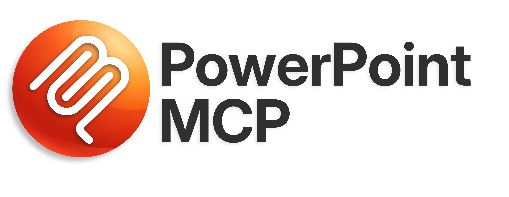
</p>

<p align="center">
  <a href="../README.md">English (en)</a> · <a href="README.ja.md">日本語 (ja)</a> · <a href="README.zh-CN.md">简体中文 (zh-CN)</a> · <a href="README.es.md">Español (es)</a> · <a href="README.pt-BR.md">Português (pt-BR)</a> · <strong>עברית (he)</strong>
</p>

<p align="center">
  <a href="https://www.python.org/"></a>
  <a href="../LICENSE"></a>
  
  <a href="https://pepy.tech/projects/ppt-mcp"></a>
</p>

<div dir="rtl">

<p align="center">
  <strong>שליטה ב־PowerPoint בזמן אמת ב־Windows וב־macOS —<br>שרת MCP עם <!--tools-->157<!--/tools--> כלים לסוכני AI ולמפתחים.</strong>
</p>

---

שרת MCP (Model Context Protocol) שנותן לסוכני AI שליטה מלאה ב־Microsoft PowerPoint פתוח, דרך COM ב־Windows ודרך Apple Events ב־macOS. בניגוד לספריות שעובדות על קבצים, כמו python-pptx, השרת הזה פועל ישירות מול יישום PowerPoint שרץ.

## 🎬 הדגמה

סוכן בונה מצגת בחלון PowerPoint פתוח (פי 15 מהמהירות הרגילה):

https://github.com/user-attachments/assets/178b9b5b-624d-4de0-a1dd-619dc13d4bd7

## ✨ תכונות עיקריות

- **שליטה בזמן אמת** — עובד ישירות על PowerPoint שרץ; השינויים מופיעים מיד על המסך
- **כיסוי רחב** — שקופיות, צורות, טקסט, טבלאות, תרשימים, אנימציות, SmartArt, מדיה, צורות חופשיות ועוד
- **בטוח לסוכני AI** — `ppt_activate_presentation` נועל את כל הכלים על קובץ מסוים, כך שלא ייערך בטעות קובץ אחר
- **אייקונים של [Google Material Symbols](https://fonts.google.com/icons)** — חיפוש בין יותר מ־2,500 אייקונים לפי מילת מפתח והוספתם כ־SVG בצבעי ערכת הנושא
- **צבעי ערכת הנושא** — אפשר להשתמש ב־`accent1`, `accent2` וכו' במקום ערכי RGB קבועים, בכל מקום שבו נקבע צבע של מילוי, קו, צל, זוהר או טקסט; הצורות מתעדכנות כשערכת הנושא משתנה
- **Windows ו־macOS** — אותם כלים, אותם ארגומנטים ואותן תשובות בשתיהן; כש־PowerPoint ל־Mac לא יכול לעשות משהו, הכלי אומר זאת במקום לא לעשות כלום בשקט

## 📋 דרישות

- Windows 11, או macOS עם Apple Silicon או Intel
- Microsoft PowerPoint
- [uv](https://docs.astral.sh/uv/getting-started/installation/)

ב־macOS השרת מפעיל את PowerPoint דרך Apple Events במקום COM. הקריאה הראשונה לכלי מעלה את חלון ההרשאה לאוטומציה של המערכת, וצריך לאשר שם את PowerPoint פעם אחת. תמונות, אייקונים, תבניות, ערכות נושא, תצוגות מקדימות וייצוא עוברים דרך התיקייה של PowerPoint עצמו, ו־macOS 14 ואילך לא נותן ליישומים אחרים לגשת אליה, ולכן היישום שמפעיל את השרת (Terminal, עורך קוד, Claude) צריך הרשאת Full Disk Access עבור הכלים האלה. כשמפעילים מהטרמינל, macOS עלול לסרב בלי לשאול; אז הכלים אומרים איזו הרשאה לתת. צורות, טקסט, טבלאות ותרשימים עובדים בכל מקרה. ההבדלים מפורטים ב[תמיכה ב־macOS](#macos-support).

## 🚀 התחלה

ההגדרה הרגילה — עובדת ב־Claude Desktop, ב־Cursor, ב־`.mcp.json` וברוב לקוחות ה־MCP האחרים:

```json
{
  "mcpServers": {
    "powerpoint": {
      "command": "uvx",
      "args": ["ppt-mcp"]
    }
  }
}
```

### Claude Code

**ברמת המשתמש** (זמין בכל הפרויקטים)
```bash
claude mcp add powerpoint uvx ppt-mcp
```

**ברמת הפרויקט** (נשמר ב־`.mcp.json` ומשותף עם הצוות)
```bash
claude mcp add --scope project powerpoint uvx ppt-mcp
```

### Cursor

[](https://cursor.com/install-mcp?name=ppt-mcp&config=eyJ0eXBlIjoic3RkaW8iLCJjb21tYW5kIjoidXZ4IiwiYXJncyI6WyJwcHQtbWNwIl19)

או הוסיפו ידנית ל־`~/.cursor/mcp.json` את ההגדרה הרגילה שלמעלה.

### Claude Desktop

ערכו את `%APPDATA%\Claude\claude_desktop_config.json` עם ההגדרה הרגילה שלמעלה.

### Codex

ערכו את `~/.codex/config.toml`:

```toml
[mcp_servers.ppt-mcp]
command = "uvx"
args = ["ppt-mcp"]
```

או השתמשו בהגדרת ה־JSON הרגילה שלמעלה ב־`.codex/config.json`.

### VS Code

```bash
code --add-mcp '{"name":"powerpoint","command":"uvx","args":["ppt-mcp"]}'
```

### מקוד המקור

```bash
git clone https://github.com/ykuwai/ppt-mcp.git
cd ppt-mcp
uv sync
```

```json
{
  "mcpServers": {
    "powerpoint": {
      "command": "uv",
      "args": [
        "--directory",
        "C:\\path\\to\\ppt-mcp",
        "run",
        "mcp",
        "run",
        "src/server.py"
      ]
    }
  }
}
```

## 🛠️ קטגוריות הכלים

הרשימה המלאה של הכלים, לפי קטגוריות, נמצאת ב־[TOOLS.md](../TOOLS.md) (באנגלית).

## 💡 דוגמאות לבקשות

פשוט תארו במילים מה אתם רוצים — אין צורך בקוד.

---

**פשוטה** — נושא בלבד

> *"Create a 3-slide intro deck for a productivity app called Flowly."*

<details>
<summary>הצגת השקופיות</summary>
<br>

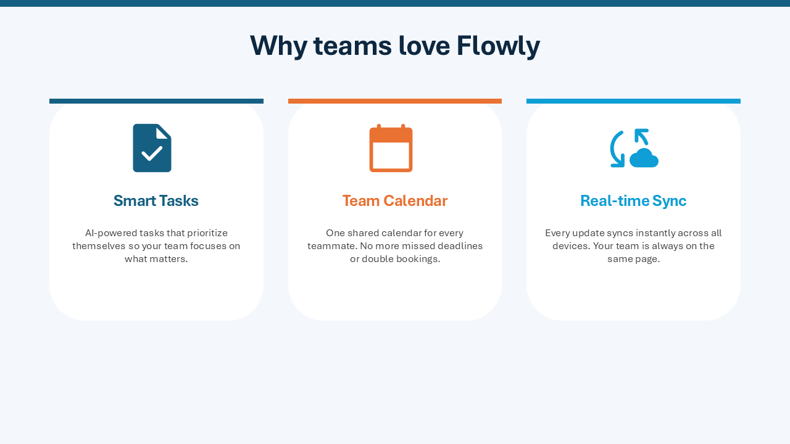

</details>

---

**עם כיוון עיצובי** — נושא וסגנון חזותי

> *"Make a 4-slide presentation on the benefits of async work. Dark navy style, add icons for each benefit."*

<details>
<summary>הצגת השקופיות</summary>
<br>
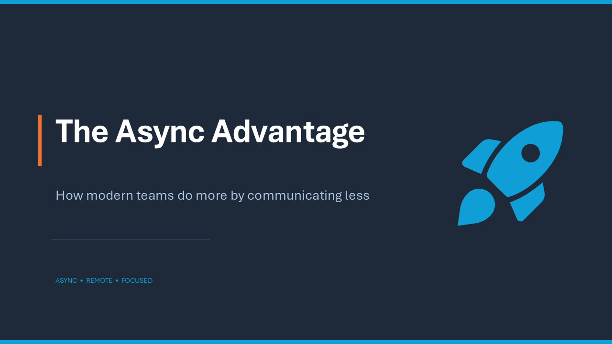
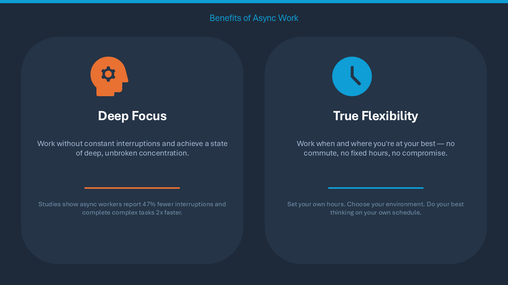
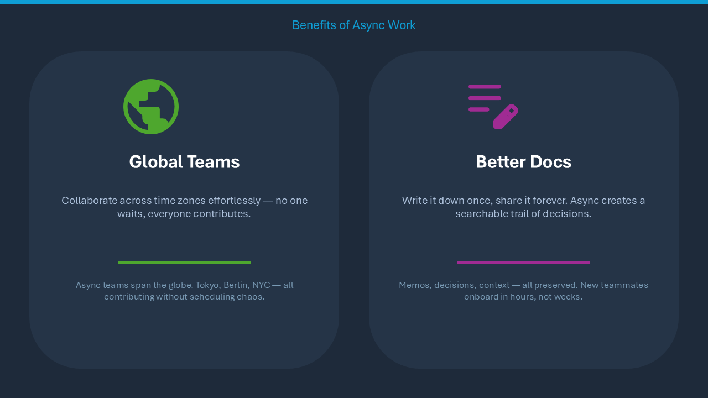
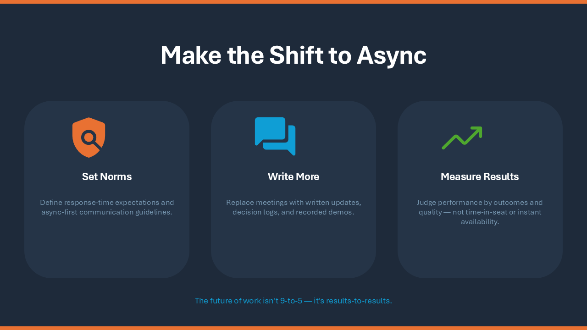
</details>

---

**מפורטת** — נושא, כוונה עיצובית ומבנה השקופיות

> *"Build a 5-slide pitch for an AI note-taking app called NoteAI. White background, teal accent. Slides: title, problem, solution, features with icons, closing."*

<details>
<summary>הצגת השקופיות</summary>
<br>
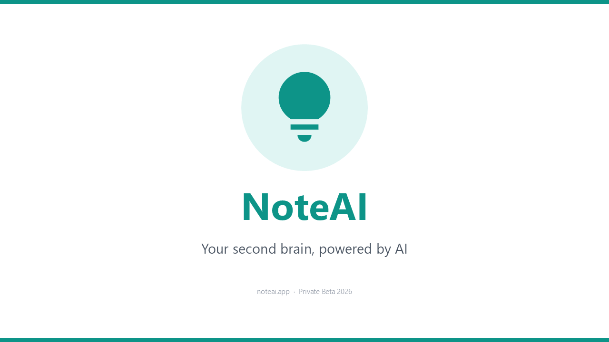
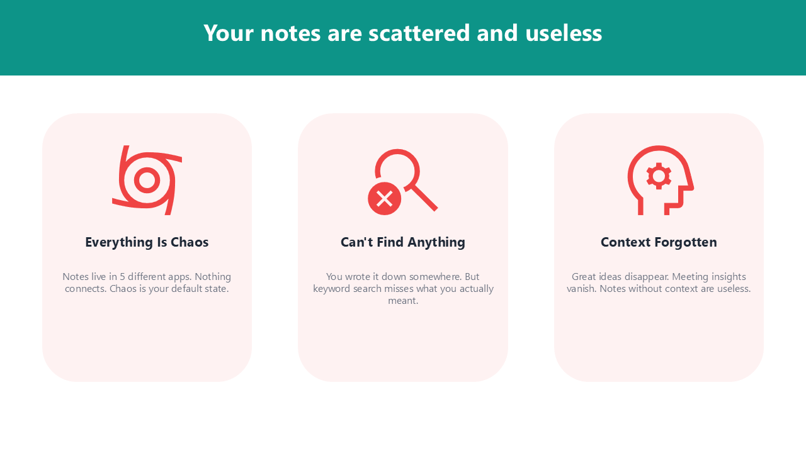
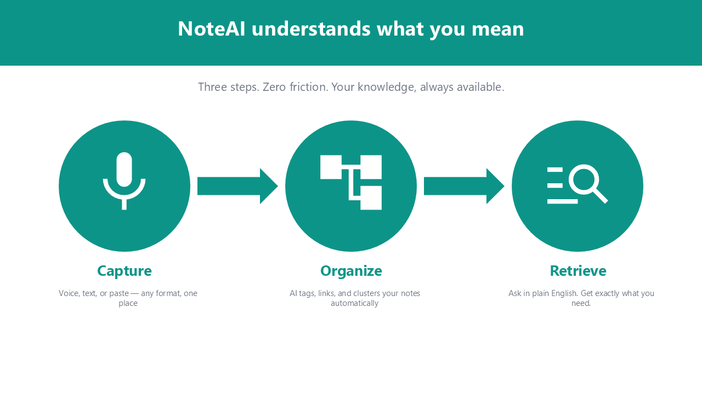
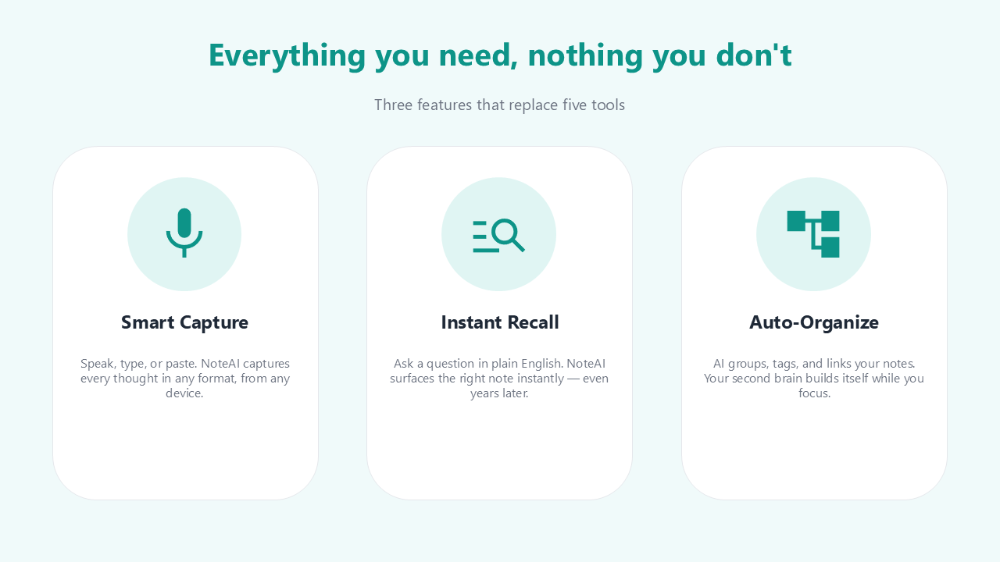
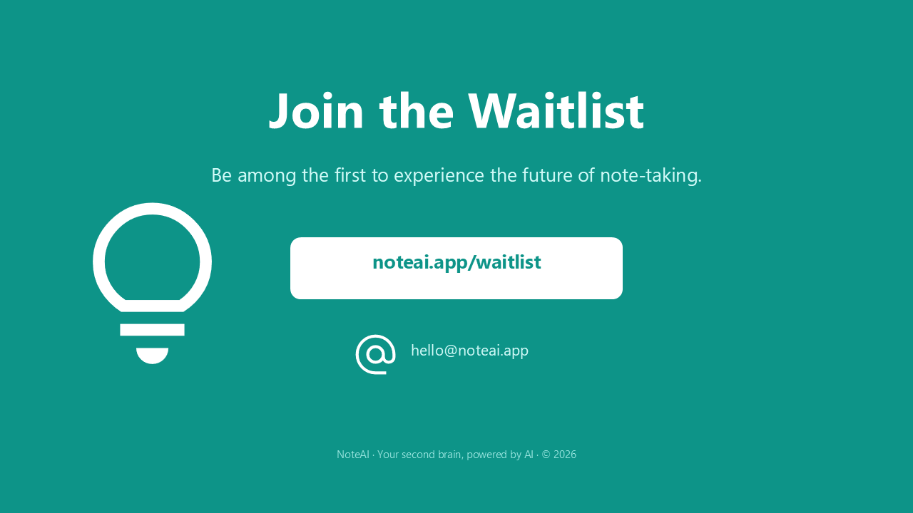
</details>

---

**מילות עיצוב שמשפרות את התוצאה:**

| היבט | מילים וביטויים | מה זה עושה |
|---|---|---|
| **אייקונים** | `add icons` · `icon for each point` · `use icons throughout` | מחפש ב־Google Material Symbols ומוסיף אייקוני SVG חדים באופן אוטומטי |
| **ערכת צבעים** | `dark navy` · `white background` · `monochrome` · `light gray` | קובע את לוח הצבעים ואת האווירה הכללית |
| **צבע הדגשה** | `teal accent` · `blue accent` · `brand color #2563EB` | מחיל צבע הדגשה מסוים על כותרות, אייקונים וצורות |
| **אופי הסגנון** | `modern minimal` · `bold and vibrant` · `clean and professional` · `playful` | מכוון את האופי החזותי הכללי |
| **סוג המצגת** | `pitch deck` · `investor presentation` · `workshop slides` · `status report` | מכוון את הפריסה ואת צפיפות התוכן למטרה |
| **מבנה השקופיות** | `Slides: title, problem, solution, features, CTA` · `4 slides` | קובע מראש את רצף הסיפור ואת מספר השקופיות |
| **פריסה** | `card layout` · `two-column` · `centered` · `full-bleed background` | קובע איך התוכן מסודר בכל שקופית |
| **כמות טקסט** | `minimal text` · `one message per slide` · `bullet points` | קובע כמה טקסט יופיע ובאיזו צורה |
| **רקעים** | `gradient background` · `solid dark background` · `soft light background` | קובע את הרקע בשקופיות |
| **הדגשה** | `highlight key numbers` · `bold headings` · `accent bar on each slide` | מושך את העין למידע החשוב ביותר |

## 🔍 התכונות בפירוט

### 🎯 בחירת מצגת היעד

`ppt_activate_presentation` קובע מצגת יעד לכל הסשן, כך שכל קריאה לכלי אחריו פועלת על הקובץ הזה — לא משנה איזה חלון פעיל ב־PowerPoint. אפשר להחליף יעד בכל רגע על ידי קריאה נוספת.

```python
ppt_activate_presentation(presentation_name="report.pptx")
# All tools now operate on report.pptx
ppt_activate_presentation(presentation_name="demo.pptx")
# Switched — all tools now operate on demo.pptx
```

המצגת שנבחרה היא ערך אחד לכל השרת, ולקוח כמו Claude Desktop מעביר את כל השיחות דרך שרת אחד. כשכמה שיחות עובדות על קבצים שונים באותו זמן, העבירו `presentation` בכל קריאה. הוא חל על הקריאה הזו בלבד, לא משנה את המצגת שנבחרה, ומקבל נתיב מלא, שם קובץ או שם קובץ בלי סיומת. קובץ שאינו פתוח הוא שגיאה, ולעולם לא נופלים במקומו לקובץ אחר.

```python
ppt_add_textbox(params={...}, presentation="report.pptx")
# Lands in report.pptx whatever another conversation has activated
```

### 📁 תבניות

השרת מוצא לבד את תיקיית התבניות האישית של PowerPoint (מהרישום, מ־OneDrive או מהנתיבים הרגילים). `ppt_list_templates` מציג את התבניות הזמינות, ו־`ppt_create_presentation(template_path=...)` יוצר מצגת חדשה מכל אחת מהן.

### 🎨 אייקונים של Google Material Symbols

חפשו בין יותר מ־2,500 אייקונים של [Google Material Symbols](https://fonts.google.com/icons) עם `ppt_search_icons(query="...")` והוסיפו אותם כ־SVG עם `ppt_add_svg_icon`:
- **3 סגנונות**: outlined, rounded, sharp
- **גרסאות מלאות**: `filled=True`
- **צבעי ערכת הנושא**: `color="accent1"` משתמש בצבע ההדגשה של המצגת
- **התאמה אוטומטית**: שומר על יחס הגובה־רוחב בתוך השטח שנקבע

### ⚡ ניווט בזמן אמת

כל פעולת כתיבה מעבירה את PowerPoint לשקופית שבה היא פועלת. רואים את השינויים קורים בזמן אמת — אין צורך לעבור בין שקופיות ידנית.

### ✍️ עיצוב טקסט

- `\n` — מעבר פסקה (Enter). לכל פסקה תבליט ורמת הזחה משלה.
- `\v` — מעבר שורה (Shift+Enter). נשאר באותה פסקה ושומר על העיצוב.
- עיצוב ברמת התו עם `ppt_format_text_range`
- שליטה בהתאמה אוטומטית: הקטנת הטקסט כך שיתאים, שינוי גודל הצורה, או גלישה

### 🎨 ערכות צבעים מוכנות ויצירה אוטומטית

`ppt_set_theme_colors` עובד בשלושה אופנים:
- **17 ערכות מוכנות** — לוחות צבעים נגישים לפי WCAG AA בחמש קטגוריות: Classic (`corporate_blue`, `executive`, `consulting`), Design Systems (`tailwind`, `chakra`, `open_color`, `radix`), Nature (`ocean`, `forest`, `sunset`, `sage`), Modern (`nord_light`, `pastel_deep`, `swiss`), Vibrant (`vivid`, `rainbow`, `neon_safe`)
- **יצירה מצבע ראשי** — נותנים צבע מותג אחד (`primary="#2B579A"`) ומקבלים לוח צבעים שלם והרמוני (split-complementary ו־analogous)
- **ידני** — קובעים כל משבצת צבע בנפרד (`accent1`, `accent2` וכו')

אפשר לשלב: ערכה מוכנה כבסיס ושינוי של משבצות מסוימות. לכל צבעי ההדגשה מובטחת ניגודיות של 3:1 לפחות על רקע לבן.

### 🔍 בדיקת טיפוגרפיה

`ppt_check_typography` מוצא בעיות טיפוגרפיה נפוצות, ואם מבקשים גם מתקן אותן:
- **שורות יתומות** — שורה של 1–3 תווים בודדים שנוצרה משבירת שורה
- **שורות קצרות אחרי מעבר שורה רך** — תוצאה של מעברי שורה ידניים (`\v`)
- **טקסט שהוקטן אוטומטית** — טקסט ש־PowerPoint הקטין בשקט כדי שיתאים

התיקון האוטומטי מרחיב תיבות טקסט ומוסיף מעברי שורה רכים.

### 📐 בדיקת פריסה

`ppt_check_layout` מודד שקופית, או את כל המצגת, ומדווח מה לא תקין במספרים ולא בתמונה, כך שהוא עובד גם כשהמודל לא יכול לקרוא תמונות:
- **מחוץ לשקופית** — צורה, או הטקסט שלה, שחורגת מקצה השקופית
- **גלישה** — טקסט שצריך יותר מקום ממה שהתיבה שלו נותנת
- **חפיפה** — טקסט שנתקל בצורה אחרת או בטקסט אחר, טקסט מעל תאי טבלה או מוסתר מתחת לכרטיס שהונח עליו, וכל מה שהשקופית מוסיפה ונתקל בגרפיקה של התבנית עצמה: הלוגו שלה, פס לאורך הצד, קו כותרת תחתונה
- **ניגודיות נמוכה** — טקסט מול מה שמאחוריו, מתחת למינימום של WCAG לגודל שלו, גם על מעבר צבע
- **טקסט צפוף** — טקסט על כרטיס שנלחץ אל אחד הקצוות שלו
- **שוליים צרים** — צורה שקרובה יותר לצד השקופית מהשוליים ששאר השקופית שומרת
- **לא מיושר** — קצוות במרחק של כמה נקודות זה מזה שנועדו להיות קו אחד
- **ריווח לא אחיד** — שורה או עמודה של צורות דומות עם רווחים לא שווים
- **גדלים לא אחידים** — צורות דומות בשורה שאינן באותו גובה, או בעמודה שאינן באותו רוחב, ושורה שבה כרטיס אחד רחב מעט מהשאר
- **טקסט לדוגמה** — lorem ipsum, ‏"Your title here", ‏"[Company name]" או "XX%" שנשארו מתבנית או מטיוטה
- **מצייני מיקום ריקים**, ובכל המצגת **כותרות** שמשנות גודל, מיקום, יישור, משקל, גופן או צבע משקופית לשקופית. כותרת מיושרת לימין, כמו במצגת בעברית או בערבית, נבדקת לפי הקצה הימני שלה

כל בעיה מציינת את הצורות ואומרת איך לתקן אותה, עם קריאת הכלי והערכים שלה. התיקון שומר על השקופית שלמה ולא רק מעלים את הבעיה: כרטיס גדל יחד עם הריווח הפנימי שלו ועם שאר השורה שלו, וצורה שמוחזרת אל השקופית שומרת על השוליים של השקופית. הכלים שמוסיפים, מעתיקים, מזיזים, משנים גודל, מיישרים, מפזרים או משנים טקסט של צורה, או ממלאים מציין מיקום, בודקים גם הם את הצורה שבה נגעו ומדווחים על בעיה בתשובה שלהם, תחת `layout_issues`, כך שהיא נתפסת בקריאה שגרמה לה. רקע שקופית חדש, או מילוי חדש מתחת לטקסט, מדווח על טקסט שקשה עכשיו לקרוא, ושינוי של כל המצגת, ערכת הנושא, צבעי ערכת הנושא, גופנים או גודל השקופית, מדווח על מה שהוא שבר ושלא היה שבור קודם.

כל אחת מהבדיקות האלה קוראת מחדש את השקופית, מה שמוסיף רגע לכל כתיבה, וב־Mac יותר. כדי להשאיר את הבדיקה ל־`ppt_check_layout` בלבד, קבעו `PPT_LAYOUT_CHECKS=off` ב־`env` של השרת; ההוראות של השרת יאמרו אז למודל להריץ אותו אחרי כל כמה שינויים. הערכים האפשריים הם `on` (ברירת המחדל) ו־`off`; כל ערך אחר נדחה עם אזהרה והבדיקות נשארות פעילות. שינוי של כל המצגת (ערכת נושא, צבעי ערכת הנושא, גופן, גופני ברירת מחדל, גודל שקופית) קורא כל שקופית לפני ואחרי. במצגת של יותר מ־300 צורות הוא אינו קורא אף אחת מהן, כי הקריאה הייתה ארוכה מהשינוי עצמו, ואומר זאת ב־`layout_check_skipped`, ומשאיר את הבדיקה ל־`ppt_check_layout`. כלי הכתיבה בודקים רק את הכלים שנמנו למעלה; ריווח פסקאות, תבליטים, חיתוך תמונות, קיבוץ, SmartArt, נתוני תרשים, העתקת שקופית ומחיקה או פיצול של תאי טבלה אינם נבדקים.

במצגת שנבנתה מתבנית, התבנית היא חלק מהבדיקה. הגרפיקה שהשקופית הראשית והפריסות שלה מציירות נקראת, כך שתרשים שגודלו נקבע מעל הלוגו או הערת שוליים על קו הסודיות מדווחים, ומה שהתבנית עיצבה נחשב מכוון: מציין מיקום שעדיין בצבעי ערכת הנושא, או הכותרת הקטנה יותר של פריסת כיתוב, אינם נמדדים מול השאר, ובמצגת עם שני עיצובים הכותרות של כל עיצוב מושוות רק זו לזו. צבעי ערכת נושא שנקבעו עם `ppt_set_theme_colors` הם של מי שקרא לכלי, ולכן הקריאה הזו בודקת גם את מצייני המיקום שבהם, וכך גם כל בדיקה מאוחרת יותר ברגע שצבע הטקסט של ערכת הנושא כבר לא קריא על הרקע שלו. PowerPoint ל־Mac חושף את הגרפיקה של השקופית הראשית אבל לא של פריסה, ולכן שם העיצוב של פריסה נלקח בחשבון דרך מצייני המיקום שלה.

## ⚙️ הגדרות מתקדמות

### חלונות דו־שיח של PowerPoint

כש־PowerPoint מציג חלון דו־שיח מודאלי (למשל בחירת פריסת SmartArt, חלון שמירה, חלון הוספה), קריאות COM מחזירות `RPC_E_CALL_REJECTED`. שרת ה־MCP **מנסה שוב אוטומטית עד 15 שניות** (5 ניסיונות × 3 שניות), כך שהשרת נשאר מחובר ומגיב גם כשחלון חוסם את PowerPoint.

**סגירה אוטומטית (לפי בחירה):** כברירת מחדל השרת מחכה שתסגרו את החלון בעצמכם. כדי שהשרת ישלח ESC אוטומטית בניסיון הראשון — ויסגור את החלון בלי מגע יד — קבעו `PPT_AUTO_DISMISS_DIALOG=true`:

```json
{
  "mcpServers": {
    "powerpoint": {
      "command": "uvx",
      "args": ["ppt-mcp"],
      "env": {
        "PPT_AUTO_DISMISS_DIALOG": "true"
      }
    }
  }
}
```

ESC מבטל בלי לאשר דבר, כך שאין לו תופעות לוואי הרסניות. זה שימושי במיוחד בתהליכים אוטומטיים שבהם אין אדם שיסגור את החלונות.

### PowerPoint שהשרת מפעיל

אם PowerPoint לא רץ כשכלי צריך אותו (`ppt_create_presentation`, `ppt_open_presentation`, `ppt_connect`), השרת מפעיל אותו. ב־macOS הוא נפתח ברקע ולא לוקח את החזית מהיישום שבו אתם עובדים.

כשסגירה משאירה את PowerPoint שהשרת הפעיל בלי אף מצגת פתוחה, `ppt_close_presentation` סוגר גם את PowerPoint ואומר זאת (`powerpoint_quit`). PowerPoint שהפעלתם בעצמכם לעולם לא נסגר, וגם לא כזה שעדיין יש בו מצגת פתוחה (ב־Windows, גם קובץ שפתוח בתצוגה מוגנת). העבירו `keep_powerpoint_open=true` כדי להשאיר אותו פתוח, למשל כדי לפתוח מיד מצגת אחרת. עד שכלי יפעיל את PowerPoint שוב, כלים שצריכים אותו עונים ש־PowerPoint לא רץ, במקום לדווח על רשימה ריקה. ב-Windows, קובץ שפתוח בתצוגה מוגנת מופיע ב-`ppt_list_presentations` תחת `protected_view`, ו-`ppt_close_presentation` סוגר אותו לפי שמו, בלי לשמור.

### עבודה באותה מצגת עם המודל

כל כתיבה מעבירה את חלון המצגת לשקופית שהיא עובדת עליה, כדי שתראו איפה המודל נמצא. כדי לעבוד במצגת בעצמכם באותו זמן, בלי שהחלון יקפוץ לשקופית אחרת, קבעו `PPT_FOLLOW_EDITS=off` ב־`env` של השרת. העריכות נכנסות באותה דרך; רק החלון נשאר במקום שהשארתם אותו. `ppt_goto_slide` עדיין מזיז אותו כשמבקשים. הערכים האפשריים הם `on` (ברירת המחדל) ו־`off`; כל ערך אחר נדחה עם אזהרה. בזמן שאתם מקלידים בתיבת טקסט PowerPoint עשוי לעכב לרגע את הקריאה של המודל, והביטול (Ctrl+Z) משותף, כך שהוא יכול לבטל את השינוי האחרון של המודל.

```json
"env": { "PPT_FOLLOW_EDITS": "off" }
```

### אייקונים ברשת שחוסמת את אתרי האייקונים

`ppt_search_icons` קורא את רשימת האייקונים מ־`fonts.google.com`, ו־`ppt_add_svg_icon` מוריד אייקונים מ־`cdn.jsdelivr.net`. כל הורדה, כולל תמונות מכתובת URL, מוותרת אחרי 15 שניות ואומרת לאיזה שרת לא הצליחה להגיע. שלוש הגדרות משנות את זה:

| הגדרה | ברירת מחדל | מה היא עושה |
|---|---|---|
| `PPT_ICON_BASE_URL` | `https://cdn.jsdelivr.net/npm/@material-symbols/svg-400@0.31.3` | מאיפה מגיעים האייקונים. כל כתובת עם מבנה החבילה (`<base>/outlined/home.svg`) עובדת: אתר מראה כמו `https://unpkg.com/@material-symbols/svg-400@0.31.3`, או עותק מקומי של החבילה בצורה `file:///path/to/svg-400`. |
| `PPT_ICON_METADATA_URL` | `https://fonts.google.com/metadata/icons` | מאיפה מגיעה רשימת האייקונים. שמרו את הדף הזה פעם אחת והפנו את ההגדרה לעותק, בצורה `file:///path/to/icons.json`. |
| `PPT_DOWNLOAD_TIMEOUT` | `15` | כמה שניות לחכות לתשובה משרת. ערך שאינו מספר חיובי נדחה (ומשתמשים ב־15). |

```json
{
  "mcpServers": {
    "powerpoint": {
      "command": "uvx",
      "args": ["ppt-mcp"],
      "env": {
        "PPT_ICON_BASE_URL": "https://unpkg.com/@material-symbols/svg-400@0.31.3"
      }
    }
  }
}
```

### רשימת הכלים: מצב קטלוג

לקוח שולח עם כל בקשה את התיאור של כל כלי שהוא מציג, והכלים של השרת הזה מגיעים לכ־112 אלף טוקנים — חלק גדול מחלון של 128 אלף או 200 אלף עוד לפני שהעבודה מתחילה. עם `PPT_TOOL_MODE=catalog` ב־`env` של השרת, השרת מציג במקומם שלושה כלים, כ־700 טוקנים, והמודל מגיע אל השאר דרכם:

| כלי | מה הוא עושה |
|---|---|
| `ppt_describe` | בלי שמות: רשימת כל הכלים, שורה לכל אחד. עם שמות: התיאור המלא והארגומנטים שלהם. |
| `ppt_run` | מריץ כלי אחד: `{"tool": "ppt_add_textbox", "params": {...}}`. |
| `ppt_run_steps` | מריץ כמה כלים לפי הסדר, בקריאה אחת. שלב יכול להשתמש במה ששלב קודם ענה: `"$prev.shape_name"` הוא ה־`shape_name` של השלב הקודם, ו־`"$2.shape_name"` של השלב השני. השלב הראשון שנכשל עוצר את הריצה ואומר למה. |

הכלים עצמם זהים, עם אותם ארגומנטים, אותן בדיקות ואותן תשובות, ו־`presentation` מועבר באותה דרך. המודל שואל את `ppt_describe` לפני שהוא משתמש בכלי בפעם הראשונה, מה שעולה קריאה אחת. כשבנינו את אותה מצגת של 12 שקופיות דרך Claude Code, ההקשר הגיע לשיא של 136 אלף טוקנים במצב קטלוג לעומת 206 אלף כשכל הכלים הוצגו, והריצה עלתה כשליש פחות.

מה שמצב קטלוג מוותר עליו הוא שליטה ברמת הכלי בלקוח: אישור או חסימה של כלי לפי שמו, וסימון קריאה־בלבד שלו, חלים על שלושת הכלים שלמעלה ולא על כל כלי. לכן זו אינה ברירת המחדל: בלי ההגדרה כל כלי מוצג בשמו, כמו קודם, וזה גם מה ש־`PPT_TOOL_MODE=full` אומר. ערך שאינו `catalog` או `full` נדחה עם אזהרה, וכל הכלים מוצגים.

```json
{
  "mcpServers": {
    "powerpoint": {
      "command": "uvx",
      "args": ["ppt-mcp"],
      "env": { "PPT_TOOL_MODE": "catalog" }
    }
  }
}
```

<a id="macos-support"></a>

## 🍎 תמיכה ב־macOS

**<!--mac-refusals-->10<!--/mac-refusals--> כלים מסרבים ב־macOS. כל השאר עובדים.** שמות <!--mac-refusals-->10<!--/mac-refusals--> הכלים מופיעים
ב־[MACOS_PORT.md](../MACOS_PORT.md), סעיף 6.1, ובדיקה אוטומטית מוודאת שהרשימה מעודכנת.

אותם כלים, אותם ארגומנטים, אותן תשובות. מה שמשתנה הוא מה שמילון הסקריפטים
של PowerPoint ל־Mac יכול להגיע אליו, וכשהוא לא יכול להגיע למשהו, הכלי אומר זאת
במקום לעשות משהו לא צפוי.

**ה־VBA של PowerPoint ל־Mac מגיע רחוק יותר, ואפשר להפעיל אותו.** השרת טוען
ל־PowerPoint תוספת קטנה, `ppt-mcp-bridge`, ומריץ דרכה את הקוד של Windows עבור מה
שאין לו מילים במילון הסקריפטים: תגיות, `ppt_select_shapes`, `ppt_set_table_style`,
הסרה והעתקה של אנימציה אחת, סוג העריכה של נקודה בצורה חופשית, כלי העיצוב, הצירים, הסדרות, הסוג והנתונים של תרשים (הנתונים דרך חוברת ה־Excel של
התרשים, שנפתחת ב־Excel לרגע, כמו ב־Windows), כלי
הנקודות של צורה חופשית והקיבוץ, טקסט בתוך קבוצה, פריסות של תבנית לפי שם, שכפול
והעתקה של שקופיות, עריכת SmartArt (טקסט, צמתים, צבעים וסגנון), והארגומנטים
שה־Mac דוחה אחרת (טיפ מסך, שורה או
עמודה בטבלה במיקום מסוים, אנימציה שמתחילה בלחיצה על צורה אחרת, גדלי ההשתקפות,
זוהר, צל והשתקפות על הטקסט, כיווץ טקסט כדי שייכנס, עוצמת שמע, השתקה ועמעום,
סגנון תרשים ומיקום המקרא והכותרת). הכלים האלה עורכים את הצורה במקומה, כך
שהאנימציות שלה נשמרות, ואין נגיעה בלוח. התוספת רק מעבירה את הקריאות האלה הלאה; קוד
המקור שלה נמצא ב־`src/backend/vba`. PowerPoint טוען אותה בלי לשאול, היא נשארת עד
ש־PowerPoint נסגר ולא משאירה אחריה כלום. כשאי אפשר לטעון אותה, למשל כשמדיניות
מכבה מאקרו, הכלים עובדים כמתואר למטה. היא כבויה כברירת מחדל,
כי זה קוד מאקרו שנטען בלי שאלה. הגדירו `PPT_MAC_VBA=on` ב־`env` של השרת כדי
להשתמש בה.

לא זמין ב־macOS:

- **בלי התוספת, סוג העריכה של נקודה בצורה חופשית.** פינה, חלקה וסימטרית אינם שמורים בשום מקום
  שסקריפט מגיע אליו; הזיזו במקום זאת את הידיות של הנקודה.
- **`ppt_execute_mso`**, ובלי התוספת גם **תגיות, `ppt_select_shapes`,
  `ppt_set_table_style` והסרת אנימציה אחת** (ניקוי כל האנימציות של שקופית עובד).
  שום דבר במילון לא מגיע אליהם.

הבדלים קטנים יותר:

- **קראו לכלים בזה אחר זה, לא לכמה באותו תור.** רק בקשה אחת בכל פעם מגיעה
  ל־PowerPoint, כך שהשאר עומדות בתור מאחוריה ויוצאות בסדר שבו הגיעו. קריאה
  שמחכה זמן רב מדי נלקחת בחזרה ואומרת זאת, בלי ששינתה דבר.
- בלי התוספת, כמה כלים מקבלים ארגומנט שאין לו מקבילה, למשל טיפ מסך על קישור. הם מסרבים
  עם הודעה שמציינת את הארגומנט, כך שהשמטה שלו וניסיון חוזר עובדים.
- **וידאו ושמע מוטמעים תמיד ולעולם לא מקושרים**, ומתוך שמונה הגדרות ההפעלה קיימות
  רק לולאה והסתרת המסגרת, ועם התוספת גם עוצמת שמע, השתקה ועמעום. הסתרת המסגרת נדחית בשקופית שכבר יש בה אנימציות,
  כי כתיבה שלה כותבת אותן מחדש.
- הייצוא עובר דרך המכל של PowerPoint עצמו ומשם מועבר החוצה, כי היישום רץ
  בארגז חול ואינו יכול לכתוב לכל תיקייה.
- **בלי התוספת, הפריסות של תבנית נמצאות לפי שם בקובץ השמור של המצגת**, ולכן
  שמרו מצגת חדשה לפני שמבקשים מ־`ppt_add_slide` פריסה לפי שם. PowerPoint ל־Mac
  לא חושף שמות של פריסות לסקריפט, ולכן השקופית מודבקת על הפריסה שלה, וזה לוקח
  בערך שנייה. עם התוספת הפריסה נמצאת במצגת הפתוחה, שמורה או לא.
- תמונות של שקופיות מרונדרות מ־PDF ולא מיוצאות כ־PNG. תצוגה מקדימה היא
  2 פיקסלים לנקודה בשתי הפלטפורמות.
- הסכמה לאוטומציה שייכת ליישום שהפעיל את השרת, כך שהפעלה מטרמינל או מעורך
  אחר מעלה שוב את חלון ההרשאה.
- שמרו את המצגת מוקדם ובכל הפסקה. זה לא עולה כלום, ו־PowerPoint נראה סוגר את
  כל המסמכים הפתוחים ויוצא כשחלון הרשאה של ארגז החול עלה מאחורי סקריפט
  ([#191](https://github.com/ykuwai/ppt-mcp/issues/191)).
- **הוספת תרשים עוברת דרך הלוח**, ובלי התוספת גם שאר כלי
  התרשים, הצורות החופשיות והקיבוץ. הפעולה לוקחת את הלוח לרגע ומחזירה את מה שהיה
  בו. כך הם מגיעים למילון שאין בו מילים עבורם.
  PowerPoint ל־Mac מדביק לחלון הקדמי שלו, ולכן כששתי מצגות פתוחות הם עובדים על
  המצגת שבחלון הקדמי; לגבי האחרת הכלי אומר זאת ולא משנה דבר, ו־`ppt_activate_presentation`
  מביא אותה קדימה.
- **בלי התוספת, עריכה של תרשים או צורה חופשית קיימים יוצרת את הצורה מחדש**,
  ועם התוספת, קביעת הגדלים של תרשים בועות עדיין עושה זאת. כלי הנתונים,
  הסוג, הכותרת, המקרא, הצירים והסדרות של תרשים, וכלי הנקודות, מעתיקים את הצורה,
  כותבים אותה מחדש ומדביקים אותה בחזרה, ואז מוחקים את המקורית. השם, המיקום
  וסדר השכבות נשמרים; אנימציות על הצורה לא, והתשובה אומרת כמה אבדו. בלי
  התוספת, כמה ארגומנטים של עיצוב שתלויים בגודל המרונדר של התרשים (`chart_style`, הקואורדינטות
  של המקרא והכותרת, שמונת כיווני המקרא המוכנים) נדחים בשמם.
- **לטקסט בתוך קבוצה** מגיעים לפי שם הצורה או לפי הנתיב שלה (`"Group 4/TextBox 3"`),
  עם `ppt_set_text` (כל הטקסט, או קטע בתוך שורה אחת) ו־`ppt_format_text`. עם התוספת
  הצורה נערכת במקומה. בלעדיה הקבוצה מועתקת, הצורה נכתבת מחדש והקבוצה מודבקת
  בחזרה: השמות של הצורות שבתוכה נשמרים, והאנימציות של הקבוצה אובדות, כמו למעלה.
- אייקונים מומרים לתמונה עם `sips` לפני שהם מוכנסים, כי PowerPoint ל־Mac לא יכול
  לקרוא SVG. זה דורש macOS 13 ואילך; מערכות ישנות יותר מקבלות סירוב שמציין את
  הסיבה ולא תיבה ריקה.

## 🤝 תרומה

בקשות משיכה יתקבלו בברכה. בססו אותן על `develop`, נושא אחד בכל אחת, עם בדיקות; השאר ב־[CONTRIBUTING.md](../CONTRIBUTING.md) (באנגלית).

## 📄 רישיון

MIT

## 🙏 תודות

- [FastMCP](https://github.com/jlowin/fastmcp) — תשתית Python לשרתי MCP
- [pywin32](https://github.com/mhammond/pywin32) — אוטומציית COM ב־Windows
- [appscript](https://github.com/hhas/appscript) — גשר Apple Events ב־macOS
- [Model Context Protocol](https://modelcontextprotocol.io/) — מאת Anthropic

</div>
