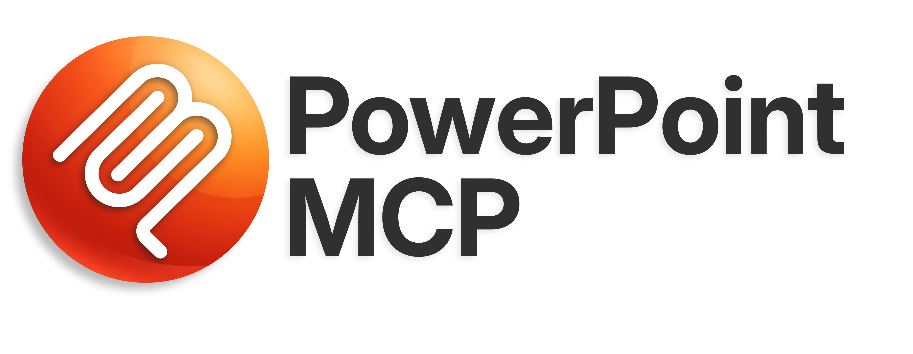
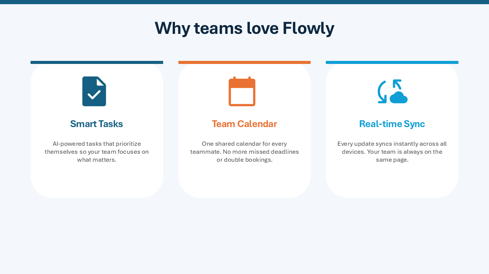
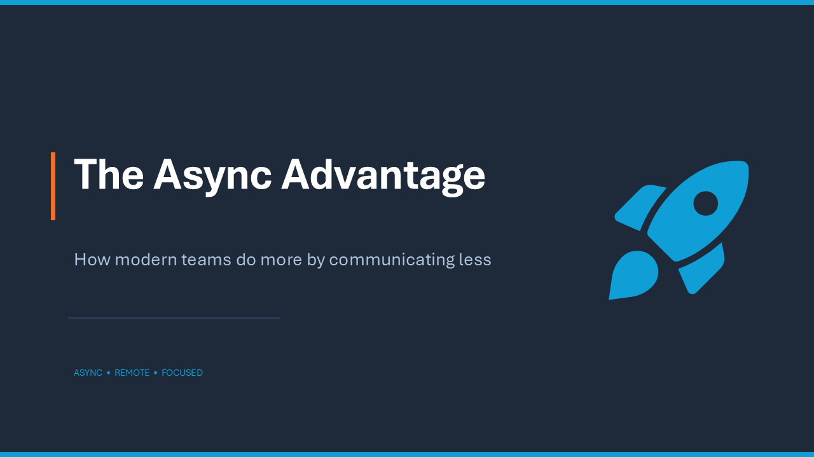
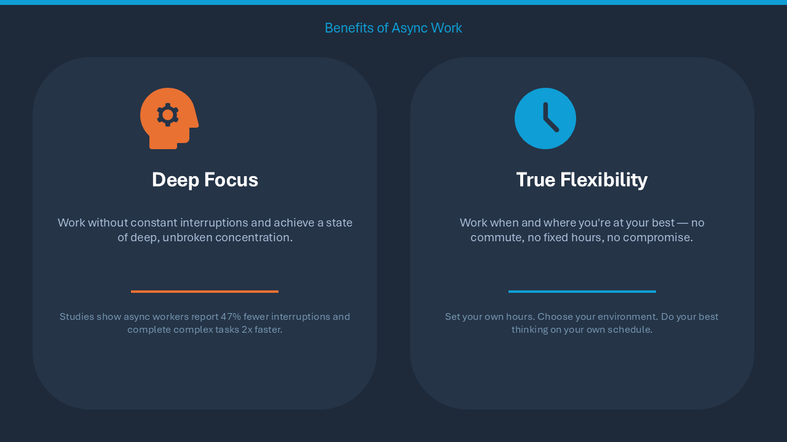
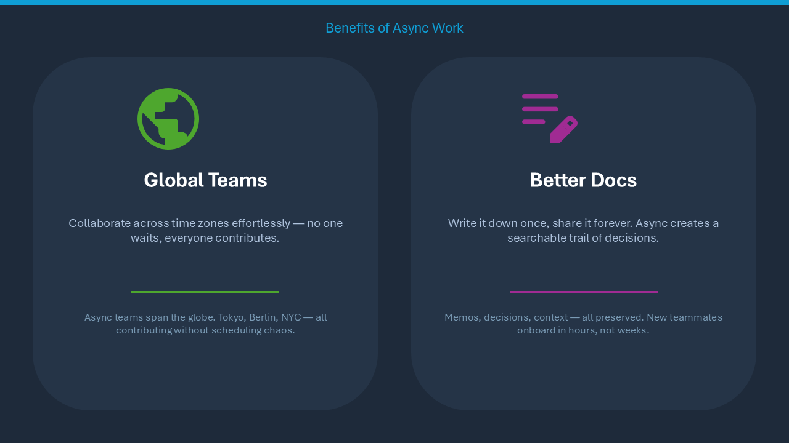
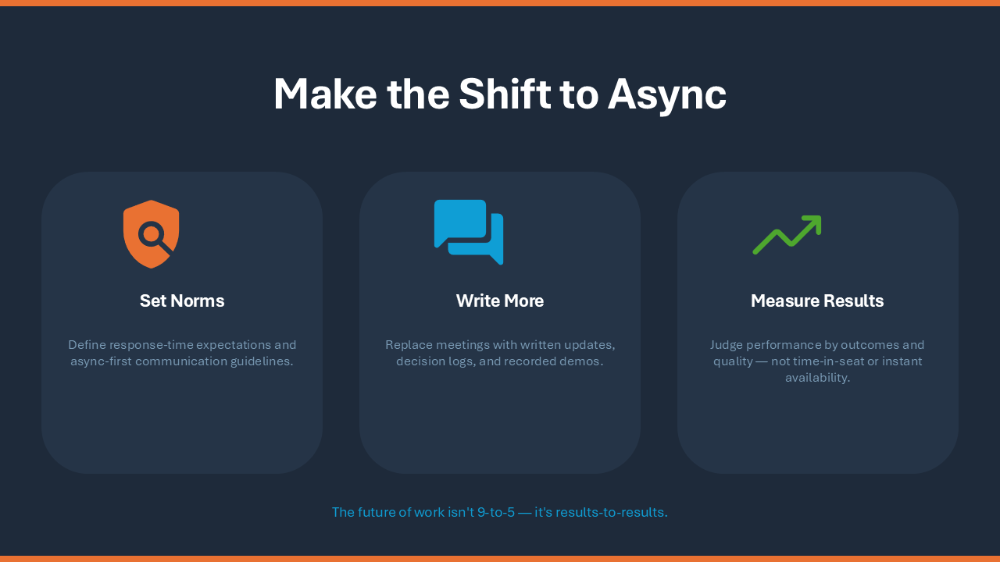
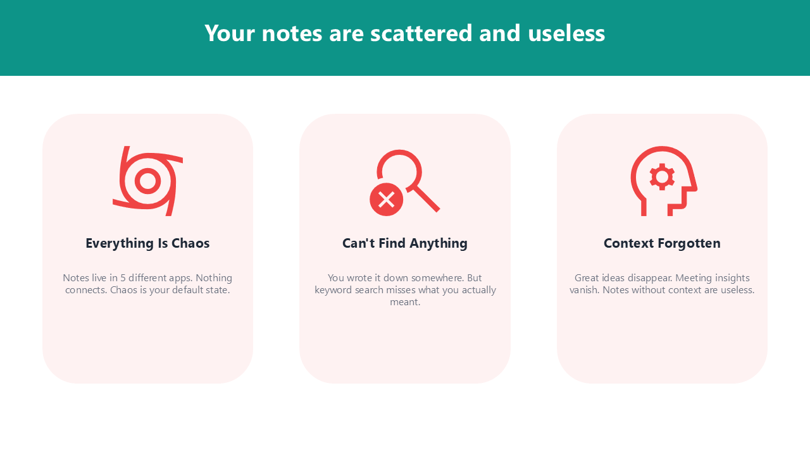
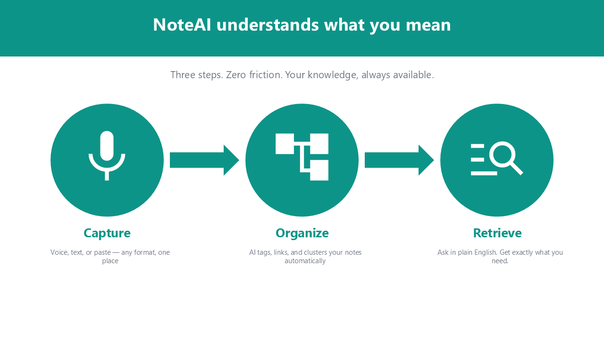
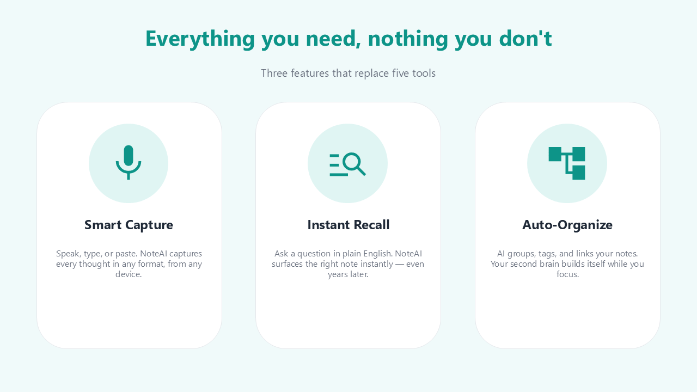
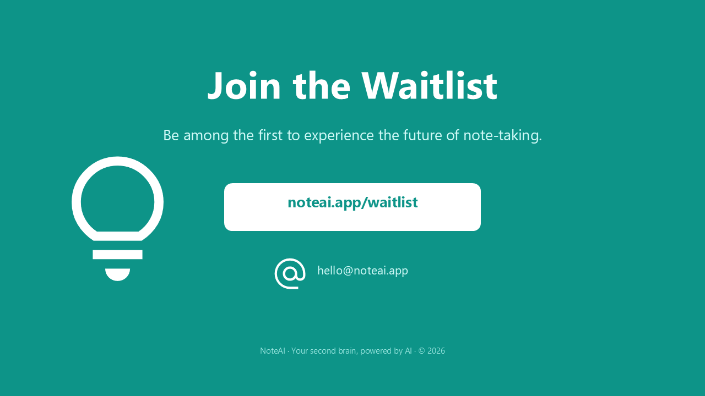

<p align="center">
  
</p>

<p align="center">
  <a href="../README.md">English (en)</a> · <strong>日本語 (ja)</strong> · <a href="README.zh-CN.md">简体中文 (zh-CN)</a> · <a href="README.es.md">Español (es)</a> · <a href="README.pt-BR.md">Português (pt-BR)</a> · <a href="README.he.md">עברית (he)</a>
</p>

<p align="center">
  <a href="https://www.python.org/"></a>
  <a href="../LICENSE"></a>
  
  <a href="https://pepy.tech/projects/ppt-mcp"></a>
</p>

<p align="center">
  <strong>WindowsとmacOSで動くPowerPointのリアルタイム制御 —<br>AIエージェントと開発者のための<!--tools-->157<!--/tools-->ツールを備えたMCPサーバー</strong>
</p>

---

起動中のPowerPointを完全に制御するMCP（Model Context Protocol）サーバーです。WindowsではCOM、macOSではApple Events経由で操作します。python-pptxのようなファイルベースのライブラリとは異なり、起動中のPowerPointアプリケーションと直接やり取りします。

## 🎬 デモ

エージェントが実際の PowerPoint ウィンドウでスライドを作成する様子（15倍速）:

https://github.com/user-attachments/assets/178b9b5b-624d-4de0-a1dd-619dc13d4bd7

## ✨ 主な特徴

- **リアルタイム制御** — 起動中のPowerPointを直接操作。変更がその場で画面に反映される
- **幅広い機能** — スライド、シェイプ、テキスト、テーブル、グラフ、アニメーション、SmartArt、メディア、フリーフォームパスなど
- **AIエージェントに安全** — `ppt_activate_presentation` で操作対象ファイルを固定。誤って別のプレゼンを編集するミスを防止
- **[Google Material Symbols](https://fonts.google.com/icons) アイコン** — 2,500以上のアイコンをキーワード検索し、テーマカラーでSVG挿入
- **テーマカラー連携** — 塗りつぶし・線・影・光彩・文字の色を、RGB値のハードコードではなく `accent1`、`accent2` などのテーマカラー名で指定。テーマを変えると図形の色も追従
- **WindowsとmacOSに対応** — ツール名も引数も返り値も両者で同一。PowerPoint for Macで届かない操作は、黙って何もせずそう答える

## 📋 動作環境

- Windows 11、または macOS（Apple Silicon と Intel のどちらも可）
- Microsoft PowerPoint
- [uv](https://docs.astral.sh/uv/getting-started/installation/)

macOS では COM ではなく Apple Event で PowerPoint を動かします。最初のツール
呼び出しで OS の自動化の許可を求めるダイアログが出るので、そこで PowerPoint を
一度許可してください。画像・アイコン・テンプレート・テーマ・プレビュー・エクスポートは
PowerPoint 専用のフォルダーを経由しますが、macOS 14 以降は他のアプリがこのフォルダーに
入ることを許しません。そのため、これらのツールにはサーバーを起動するアプリ（ターミナル、
エディター、Claude など）にフルディスクアクセスが必要です。ターミナルから起動すると
macOS が確認なしに拒否することがあり、その場合はツールが何を許可すればよいかを返します。
図形・テキスト・表・グラフはこの許可がなくても動きます。違いは
[macOS 対応](#-macos-対応) にまとめてあります。

## 🚀 はじめかた

ほとんどの MCP クライアント（Claude Desktop、Cursor、`.mcp.json` など）で使える標準設定：

```json
{
  "mcpServers": {
    "powerpoint": {
      "command": "uvx",
      "args": ["ppt-mcp"]
    }
  }
}
```

### Claude Code

**ユーザースコープ**（全プロジェクトで利用可能）
```bash
claude mcp add powerpoint uvx ppt-mcp
```

**プロジェクトスコープ**（`.mcp.json` に保存、チームで共有可能）
```bash
claude mcp add --scope project powerpoint uvx ppt-mcp
```

### Cursor

[](https://cursor.com/install-mcp?name=ppt-mcp&config=eyJ0eXBlIjoic3RkaW8iLCJjb21tYW5kIjoidXZ4IiwiYXJncyI6WyJwcHQtbWNwIl19)

または `~/.cursor/mcp.json` に上記の標準設定を追加。

### Claude Desktop

`%APPDATA%\Claude\claude_desktop_config.json` に上記の標準設定を追加。

### Codex

`~/.codex/config.toml` を編集：

```toml
[mcp_servers.ppt-mcp]
command = "uvx"
args = ["ppt-mcp"]
```

または上記の標準設定を `.codex/config.json` に記述しても動作します。

### VS Code

```bash
code --add-mcp '{"name":"powerpoint","command":"uvx","args":["ppt-mcp"]}'
```

### ソースから実行

```bash
git clone https://github.com/ykuwai/ppt-mcp.git
cd ppt-mcp
uv sync
```

```json
{
  "mcpServers": {
    "powerpoint": {
      "command": "uv",
      "args": [
        "--directory",
        "C:\\path\\to\\ppt-mcp",
        "run",
        "mcp",
        "run",
        "src/server.py"
      ]
    }
  }
}
```

## 🛠️ ツール一覧

ツールの全一覧は、カテゴリごとに [TOOLS.md](../TOOLS.md)（英語）にまとめています。

## 💡 プロンプト例

日本語でそのまま伝えるだけ — コードは不要です。

---

**シンプル** — テーマだけ指定

> *「Flowlyというアプリの紹介スライドを3枚作って。」*

<details>
<summary>スライドを見る</summary>
<br>



</details>

---

**スタイル指定あり** — テーマ＋ビジュアルの方向性

> *「非同期ワークのメリットについて4枚スライドを作って。ダークネイビースタイルで、各メリットにアイコンを入れて。」*

<details>
<summary>スライドを見る</summary>
<br>




</details>

---

**詳細指定** — テーマ＋デザインイメージ＋スライド構成

> *「NoteAIというAIメモアプリの5枚ピッチを作って。白背景・ティールアクセント。スライド構成：タイトル・課題・解決策・機能（アイコン付き）・クロージング。」*

<details>
<summary>スライドを見る</summary>
<br>





</details>

---

**クオリティを上げるデザインキーワード：**

| 観点 | 単語やフレーズ例 | 詳細 |
|---|---|---|
| **アイコン** | `アイコンを入れて` · `各ポイントにアイコン` · `全スライドにアイコン` | Google Material Symbols を自動検索してSVGアイコンを配置 |
| **カラースキーム** | `ダークネイビー` · `白背景` · `モノクロ` · `ライトグレー` | 全体のカラーパレットと雰囲気を設定 |
| **アクセントカラー** | `ティールアクセント` · `ブルーアクセント` · `ブランドカラーは #2563EB` | 見出しやアイコン、図形に適用する強調色を指定 |
| **スタイル・トーン** | `モダンでミニマル` · `ビビッドでインパクト重視` · `クリーンでプロフェッショナル` · `カジュアル` | デザイン全体のテイストを指定 |
| **用途・目的** | `ピッチデッキ` · `投資家向けプレゼン` · `ワークショップ資料` · `進捗報告` | 目的に応じたレイアウトとコンテンツ密度に誘導 |
| **スライド構成** | `構成：タイトル・課題・解決策・機能・CTA` · `4枚で` | 構成とスライド数を最初に明示 |
| **レイアウト** | `カードレイアウト` · `2カラム` · `センタリング` · `全面背景` | 各スライドのコンテンツ配置を指定 |
| **テキスト量** | `テキストは最小限` · `1スライド1メッセージ` · `箇条書き` | 情報量とテキストスタイルを制御 |
| **背景** | `グラデーション背景` · `ダーク単色背景` · `ソフトな明るい背景` | 背景の処理を全体に指定 |
| **強調** | `数字を強調` · `太い見出し` · `各スライドにアクセントバー` | 重要な情報への視線の誘導を指定 |

## 🔍 機能の詳細

### 🎯 プレゼンテーション操作対象の指定

`ppt_activate_presentation` でセッションレベルの操作対象を設定すると、以降のすべてのツールがそのファイルに対して動作します。PowerPointのウィンドウが切り替わっても影響を受けません。再度呼び出すことで対象を切り替えられます。

```python
ppt_activate_presentation(presentation_name="report.pptx")
# 以降のツールはすべて report.pptx を操作
ppt_activate_presentation(presentation_name="demo.pptx")
# 切り替え — 以降は demo.pptx を操作
```

操作対象はサーバー全体で1つだけです。Claude Desktop のように、1つのサーバーにすべての会話を通すクライアントもあります。複数の会話で別々のファイルを同時に扱うときは、各呼び出しに `presentation` を渡してください。その呼び出しだけに効き、アクティブ化済みの操作対象は変わりません。フルパス、ファイル名、拡張子なしのファイル名のいずれでも指定できます。開いていないファイルを指定するとエラーになり、別のファイルに処理が流れることはありません。

```python
ppt_add_textbox(params={...}, presentation="report.pptx")
# 他の会話が何をアクティブ化していても report.pptx に追加される
```

### 👥 他のユーザーと同時に編集されるファイル（Windows）

SharePoint や OneDrive から開いたプレゼンテーションは、サーバーが操作している間にも他のユーザーが編集できます。自動保存がオフの場合、PowerPoint は他のユーザーが保存した変更を保存時にしか取り込まず、それまでは「更新プログラムを利用できます」と表示します。そのままでは古い状態を読み書きすることになるため、サーバーは次のように扱います。

- **ツール呼び出しの前に**、このコピーに未保存の変更がなければ他のユーザーの変更を取り込みます。読み取りは常に最新の状態を見ます。取り込みによってスライドや図形の位置が変わった場合、書き込みの呼び出しは何も変更せずに拒否されます（インデックスが古い状態に基づいているため）。
- **結果**には `coauthoring` が付きます: `pending_updates`（変更が待機中。`ppt_save_presentation` で取り込まれます）、`merged_updates`（いま取り込まれました）、`conflict`。`ppt_open_presentation`、`ppt_activate_presentation`、`ppt_get_presentation_info` は `coauthor_count` とともに常に状態を返し、`ppt_list_presentations` はファイルごとに `pending_updates` を返します。
- **競合**（双方が同じオブジェクトを変更）が起きると、PowerPoint の「競合の解決」ダイアログが開きます。オブジェクトモデルからは応答できないため、ユーザーに任されます。組み込み側で応答することもできます: `utils.coauthoring.set_conflict_resolver(fn)` で関数を登録すると、COM スレッド上で Presentation を受け取り、ダイアログに応答したら `True` を返します。その場合、結果の `overwritten` に、このコピーの版と異なるスライドとここでのテキストが列挙されます。

### 📁 テンプレート対応

個人用のPowerPointテンプレートフォルダを自動検出します（レジストリ、OneDrive、デフォルトパスを順に確認）。`ppt_list_templates` でテンプレートを一覧し、`ppt_create_presentation(template_path=...)` で任意のテンプレートから新規プレゼンテーションを作成できます。

### 🎨 Google Material Symbolsアイコン

`ppt_search_icons(query="...")` で2,500以上の[Google Material Symbols](https://fonts.google.com/icons)アイコンをキーワード検索し、`ppt_add_svg_icon` でSVG画像として挿入：
- **3つのスタイル**: outlined、rounded、sharp
- **塗りつぶしバリアント**: `filled=True` で指定
- **テーマカラー**: `color="accent1"` でプレゼンのアクセントカラーを自動適用
- **自動フィット**: 指定エリア内でアスペクト比を保持

### ⚡ リアルタイムナビゲーション

書き込み操作のたびに、PowerPointの画面が自動的に対象スライドに移動します。変更がリアルタイムで目の前に表示されるため、手動でスライドを切り替える必要はありません。

### ✍️ テキスト制御

- `\n` — 改段落（Enter）。段落ごとに独自の箇条書き・インデントレベルを持つ
- `\v` — 改行（Shift+Enter）。同じ段落内に留まり、書式を維持
- `ppt_format_text_range` で文字単位の書式設定
- 自動調整: テキストをシェイプに収める、シェイプをリサイズ、またはオーバーフロー

### 🎨 テーマカラーのプリセット・自動生成

`ppt_set_theme_colors` は3つのモードに対応：
- **17種のプリセット** — WCAG AAアクセシブルなパレット。5カテゴリ: Classic（`corporate_blue`, `executive`, `consulting`）、Design Systems（`tailwind`, `chakra`, `open_color`, `radix`）、Nature（`ocean`, `forest`, `sunset`, `sage`）、Modern（`nord_light`, `pastel_deep`, `swiss`）、Vibrant（`vivid`, `rainbow`, `neon_safe`）
- **プライマリカラー生成** — ブランドカラー1色（`primary="#2B579A"`）からカラーハーモニー（分割補色 + 類似色）を使って調和のとれた配色を自動生成
- **手動指定** — 個別のカラースロット（`accent1`, `accent2` など）を直接設定

モードは組み合わせ可能：プリセットをベースに特定のスロットだけ上書きできます。すべてのアクセントカラーは白背景に対して3:1以上のコントラスト比を保証。

### 🔍 組版チェック

`ppt_check_typography` はよくある組版の問題を検出し、自動修正も可能：
- **ウィドウ行** — 折り返しにより1〜3文字だけの行が発生した状態
- **改行後の短い行** — 手動改行（`\v`）後の短すぎる行
- **自動縮小テキスト** — PowerPointの「テキストに合わせて縮小」で暗黙的に圧縮されたテキスト

自動修正はテキストボックスの拡幅やソフトリターン挿入で対応します。

### 📐 レイアウトチェック

`ppt_check_layout` はスライド1枚またはデッキ全体を計測し、問題を画像ではなく数値で報告します。画像を読めるモデルでも読めないモデルでも使えます：
- **スライド外へのはみ出し** — シェイプやそのテキストがスライドの端を越えている
- **オーバーフロー** — テキストがボックスに収まらない
- **重なり** — テキストが他のシェイプや他のテキストにぶつかっている。表のセルの上に載っている、または上に置かれたカードに隠れている。また、スライドに追加したものがテンプレート自身のグラフィック（ロゴ、端の帯、フッターの行、タイトル下の罫線）にぶつかっている、または横切っている
- **コントラスト不足** — 背景に対する文字色が、そのサイズのWCAG基準を下回っている（グラデーションの背景も含む）。写真の上の文字は、文字の下にある写真の部分と比べます
- **窮屈なテキスト** — カード上のテキストがカードの端に詰まっている
- **狭い余白** — スライドの他の要素が保っている余白より、シェイプがスライドの左右の端に近い、または上下の端ぎりぎりまで来ている
- **タイトルの端** — タイトルの文字の始まりが、下の本文の端から数ポイントずれていて、2本の端が少しずれて見える
- **わずかな位置ずれ** — 揃えるつもりだった端が数ポイントずれている
- **不均等な間隔** — 同じ種類のシェイプの行や列で間隔がそろっていない
- **不揃いなサイズ** — 同じ種類のシェイプの行で高さが、列で幅がそろっていない。また、行の中で1枚だけカードが少し広い
- **仮のテキスト** — テンプレートや下書きに残った lorem ipsum、「Your title here」、「[Company name]」、「XX%」など。また、PowerPoint が新しいグラフに入れるサンプルデータのままのグラフ
- **引き伸ばされた画像** — 元の画像と違う縦横比で描かれた写真やロゴ。直し方は縦横比を戻すか、`ppt_crop_picture` の `crop_fit` で枠に合わせてトリミングします
- **小さすぎる文字** — 10 pt 未満の文字。投影すると読めません。縮小して収める設定の文字は、PowerPoint が実際に描く大きさで判断します
- **ぼやけた画像** — 画像のピクセル数に対して大きく描かれた図
- **グラフ** — 重なり合うデータラベルや、プロットにかかる凡例やタイトル。Windows のみ（PowerPoint for Mac にはグラフを読み取るオブジェクトがありません）
- **代替テキスト** — スクリーンリーダーが説明できない図、グラフ、SmartArt。Windows では `ppt_update_shape alt_text` で設定できます。PowerPoint for Mac ではツールから設定できないため、手作業で設定します
- **フォント** — このコンピューターにないフォントが指定されていて、PowerPoint が代わりのフォントで描いているテキスト。また、指定したものと別のフォントで描かれているヘブライ語やアラビア語
- **右から左のテキスト** — ヘブライ語やアラビア語のスライドで、「1948–1967」のように数字だけの行。PowerPoint は左から右に描くため、読み手には逆順に読めます。また、他のプログラムが書いたファイルで左から右になっている段落。`ppt_set_paragraph_format direction='rtl'` で段落の向きを設定でき、揃えている側はそのまま保たれます
- **空のプレースホルダー**、およびデッキ全体ではスライドごとに**タイトル**のサイズ・位置・揃え・太さ・書体・色が変わっているもの、通常の表記のタイトルの中で大文字だけで入力されたもの、他のスライドより1〜2段階大きさの違う**本文**、そして**タイトルのない**スライドや他と**同じタイトル**のスライド（スクリーンリーダーやアウトラインで区別できません）。ヘブライ語やアラビア語のデッキのように右揃えのタイトルは、右端で比べます。他のスライドが使っていないレイアウトのタイトルは、そのレイアウトが置く位置と比べます

グループや SmartArt の中のシェイプも、テキストの内容と設定（オーバーフロー、コントラスト、仮のテキスト、フォント、向き、大きさ）をチェックします。

スライドはスライドショーで描かれるとおりに判断します。同じ場所に順番に表示されるビルドの行は重なりとして扱わず、モーションパスで動くシェイプは行き先で判断し、スライドの外に出したサウンドのアイコンは意図的に隠したものとし、変形（Morph）切り替えの隣のスライドの外で待つシェイプはそのままにします。非表示スライドの指摘には、非表示であることを書き添えます。

各問題には対象のシェイプ名と直し方が、ツールの呼び出しと値つきで付きます。直し方は問題を消すだけでなく、スライド全体の整いを保ちます。カードは余白ごと、同じ行のカードと一緒に大きくなり、スライドに戻すシェイプはスライドの余白を保ちます。シェイプを追加・コピー・移動・リサイズ・整列・分散・テキスト変更するツールや、プレースホルダーに文字を入れるツールも、操作したシェイプをチェックし、問題があれば自身の結果の `layout_issues` で報告するので、原因となった呼び出しの時点で気付けます。スライドの背景や、文字の下にあるシェイプの塗りつぶしを変えると、読みにくくなった文字を報告します。テーマ・テーマの色・フォント・スライドサイズのようにデッキ全体を変えると、それまでになかった問題を報告します。

これらのチェックは毎回スライドを読み直すため、書き込みのたびに少し時間がかかります（Mac ではより長く）。チェックを `ppt_check_layout` だけに任せるには、サーバーの `env` に `PPT_LAYOUT_CHECKS=off` を設定します。その場合、サーバーの指示はモデルに、何回か変更するごとに `ppt_check_layout` を実行するよう伝えます。指定できる値は `on`（既定）と `off` です。それ以外の値は警告を出して無視され、チェックは有効のままです。デッキ全体を変える操作（テーマ、テーマカラー、フォント、既定フォント、スライドサイズ）は、前後ですべてのスライドを読みます。図形が300個を超えるデッキでは、読むほうが変更より時間がかかるため前後とも読まず、そのことを `layout_check_skipped` で伝えます。その場合のチェックは `ppt_check_layout` に任せます。段落の書式、箇条書き、図のトリミングと書式、グループ化、SmartArt、グラフデータ、線、表の行と列の削除、セルの分割、スライドのコピーも同じようにチェックされます。ただし、開いている別のデッキにコピーしたスライドはチェックされません（チェックはサーバーが作業中のデッキを読むためです）。

テンプレートから作ったデッキでは、テンプレートもチェックの対象になります。スライドマスターとレイアウトが描くグラフィックを読み取るので、ロゴにかかるほど大きいグラフや、機密表示の行に重なる脚注を報告します。テンプレートがデザインしたものは意図どおりとして扱い、テーマの色のままのプレースホルダーや、キャプション用レイアウト独自の小さなタイトルは他のタイトルと比べません。2 つのデザインを使うデッキでは、タイトルは同じデザインのタイトルとだけ比べます。`ppt_set_theme_colors` で設定したテーマの色は呼び出し側が選んだものなので、その呼び出しではその色のプレースホルダーもチェックします。テーマ自体の文字色がその背景色の上で読めなくなっていれば、その後のチェックでも同様です。PowerPoint for Mac ではスライドマスターのグラフィックは読めますが、レイアウト独自のグラフィックやグループの中身は読めないため、Mac ではレイアウトのグラフィック、タイトルの位置、テーマのフォント、グループ内のテキストを、画面と同じ内容が保存されている間はデッキの保存ファイルから読み取ります。まだ保存していない、または保存後に変更したデッキでは、レイアウトのデザインはプレースホルダーを通して考慮されます。

## ⚙️ 詳細設定

### PowerPointのモーダルダイアログへの対応

PowerPointのモーダルダイアログ（SmartArt レイアウト選択、保存ダイアログ、挿入ダイアログなど）が開いているとき、COMの呼び出しは `RPC_E_CALL_REJECTED` を返します。MCPサーバーは**最大15秒（5回 × 3秒）自動的にリトライ**するため、ダイアログが表示されていてもサーバー接続が安定して維持されます。

**自動ESCによるダイアログ閉じ（オプトイン）：** デフォルトでは、ユーザーが手動でダイアログを閉じるのを待ちます。最初のリトライ時にESCキーを自動送信してダイアログを閉じさせるには、`PPT_AUTO_DISMISS_DIALOG=true` を設定してください：

```json
{
  "mcpServers": {
    "powerpoint": {
      "command": "uvx",
      "args": ["ppt-mcp"],
      "env": {
        "PPT_AUTO_DISMISS_DIALOG": "true"
      }
    }
  }
}
```

ESCは変更を確定せずにキャンセルするため、意図しない操作は発生しません。人間が操作しない自動化ワークフローで特に有用です。

### サーバーが起動するPowerPoint

PowerPointが起動していないときにツールが必要とすると（`ppt_create_presentation`、`ppt_open_presentation`、`ppt_connect`）、サーバーがPowerPointを起動します。macOSではバックグラウンドで起動し、作業中のアプリから前面を奪いません。

サーバーが起動したPowerPointで、閉じた結果プレゼンテーションが1つも残らないとき、`ppt_close_presentation` はPowerPointも終了し、その旨（`powerpoint_quit`）を返します。自分で起動したPowerPointは終了されません。プレゼンテーションが開いたままのもの（Windowsでは保護ビューで開いているファイルも含む）も終了されません。続けて別のプレゼンテーションを開くときなどは、`keep_powerpoint_open=true` で起動したままにできます。ツールがPowerPointを再び起動するまでは、PowerPointを必要とするツールは、空の一覧ではなく「PowerPointが起動していない」と答えます。 Windows では、保護ビューで開いているファイルは `ppt_list_presentations` の `protected_view` に並び、`ppt_close_presentation` に名前を渡すと保存せずに閉じます。

### モデルと同じデッキで作業する

書き込みのたびに、デッキのウィンドウはモデルが作業しているスライドへ移ります。モデルがどこを触っているかが見えるようにするためです。同じデッキで自分も作業したいときは、サーバーの `env` に `PPT_FOLLOW_EDITS=off` を設定します。ウィンドウが別のスライドへ勝手に移らなくなります。編集はこれまでどおり反映され、ウィンドウだけがあなたの開いている場所に残ります。`ppt_goto_slide` を頼んだときは移ります。指定できる値は `on`（既定）と `off` です。それ以外の値は警告を出して無視されます。テキストボックスに文字を打っている間は、PowerPoint がモデルの呼び出しを少し待たせることがあります。元に戻す（Ctrl+Z）の履歴は共有なので、モデルの直前の変更が取り消されることもあります。

```json
"env": { "PPT_FOLLOW_EDITS": "off" }
```

### アイコンのサイトがブロックされているネットワーク

`ppt_search_icons` はアイコン一覧を `fonts.google.com` から読み込み、`ppt_add_svg_icon` はアイコンを `cdn.jsdelivr.net` からダウンロードします。URL からの画像も含め、すべてのダウンロードは 15 秒で打ち切られ、接続できなかったホストをエラーに示します。次の 3 つの設定で変更できます：

| 設定 | 既定値 | 内容 |
|---|---|---|
| `PPT_ICON_BASE_URL` | `https://cdn.jsdelivr.net/npm/@material-symbols/svg-400@0.31.3` | アイコンの取得元。パッケージと同じ構成（`<base>/outlined/home.svg`）であれば使えます。`https://unpkg.com/@material-symbols/svg-400@0.31.3` のようなミラー、またはパッケージのローカルコピー（`file:///path/to/svg-400`）。 |
| `PPT_ICON_METADATA_URL` | `https://fonts.google.com/metadata/icons` | アイコン一覧の取得元。このページを一度保存し、そのコピー（`file:///path/to/icons.json`）を指定します。 |
| `PPT_DOWNLOAD_TIMEOUT` | `15` | サーバーの応答を待つ秒数。正の数でない値は無視され、15 になります。 |

```json
{
  "mcpServers": {
    "powerpoint": {
      "command": "uvx",
      "args": ["ppt-mcp"],
      "env": {
        "PPT_ICON_BASE_URL": "https://unpkg.com/@material-symbols/svg-400@0.31.3"
      }
    }
  }
}
```

### ツール一覧：カタログモード

クライアントは、一覧にあるすべてのツールの説明を毎回のリクエストで送ります。このサーバーのツールは約112kトークンになり、128kや200kのウィンドウでは作業を始める前に大きな部分を占めます。既定では、サーバーは次の3つのツールだけを一覧に載せ（約700トークン）、モデルはそれを通じて残りのツールを使います：

| ツール | 内容 |
|---|---|
| `ppt_describe` | 名前を渡さないと、すべてのツールの一覧を1行ずつ返します。名前を渡すと、そのツールの説明と引数をすべて返します。 |
| `ppt_run` | ツールを1つ実行します：`{"tool": "ppt_add_textbox", "params": {...}}`。 |
| `ppt_run_steps` | 複数のツールを1回の呼び出しで順に実行します。前のステップの結果を使えます：`"$prev.shape_name"` は直前のステップの `shape_name`、`"$2.shape_name"` は2番目のステップのものです。失敗したステップでそこまでとなり、理由を返します。 |

ツールそのもの（引数、チェック、返す内容）は同じで、`presentation` の渡し方も同じです。モデルは初めて使うツールの前に `ppt_describe` を呼ぶため、1回分の呼び出しが増えます。Claude Codeで同じ12枚のデッキを作ったところ、コンテキストの最大値はカタログモードで136kトークン、すべてのツールを載せた場合は206kトークンで、費用は3分の1ほど少なくなりました。

カタログモードで失われるのは、クライアント側でツールごとに行う制御です。ツール名による許可やブロック、読み取り専用のヒントは、個々のツールではなく上の3つに対してかかります。それに頼るクライアントでは、サーバーの `env` に `PPT_TOOL_MODE=full` を設定すると、すべてのツールが名前つきで載ります。既定は `PPT_TOOL_MODE=catalog` です。`catalog` と `full` 以外の値は警告を出して無視され、カタログモードになります。

```json
{
  "mcpServers": {
    "powerpoint": {
      "command": "uvx",
      "args": ["ppt-mcp"],
      "env": { "PPT_TOOL_MODE": "full" }
    }
  }
}
```

## 🍎 macOS 対応

**macOS で断るツールは <!--mac-refusals-->11<!--/mac-refusals--> です。残りは動きます。**その <!--mac-refusals-->11<!--/mac-refusals--> は
[MACOS_PORT.md](../MACOS_PORT.md) の 6.1 に名前で並べてあり、
その一覧が古びないようにテストで見張っています。

ツールも引数も返り値も Windows と同じです。違うのは PowerPoint for Mac の
スクリプト辞書が届く範囲だけで、届かないところではツールがそう答えます。
黙って何もしなかったことにはしません。

**PowerPoint for Mac の VBA はもっと先まで届きます。**サーバーは
小さなアドイン `ppt-mcp-bridge` を PowerPoint に読み込み、スクリプト辞書に
言葉がないところは Windows のコードをそのアドイン経由で動かします。タグ、
`ppt_select_shapes`、`ppt_set_table_style`、アニメーションを1つだけ削除・コピー、
フリーフォームの頂点の編集タイプ、グラフの書式・軸・系列・種類・データのツール（データはグラフの Excel ブックに書き込み、
Windows と同じくその間だけ Excel にブックが開きます）、フリーフォームの頂点のツールとグループ化、
グループの中のテキスト、テンプレートのレイアウトを名前で指定したスライドの追加、
スライドの複製とコピー、SmartArt の編集（テキスト、ノード、色、スタイル）、
それに Mac では断っている引数（スクリーンチップ、位置を指定した表の行や列、
別の図形のクリックで始まるアニメーション、反射の大きさ、テキストへの光彩・影・
反射、はみ出したテキストの縮小、音量・ミュート・トリミング・フェード、グラフのスタイルと
凡例・タイトルの配置）です。これらは図形をその場で直すので、アニメーションは
残り、クリップボードにも触れません。アドインは呼び出しを取り次ぐだけで、
ソースは `src/backend/vba` にあります。PowerPoint は確認なしに読み込み、
PowerPoint を終了するまで有効で、あとには何も残りません。ポリシーでマクロが
無効になっているときなど、読み込めない場合は以下のとおりに動きます。既定ではオンです。
サーバーの `env` に `PPT_MAC_VBA=off` を設定するとオフになり、アドインが受け持つ
はずだった呼び出しは、アドインを読み込めなかったときと同じく `hint` か `warnings` でそう伝えます。

macOS でできないこと。

- **アドインがないときは、フリーフォームの頂点の編集タイプ。** 角、スムーズ、対称という区別は
  スクリプトから届く場所のどこにも記録されていません。代わりにハンドルの
  頂点を動かしてください
- **`ppt_execute_mso`。** アドインがないときは、**タグ、`ppt_select_shapes`、
  `ppt_set_table_style`、アニメーションを1つだけ削除**もできません (スライド
  ごと消すことはできます)。どれも辞書に届く手段がありません

細かい違い。

- **ツールは1つずつ順番に呼んでください。**同じ返信で並べて呼ばないでください。
  PowerPoint に届くのは一度に1つだけなので、残りは後ろに並んで待ちます。
  出てくる順番は届いた順のままです。待たされすぎた呼び出しは取り下げられ、
  何も変えないままそう答えます
- アドインがないときは、対応するものがない引数を渡すと、その引数を名指しして断ります。
  たとえばハイパーリンクのスクリーンチップです。外して呼び直せば通ります
- **動画と音声はファイルを埋め込みます。リンクはできません。**再生の設定は
  8つのうち繰り返しと再生していないときに隠すの2つだけで、アドインがあれば
  音量、ミュート、トリミング、フェードも使えます。隠す方は
  アニメーションのあるスライドでは断ります。書き込むとそのスライドの
  アニメーションを作り替えてしまうからです
- PowerPoint はサンドボックスの中にいて任意のフォルダーに書けないので、
  書き出しは PowerPoint 自身の容器を経由して取り出します
- **アドインがないときは、テンプレート独自のレイアウトを保存済みのファイルから
  名前で探します。**新しいデッキで `ppt_add_slide` にレイアウト名を渡す前に
  保存してください。PowerPoint for Mac はスクリプトにレイアウト名を教えないため、
  そのレイアウトのスライドを貼り付けて追加します（1 秒ほどかかります）。
  アドインがあれば、保存していなくても開いているデッキからレイアウトを探します
- スライド画像は PNG 書き出しではなく PDF から描画しています。
  プレビューはどちらのプラットフォームでも 1 ポイントあたり 2 ピクセルです
- 自動化の許可はサーバーを起動したアプリに紐づきます。別のターミナルや
  エディターから起動すると、もう一度許可を求められます
- こまめに保存してください。損はありませんし、スクリプトの後ろで
  サンドボックスの確認が出たときに、PowerPoint が開いている書類を全部閉じて
  そのまま終了した例があります
  ([#191](https://github.com/ykuwai/ppt-mcp/issues/191))
- **グラフの追加はクリップボード経由です。**アドインがないときは、
  ほかのグラフのツール、フリーフォーム、グループ化もそうです。操作の間だけ
  クリップボードを借りて、終わったら元に戻します。辞書にこれらを表す言葉が
  ないので、こうして届かせています。PowerPoint for Mac は最前面のウィンドウに
  貼り付けるので、デッキを2つ開いているときは最前面のデッキにしか使えません。
  もう一方に対してはツールがそう答えて何も変えません。`ppt_activate_presentation`
  で最前面に出せます
- **アドインがないときは、すでにあるグラフやパスを直すと、図形が作り直されます。**
  アドインがあっても、バブルチャートのサイズを設定すると作り直されます。グラフのデータ、
  種類、タイトル、凡例、軸、系列のツールと、頂点のツールは、図形をコピーして
  書き換え、貼り直してから元を消します。名前、位置、重なり順は保たれますが、
  その図形についていたアニメーションは残らず、いくつ消えたかを返り値で
  伝えます。アドインがないときは、グラフの描画サイズに依存する引数 (`chart_style`、凡例と
  タイトルの座標、8方向の凡例位置) は引数名を挙げて
  断ります
- **グループの中のテキスト**には、`ppt_set_text` (全体、または1行の中の一部) と
  `ppt_format_text` で、図形の名前かパス (`"Group 4/TextBox 3"`) で届きます。
  アドインがあればその図形をその場で直します。アドインがないときはグループを
  コピーし、その図形を書き換えて貼り直します。中の図形の名前は保たれ、
  グループのアニメーションは上と同じく残りません
- アイコンは挿入前に `sips` で PNG にしています。PowerPoint for Mac は SVG を
  読めないからです。macOS 13 以降が必要で、それより古いと空の四角ではなく
  理由を書いた拒否が返ります

## 🤝 コントリビュート

プルリクエストを歓迎します。`develop` 向けに、1つの話題ごとに、テストを添えて出してください。詳しくは [CONTRIBUTING.md](../CONTRIBUTING.md)（英語）にあります。

## 📄 ライセンス

MIT

## 🙏 クレジット

- [FastMCP](https://github.com/jlowin/fastmcp) — Python MCPサーバーフレームワーク
- [pywin32](https://github.com/mhammond/pywin32) — Windows COM自動化
- [appscript](https://github.com/hhas/appscript) — macOS Apple Event ブリッジ
- [Model Context Protocol](https://modelcontextprotocol.io/) — by Anthropic
